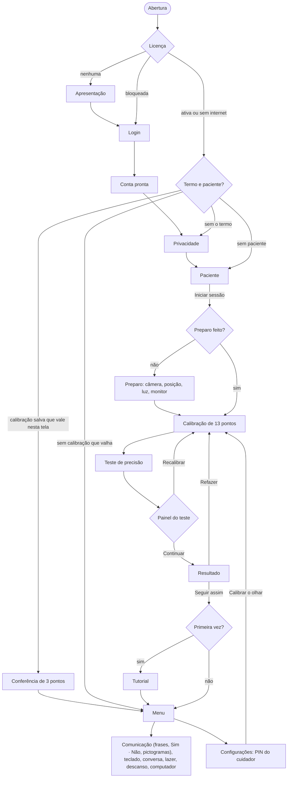

# IrisFlow

Tecnologia assistiva de rastreamento ocular com webcam comum, feita para
pessoas com Esclerose Lateral Amiotrófica (ELA) e outras condições severas de
restrição motora. Sem hardware especializado: uma webcam, um computador e
100 % do processamento local.

O produto entregue à família chama-se **IrisFlow Communicator** — é esse o nome
do instalador, do atalho, do `productName`, da janela e da tela de abertura.
**IrisFlow** continua sendo o nome da empresa, e é assim que o app se apresenta
onde o espaço é curto (barra compacta, rodapés) e ao longo desta documentação.
Os canais de IPC e as chaves de `localStorage` seguem com o prefixo `irisflow`
**de propósito**: renomeá-los apagaria a calibração, os perfis, o vocabulário e
o vínculo de quem já usa o app.


[](https://github.com/ZambePy/Communicator-V3/actions/workflows/ci.yml)
[](LICENSE)

---

## O que o sistema faz

O IrisFlow estima o ponto da tela para onde a pessoa está olhando e converte
fixações prolongadas (*dwell*) em cliques. Com isso o paciente escreve num
teclado, fala frases prontas, pede ajuda, joga e descansa, usando só os olhos.
No **Modo Computador** o mesmo cursor sai do app e passa a controlar o Windows
inteiro (clicar, arrastar, rolar, digitar), e com a **voz personalizada** o
que o paciente diz sai na própria voz dele, recriada a partir de uma gravação
— tudo processado neste computador. Um **assistente de escrita** aprende as
palavras e as frases dessa pessoa e as oferece de volta, para que dizer o que
já foi dito custe uma fixação em vez de vinte.

Duas pessoas usam o app: o **paciente**, que opera tudo pelo olhar em telas
de alvos grandes e alto contraste, e o **cuidador**, que usa mouse e teclado
para configurar, calibrar e acompanhar o rastreamento.

O repositório é um monorepo com as quatro peças do produto:

| pasta | o que é |
|---|---|
| `src/`, `frontend/`, `electron/`, `voice-engine/` | o app desktop (núcleo do rastreamento, interface, processo principal, motor de voz) |
| `site/` | o site: inscrição na beta, conta e download dos instaladores ([Site](#site-site)) |
| `app/` | o **IrisFlow Cuidador**, o app de celular de quem cuida, em Expo ([IrisFlow Cuidador](#irisflow-cuidador-app)) |
| `supabase/` | banco, regras de acesso e Edge Functions, compartilhados pelos três ([Supabase](#supabase-supabase)) |

A privacidade do produto se organiza em **três camadas**, e vale enunciá-las
nesta ordem porque é assim que elas são explicadas ao cuidador e ao paciente:

1. **O rastreamento é 100 % local e não sai nunca.** Imagens da câmera, marcos
   faciais, vetores de calibração e os registros brutos de sessão ficam neste
   computador. No Electron isso é imposto por política de conteúdo (CSP), não
   só por disciplina de código.
2. **O que o paciente escolheu dizer sai apenas quando há conta vinculada** — o
   texto que ele mandou falar, os alertas de socorro e os indicadores agregados
   da calibração vão para o celular do cuidador. Sem conta, nada disso existe;
   o app funciona inteiro offline. Ver [Conta IrisFlow e
   nuvem](#conta-irisflow-e-nuvem).
3. **Dois módulos dependem de autorização expressa por funcionalidade, e
   revogável**: a **clonagem de voz**, porque o áudio de referência é dado
   biométrico, e o **chatbot integrado**. Este último hoje existe só na versão
   local — o assistente de escrita — e por isso não envia nada; o dia em que
   houver um modo de nuvem, ele passará pela mesma autorização separada que a
   voz tem hoje.

Fora isso, o app só sai para a rede em três casos, todos fora do renderer: a
verificação de atualizações (GitHub Releases), o download, uma vez, dos pesos
do modelo de voz (processo Python) e o envio de relatórios de falha — este
só num instalador compilado com `IRISFLOW_CRASH_URL`, um segredo opcional do
release que, sem cadastro, deixa o envio desligado.

---

## Estado e resultados

**Fase:** beta gratuita, com o download aberto desde **29/09/2026** (antes
marcado para 10/11), primeiro para Windows 10 e 11 (macOS e Linux em preparação —
[Pendências e riscos](#pendências-e-riscos), item 7).

**Acurácia medida.** Protocolo, métricas e todas as ressalvas em
[`docs/MEDICOES.md`](docs/MEDICOES.md); o resumo sem jargão está na §0 de lá.

| rodada | erro médio | acerto num raio de 100 px | observação |
|---|---|---|---|
| baseline de 20/09/2026, **com** o L2CS | **1,40°** (56 px) | 76 % | menor erro medido; uma pessoa, sem réplica |
| M1, 06/09/2026 (pipeline anterior) | 1,86° (74 px) | 64 % | reproduzido em 1,93° numa segunda calibração |
| **sem** o L2CS (a beta de 24/09 até a 1.0.0-beta.9; hoje, "calibrar só com a íris") | não medido | — | M-ablação, `docs/MEDICOES.md` §4.6 |
| literatura, webcam | 2–4° | — | WebGazer 4,17° · FAZE 2,4° · L2CS-Net sozinho 3,92° (MPIIGaze) |
| literatura, infravermelho de laboratório | 0,5–1° | — | Tobii Pro Nano 0,54–0,69° · EyeLink 0,75–0,86° |

Três coisas precisam andar junto com esse número sempre que ele for citado:

- **É N = 1.** Uma pessoa, num posto de uso conhecido, calibrada para ela
  mesma. A faixa da literatura vem de muitos participantes.
- **Foi medido com o L2CS, em 20/09, antes do V2.** Os pesos do L2CS têm
  licença só para pesquisa; desde a 1.0.0-beta.10 eles vão no instalador, e
  por isso a beta é acadêmica e não comercial ([Pendências e riscos](#pendências-e-riscos),
  item 1). O pipeline padrão de hoje ([V3](#pipeline-v3-m1m22)) ainda não foi
  medido ao vivo, e desde 19/10/2026 a calibração e o teste usam outro alvo e
  outro fundo (`docs/MEDICOES.md` §2): o 1,40° é de antes da troca. Para uma
  versão comercial, o caminho é o retreino do V2 (ramo ocular com UnityEyes 2,
  MIT; ramo facial dependente de licença).
- **A precisão piorou** enquanto a acurácia melhorava (tremor de 21,8 → 38,1 px
  entre M1 e o baseline), e o efeito do filtro sobre o dwell não tem medida
  própria (`docs/MEDICOES.md` §14.3 e §14.4).

**Código:** o estado dos testes está em [Verificação](#verificação).

---

## Versões: a entregue, a beta e o V2

| versão | onde fica | regra |
|---|---|---|
| Entregue no Ensino Médio Técnico | tag `entrega-tecnico-2026` | congelada: é a do pitch, do portfólio e da documentação do curso |
| Beta pública | `main` deste repositório | só correções pequenas e testadas; release pela tag `v1.0.0-beta.N` (o site e a atualização automática leem os releases daqui) |
| V2: pipeline novo, acurácia, correções maiores | branch `pipeline-v2`, num repositório privado, aberta na pasta `IrisFlow V2` (um `git worktree` deste repositório) | nada de tag `v*` nela; instalador de teste no próprio PC (`npm run electron:build:win`) ou pelo Release à mão; volta para a `main` só quando ganhar do pipeline atual nas medições ([docs/MEDICOES.md](docs/MEDICOES.md)) |

Para levar uma correção da beta para o V2, na pasta `IrisFlow V2`: `git fetch origin` e
`git merge origin/main`. O `git push` dessa pasta vai para o repositório privado (remoto
`v2`); o da pasta principal, para este. O *Supabase keepalive* agendado só roda aqui
(`if: github.repository == ...`): o repositório do V2 não consulta o banco nem gasta minutos.

## Pipeline

```
Webcam (getUserMedia, até 1920×1080)
  │
  ├─ Ajuste da câmera em malha fechada ─ zoom (guiado pelo tamanho do rosto
  │     no quadro), brilho e contraste (guiados pela medida no recorte dos
  │     olhos). Roda uma vez, na abertura da câmera (até 14 iterações). Ao
  │     sair do laço, se o brilho medido está na faixa boa [0,25; 0,75] —
  │     convergir não é exigido, e não precisa ser: convergir já implica
  │     brilho bom —, trava exposição, balanço de branco e foco em manual.
  │     Ao subir a resolução, o `frameRate` é RE-DECLARADO: `applyConstraints`
  │     substitui o conjunto inteiro de constraints, e sem isso o pedido de
  │     30 fps do `getUserMedia` sumia — boa parte das webcams UVC entrega
  │     15 fps a 1080p contra 30 a 720p. Se a cadência medida depois da subida
  │     ficar abaixo de 24 fps E abaixo da de antes, a resolução é DESFEITA:
  │     para o olhar, cadência vale mais que pixels, e o custo aparece como o
  │     cursor travando. (Uma câmera que já entregava 15 fps a 720p não é
  │     rebaixada por continuar em 15: o rebaixamento só desfaz o que a
  │     subida causou.) À noite a trava impediria a câmera de compensar: o
  │     QUADRO INTEIRO é medido a cada 2 s (reduzido a 64 px de largura,
  │     com ou sem rosto), e luminância média abaixo de 0,12 por 10 s é
  │     pouca luz — a exposição e o balanço de branco voltam ao automático,
  │     uma vez por episódio, e a tela diz "Está escuro para a câmera" (com
  │     a tela escurecida ou o filtro âmbar, oferece "Clarear a tela", um
  │     botão com o tamanho mínimo de alvo); o
  │     aviso sai acima de 0,18 por 3 s. `src/poucaLuz.ts`; os limiares são
  │     estimativas a conferir com webcam real
  │
  ├─ MediaPipe FaceLandmarker ─ 478 landmarks 3D + matriz de pose da cabeça
  │
  ├─ L2CS-Net (ONNX, Web Worker) ─ yaw / pitch do olhar. A política segue o
  │     provider efetivo (com `l2cs: auto`, o padrão): WebGPU recorta em 448²
  │     e submete a cada 100 ms; WASM cai para 224² e ~160 ms, porque lá
  │     quem manda é a latência da rede e insistir na resolução alta só
  │     produz leitura velha. Com o provider forçado (`webgpu`/`wasm`),
  │     valem `l2csInputSize` e `l2csCadenceMs`. Uma
  │     inferência em voo por vez; o recorte e o tensor (Float32Array NCHW)
  │     são montados na thread principal, no laço do engine, e o worker só
  │     roda a sessão ONNX. O tensor vai ao worker por transferência e volta
  │     com a resposta, para o recorte seguinte escrever nele em vez de
  │     alocar (até 2 guardados por tamanho; o mesmo na EyeNet e no buffer
  │     de luminância do recorte dos olhos): numa medição sintética de 1 min
  │     de pipeline, de 707 MB (224²) e 1,74 GB (448²) alocados para ~0, com
  │     a saída idêntica (`src/reusoDeBuffers.test.ts`); o `getImageData` de
  │     cada recorte ainda aloca. Enquanto o cliente ainda considera a última
  │     leitura válida (tolerância `max(400, 3·latência + cadência)` ms, teto
  │     2,5 s), o bloco a usa normalmente; passada essa tolerância, o último
  │     ângulo válido é REUSADO por mais 600 ms em vez de zerar o bloco —
  │     zerar produzia um
  │     degrau que o Ridge saltava e o One Euro tentava seguir, e o cursor
  │     pulava. Passada a janela, o ângulo não some de uma vez: ele
  │     DESVANECE por uma rampa de 200 ms até zero. O desvanecimento é no
  │     ÂNGULO e não nos sete termos — escalar os termos produziria um vetor
  │     que não corresponde a ângulo nenhum, enquanto escalar o ângulo mantém
  │     o bloco válido para ALGUM olhar, e como todos os termos têm fator
  │     `tan`, ângulo zero dá exatamente os mesmos sete zeros de antes. O
  │     provider efetivo, a latência, a fração de leituras obsoletas e o lado
  │     EFETIVO do recorte (224 no WASM, mesmo com a flag em 448) vão para os
  │     diagnósticos e para o relatório. O motivo de cada bloco zerado
  │     (leitura obsoleta, implausível, sem confiança) é contado por alvo de
  │     calibração e vai para o console (`[calib] processStaticPoint`), não
  │     para a tela nem para o relatório: o núcleo não refaz alvo por bloco
  │     zerado. O peso com que o ângulo entrou só é lido como "zerado ou
  │     atenuado" pela calibração, e a amostra vale ×0,35
  │
  ├─ Escala métrica pela íris ─ o diâmetro horizontal visível da íris é
  │     notavelmente constante (11,7 mm, ±4 %, praticamente invariante com
  │     etnia), e serve de régua para MEDIR a distância cantal desta pessoa
  │     no lugar dos 9,0 cm genéricos. As duas medidas saem do mesmo quadro,
  │     à mesma profundidade, então a distância da câmera se cancela e não é
  │     preciso conhecer o FOV. Importa porque a compensação lateral é 1:1
  │     em centímetros: num rosto de 8,2 cm, a constante genérica faria a
  │     cadeira andar 4 cm e o cursor andar 4,4
  │
  ├─ Vetor de features por olho ─ 2 dimensões de íris (`offsetX`/`offsetY`,
  │     em distâncias cantais) + 2 do L2CS (`tan yaw` / `tan pitch`; no V3,
  │     com os ângulos girados para o referencial da cabeça, M4) = 4
  │     expansão polinomial de grau 2 PARCIAL: o par angular fica só no termo
  │     linear, porque já chega linearizado pela tangente — a geometria de
  │     projeção é `x_tela ≈ x_olho + d·tan(yaw)`, então a 1ª ordem já é o
  │     modelo certo e o quadrado captura só curvatura residual.
  │     4 dims → 7 colunas por olho → StandardScaler → Ridge por olho, com λ
  │     por eixo e penalidade branqueada pelo ruído intra-fixação
  │
  ├─ Fusão binocular ─ ponderada pela abertura de cada olho, pela
  │     confiabilidade medida no treino e pela dominância ocular configurada
  │
  ├─ Referência geométrica ─ as compensações medem um Δ contra a pose e o
  │     centro do rosto no instante da calibração, e essa referência fica
  │     FIXA. Existiu (e continua como flag, `referenciaLenta`, desligada) uma
  │     referência lenta: uma EMA de τ = 30 s que absorveria a deriva de
  │     postura. Na gravação de 22/09 ela absorveu 43–48 % de uma rotação real
  │     de cabeça — medida contra uma referência que andava junto, a
  │     compensação corrigia metade do movimento —, e desligá-la derrubou o
  │     erro do miolo de 88 para 67 px no replay (`docs/MEDICOES.md` §14.5). A
  │     deriva lenta de postura fica com o reajuste de 2 s no centro e com a
  │     correção por dwell (abaixo)
  │
  ├─ Compensação de cabeça ─ na saída, depois da fusão: primeiro a distância
  │     (a distância ATUAL até a tela é inferida somando a variação medida na
  │     câmera à distância de calibração; a correção em si é um ESCALONAMENTO
  │     do ponto em torno do centro da tela pela razão entre as duas, presa a
  │     0,6–1,6), depois a pose (d·tan Δ, com d = distância de calibração),
  │     por último a translação lateral do tronco (nariz em unidades da
  │     distância cantal medida). Só a de pose também é aplicada aos ALVOS de
  │     treino; as de distância e translação são exclusivas da inferência.
  │     Limite conhecido: o escalonamento de distância gira em torno do centro
  │     da TELA, e o ponto certo é a projeção do olho — igual só quando os
  │     olhos estão à altura do centro (ver "compensação 6DoF" abaixo)
  │
  ├─ Correção local dos cantos ─ a calibração padrão tem os quatro cantos da
  │     tela (a 5 % da borda) além da grade 3×3, e o resíduo médio de cada
  │     canto vira uma correção local: um processo gaussiano (núcleo RBF,
  │     ℓ = 0,10 da tela, σ² = 0,10) ancorado em resíduo zero nos nove alvos
  │     da grade. Perto do canto ela puxa o ponto para onde a pessoa de fato
  │     olhava; no miolo ela some (< 0,01 px no centro). É o que o polinômio
  │     global não representa: a saturação da íris embaixo, quando a pálpebra
  │     cobre, e a expansão nos cantos. `src/correcaoLocal.ts`; viaja no
  │     perfil salvo
  │
  ├─ Correção por dwell ─ ainda dentro de `mapGaze`, depois das compensações
  │     e da correção dos cantos, e ANTES do clamp: cada dwell concluído num alvo isolado
  │     é um rótulo de graça — a pessoa estava olhando para onde clicou. No
  │     V3 (M15, padrão) o rótulo entra num filtro de Kalman
  │     Ornstein–Uhlenbeck por eixo, em px (meia-vida de 10 min, σ∞ = 60 px):
  │     a medida é em malha aberta — o centro do alvo menos a mediana da
  │     predição ANTES desta correção e do clamp, de 200 ms depois da
  │     entrada até 50 ms antes do disparo —, o ganho do deslocamento fica
  │     ≤ 0,5, a inovação fora do χ² de 99 % é recusada, o rótulo espera 4 s
  │     em quarentena (descartado se a ação seguinte for Voltar, Apagar ou
  │     Limpar) e a correção nova entra numa rampa de 300 ms; com M16, também
  │     um ganho por eixo, só com rótulos espalhados (`kalmanDoDwell.ts`). No
  │     pipeline base é um integrador de ganho 0,05 (não uma média), com
  │     meia-vida de 10 min, que recusa dois dwells a menos de 300 ms e
  │     resíduo acima de 180 px. Nos dois, a correção aplicada é limitada a
  │     8 % da tela e não aprende de quadro degradado, saturado pelo clamp,
  │     em modo apresentação nem de alvo de emergência. No Modo Computador aprende dos alvos que a
  │     própria sobreposição desenha (barra e teclado flutuante, lado ≥ 52 px)
  │     — um botão de 20 px do Windows não é evidência de para onde a pessoa
  │     olhava. A aplicação vem aqui; o aprendizado acontece na conclusão do
  │     dwell
  │
  ├─ Clamp de borda ─ `suave` (produção geral): Hermite cúbico nos 2 % de cada
  │     borda, para o ponto caber na tela sem salto de velocidade. `duro` no
  │     Modo Computador: [0, 1] com margem de 0–4 px, porque ali os alvos são
  │     os botões da borda da tela e 2 % de amortecimento é o que fazia o
  │     cursor "não chegar" no canto. É a última etapa dentro de `mapGaze`
  │
  ├─ Filtro temporal ─ One Euro (o do pipeline base, e o do V3 até uma
  │     calibração medir o ruído); Kalman e Kalman+EMA disponíveis para
  │     comparação (`filterMode`). Vem depois de tudo isso, no engine.
  │     No V3 (M9), depois de uma calibração que mediu o ruído, quem governa
  │     é o ESTIMADOR DE FIXAÇÃO no lugar do One Euro e do estabilizador
  │     abaixo: os presets de "Suavização" ficam guardados e não mudam o
  │     cursor, e o engine diz isso a quem pede (A2, 19/10/2026)
  │
  ├─ Estabilizador de fixação ─ durante uma fixação a melhor estimativa não é
  │     a última amostra: é a média da janela de 200 ms. Na sacada a média é
  │     veneno, porque mistura a partida com a chegada. A saída é
  │     `x + w·(média − x)`, com `w` CONTÍNUO: sobe com o enchimento da janela
  │     e cai com a dispersão I-DT (1 até 1,0°, 0 a partir de 1,5°). Os dois
  │     extremos são o comportamento de sempre; o que sumiu foi o degrau entre
  │     eles. Teto rígido de 0,5°: a média limpa ruído, não inventa posição
  │
  ├─ Cursor pelo compositor ─ SEPARA A TAXA DE RENDER DA TAXA DE INFERÊNCIA.
  │     A posição era escrita no DOM uma vez por quadro de câmera (zero-order
  │     hold: ~65 % dos quadros de display parados, os outros com o passo
  │     inteiro). Um laço de rAF passou a distribuir o passo pelos quadros de
  │     tela — mas o rAF roda na thread do MediaPipe, ocupada 70–100 % do
  │     tempo, e na gravação de 30/09 o cursor ainda andava aos degraus a
  │     ~15 Hz. Agora cada amostra escreve UMA vez o destino e a duração da
  │     travessia (`transform` com `transition`), e a thread do COMPOSITOR
  │     desenha os quadros intermediários a 60 Hz, com a thread principal
  │     ocupada ou não (`interaction/cursorNoCompositor.ts`). Mesmo custo de
  │     meio intervalo de amostra de latência (~16 ms a 30 Hz); a sacada
  │     atravessa em ~1 quadro. Vale na janela do app E na sobreposição do
  │     Modo Computador. NÃO extrapola (errar no fim da sacada custa uma
  │     seleção errada) e NÃO segura predição velha: passados 300 ms sem
  │     amostra o cursor para e fica translúcido. O laço de rAF de antes
  │     continua como volta segura (`cursorPeloCompositor: false`)
  │
  └─ Interação ─ dwell, cursor, emergência, varredura opcional, fallback
        quando o olhar se perde. É na conclusão do dwell que a correção por
        dwell (acima) recebe o rótulo. O dwell não conta tempo sobre posição
        NÃO medida (`posicaoMedida: false`: a última posição repetida — a
        predição que falhou, o vetor vazio, os primeiros 10 s de contraluz
        forte); passados esses 10 s, a predição volta marcada como
        degradada, e só a Emergência (dwell 2×) e os botões de recuperação
        (2,5×) aceitam. Para quando o olhar piora, o Plano B: varredura com
        acionador e Sim/Não por piscada longa (ver Fluxo de uso)
```

### Nenhum estágio comuta: todos desvanecem

Um princípio que atravessa o pipeline inteiro e vale registrar sozinho. Vários
estágios têm um limiar — "acima disto é sacada", "acima disto a pose é
implausível", "passado isto a leitura é velha". Toda vez que um limiar desses
era um **portão binário**, o cruzamento dele somava, num único quadro, a
diferença inteira entre os dois comportamentos. Medindo duas gravações de tela
quadro a quadro, durante movimento real:

| | build de 02/09 | build de 18/09 |
|---|---|---|
| taxa efetiva | 19,3 Hz | 21,2 Hz |
| deslocamento mediano por quadro | 0,77 px | 1,63 px |
| **quadros com salto > 30 px** | **0,9 %** | **11,8 %** |

A taxa não tinha caído — tinha subido. O que se relatava como "travada" era o
padrão **para-e-teleporta**: alguns quadros imóveis seguidos de um pulo. Foi o
que redirecionou o trabalho: o problema não era suavizar pouco, era o tamanho
do passo.
Os portões encontrados e o tamanho do degrau de cada um, na geometria de
referência (1920×1080, 23,6", 60 cm → 38,5 px/grau):

| portão | degrau | hoje |
|---|---|---|
| soltura da EMA angular, limiar único em 40 °/s | ~68 px | rampa de 20 a 60 °/s |
| compensação de pose, portão em ±30° | **1273 px** | rampa de ~10° em torno do limiar |
| estabilizador, média ↔ amostra crua | até 19 px | peso contínuo |
| fim do reuso do bloco L2CS (o bloco ocular, da EyeNet, ganhou a mesma rampa em 19/10/2026) | vetor cheio → 7 zeros | ângulo desvanece em 200 ms |

Em todos, os **dois extremos são idênticos ao comportamento anterior** — a
rejeição continua rejeitando, a sacada continua soltando — e a rampa é um
Hermite (3t²−2t³), contínuo em valor e em derivada. A regra que ficou: um
limiar no caminho do cursor é uma rampa, não uma chave. Os testes que protegem
isso são de **refinamento**: varrem o parâmetro com passo grosso e fino e
exigem que o maior salto encolha proporcionalmente — uma descontinuidade não
encolhe, fica presa no tamanho do degrau.

Outras duas não eram limiares, e sim afirmações falsas:

- **Piscada sem Kalman.** O teto de 2 s que separa "piscada" de "olho fechado"
  só rodava com a cadeia Kalman. Nos presets One Euro — que são o padrão — o
  ramo emitia a última posição, bit a bit idêntica, com `hasFace: true` e sem
  degradar, **sem teto nenhum**. É o congelamento de 967 ms medido na gravação
  de 18/09. O hold agora roda nos dois modos, e passado o teto a amostra sai
  marcada como degradada.
- **`mapGaze` nulo com o modelo treinado.** Caía no fallback do NARIZ, que não
  tem relação com o olhar e não tem teto: um único quadro de exceção
  arremessava o cursor e o trazia de volta. O nariz continua sendo o ponteiro
  de quem **ainda não calibrou** — ali ele é a medida, não um substituto para
  uma que faltou. Calibrado, o cursor simplesmente não se move, e o timer de
  degradação avisa.

Quando a geometria sai do lugar — a pessoa sentou mais perto, escorregou na
cadeira, apoiou a cabeça de outro jeito — a primeira saída **não** é
recalibrar. Um **reajuste de 2 s** olhando um alvo único no centro mede onde o
cursor está caindo enquanto a pessoa olha o centro e desconta esse desvio como
deslocamento da correção por dwell (até 8 % da tela; acima disso ele recusa e
pede nova calibração). O Ridge e as referências de pose e de distância ficam
como estão: até 23/09 o reajuste recomeçava as referências, o que faz sentido
só se o "zero" da cabeça mudou sem o olhar mudar — e apagava de uma vez a
compensação da postura que a pessoa ainda mantinha. Ele aparece como botão no
aviso de distância e no de postura; não tem botão de cancelar próprio (2 s é
menos que o tempo de achar um botão com o olhar), mas a Emergência fica por
cima dele, e acioná-la cancela o reajuste e descarta a coleta. A calibração
completa é pedida pelo **vigia de recalibração** quando o
modelo deixou de descrever a pessoa: dispersão recente (mediana da BCEA das
últimas 20 fixações dos últimos 2 min — fixação é a janela de 500 ms cujos
quatro quartos têm o centro no mesmo lugar, sem teto para o tamanho do ruído)
acima de 3× a do último teste de precisão salvo, viés acima de 2× o
de lá (piso 48 px, teto 80 px), ou a correção por dwell a 90 % do seu teto —
este último critério vale mesmo sem teste salvo. O vigia é consultado a cada
15 s; o aviso só aparece depois de duas consultas positivas seguidas, com
"Calibrar de novo" e "Agora não" (que dorme por 10 min), e some sozinho quando
a medida volta ao normal. Continuam existindo os outros caminhos para
recalibrar: a checagem de retomada, o diálogo de deriva de pose e o botão
manual em Configurações.

A **calibração** apresenta **13 alvos**: uma grade 3×3 posicionada por um
orçamento de excentricidade angular (≤ 16°) e os **quatro cantos da tela**, a
5 % da borda — onde ficam o botão de Emergência e o de voltar. Até 23/09 eram
só os nove da grade, e o canto era previsto por extrapolação: 201 px de erro
contra 88 px no miolo, na gravação de 22/09; com os cantos na calibração e a
correção local deles, 40 px no replay (a expectativa realista ao vivo é de
40–110 px — ver `docs/MEDICOES.md` §14.5). O modo rápido continua com 4 alvos
(os cantos da grade), e o perfil `computador` tem 13 alvos próprios, indo a
2 % da borda, porque ali o alvo é o canto do monitor (o perfil existe no
núcleo e tem testes, mas nenhuma tela o usa ainda: o Modo Computador calibra
com a grade padrão).

O alvo é o **ABC** de Thaler et al. (2013) — disco azul, cruz recortada na
cor do fundo e ponto central vermelho, `src/alvoDeFixacao.ts` —, o MESMO do
teste de precisão, sobre o mesmo fundo azul-marinho `#091B33`. Até 18/10/2026
a calibração mostrava uma bola azul que pulsava, e o teste, outro alvo, os
dois sobre preto: é mudança de estímulo, e as medições de antes não se
comparam termo a termo com as de depois (`docs/MEDICOES.md` §2). A ordem não
é a de leitura: no V3 (M1), uma busca determinística começa no alvo do centro
e não correlaciona a posição do alvo com o tempo, para a deriva da cabeça não
virar ganho (no pipeline base, linha a linha, de cima para baixo).

No V3 (M8) a coleta de cada alvo abre quando a bola chega (o deslocamento
leva 620 ms) e descarta os primeiros 800 ms — sacada e acomodação, com folga
para a latência de sacada de quem tem ELA; no pipeline base, ela abre 1200 ms
depois do alvo anterior e descarta 600 ms. Em seguida vem uma janela útil
cujo TETO cresce com a distância ao centro (normalizada: 0 no centro, 1 no
canto geométrico): `1680 + d·1120` ms, o que dá 1680 ms no centro e ~2690 ms
nos cantos a 5 % (no `computador` um bônus por excentricidade angular leva o
canto a até ~3900 ms). É teto, não duração fixa: o ponto fecha assim que o
olhar estabiliza, com piso de 900 ms e 15 amostras. No pior caso (toda janela
até o teto), na tela de referência, acomodação e janela somam 41,8 s no V3 e
39,2 s no base; com a espera até cada coleta abrir, a sessão inteira dá 49,9 s
no V3 e 54,8 s no base. `calibration.janelaDoPonto.test.ts` segura o teto de
fadiga de 40 s só no pipeline base e, com M7 e M8 ligadas, que a sessão
inteira não passa a do base (53,7 s com 14 alvos).

Terminados os pontos, a **recoleta dos alvos ruins** (M22) refaz na hora até 4
alvos cujo erro fora da amostra (LOTO) ou dispersão passou de 2× a mediana da
região — miolo com miolo, borda com borda — e de um piso de 2,5° (erro) ou
2,0° (dispersão), ou que ficaram com menos de 15 amostras; as amostras novas
SUBSTITUEM as antigas, o treino é refeito do zero e o modelo novo só fica se
o LOTO médio dos mesmos alvos não piorar. É uma rodada automática por
calibração, e a tela de resultado oferece a mesma rodada, à mão, para os
pontos ruins — com um teste de precisão medido, para os cantos que ele mediu
como "Ruim" (`src/calibration/recoletaDeAlvos.ts`; a tabela do V3, abaixo).

Amostra com bloco angular zerado **é aceita**, e isso é deliberado: rejeitá-la
derrubava a linha inferior da grade inteira — é onde a pálpebra cobre a íris —
e os alvos de baixo eram pulados por esgotar as tentativas, deixando o modelo
extrapolar justamente a região onde ficam os botões mais usados. Trocamos "sem
a linha de baixo" por "com a linha de baixo, parte dela com bloco zerado". Hoje
nenhum gate de qualidade rejeita amostra: a qualidade da imagem e o bloco
zerado viram PESO dentro do alvo (o bloco zerado ou atenuado vale ×0,35;
`calibration/pesoDaAmostra.ts`), o contador vai para o diagnóstico do ponto, e
a amostra entra — mesmo um alvo com menos de 15 amostras entra (a recoleta o
refaz). O que fica fora: os quadros da acomodação (800 ms no V3, 600 ms no
base) e os recebidos fora de um alvo; os quadros de piscada e os de contraluz
forte, que o engine nem manda à calibração; e, com M6 (`calibracaoRobusta`,
padrão do V3), o quadro a mais de 4·1,4826·MAD da mediana do alvo em alguma
feature (entre 3 e 4, ele entra com peso menor, numa rampa) — é o que tira do
treino uma piscada mal detectada ou uma intrusão sacádica. A fração vai em
`calibrationFit.robusto.fracaoDescartada`.

O Ridge é treinado por olho, com λ escolhido por eixo em validação cruzada
leave-one-target-out — cada fold deixa de fora um alvo inteiro, não uma
amostra. A regularização não é isotrópica: durante a janela de um alvo o olhar
está parado por construção, logo toda variação intra-alvo é ruído, e trocar
`λI` por `λ·m·Σ_W` (a covariância intra-alvo) penaliza forte as direções que
só o jitter preenche. Sem isso, medimos ~30× de amplificação de ruído.

Ao fim, um **teste de precisão** de 13 pontos (grade 3×3 interior mais 4
cantos a 5 %) mede a qualidade do modelo, com o mesmo alvo e o mesmo fundo
da calibração. Os nove interiores ficam fora da
grade de calibração, para medir generalização; os quatro cantos coincidem,
desde 23/09, com os cantos calibrados — ali o teste mede a acurácia no canto
calibrado, que é o que o botão de canto sente. Os alvos aparecem em **ordem sorteada**,
com a semente gravada no relatório; cada um coleta 2000 ms, dos quais os
primeiros 600 ms de sacada e acomodação são descartados — sobram **1400 ms
úteis**, ~42 amostras a 30 Hz. Um ponto que receba menos de 80 % dos quadros
esperados é marcado, não removido; abaixo de 8 amostras ele entra no relatório
como não medido. As métricas saem da predição crua, antes do filtro temporal —
a dispersão do cursor filtrado é reportada à parte. O relatório JSON traz
acurácia (erro médio em px e em graus, viés por eixo), as três medidas de
precisão que a literatura pede juntas (desvio-padrão por eixo, RMS
amostra-a-amostra e BCEA de 68 %), perda de dados, taxa de acerto por raio de
alvo, a distância medida durante o teste e o **tamanho mínimo de botão** que o
erro daquela pessoa exige. Na tela, o resultado sai em palavras ("Ótima",
"Boa", "Refazer os cantos", "Refazer alguns pontos", "Vale refazer a
calibração") ou em números, conforme a pergunta feita uma vez, antes da
primeira calibração (`linguagemDoRelatorio`; muda em Configurações). As
palavras saem dos mesmos limiares do `score` — 30, 60 e 100 px de erro nos
pontos interiores (`src/resultadoSimples.ts`) —, e o relatório não muda.

Durante a medição **o cursor fica escondido**, e isso não é economia de tela: o
cursor é um laço de realimentação. Vendo-o, a pessoa corrige o olhar até ele
cair no alvo — a partir daí "olhar para o alvo" deixou de ser verdade, o erro
medido vira o resíduo da perseguição, e ele tende a zero qualquer que seja a
qualidade do modelo. A contaminação entra no COMPORTAMENTO, então nenhum
pós-processamento a desfaz.

Como a pergunta "consigo levar o cursor até o alvo?" também importa — e é ela
que decide se o teclado é usável —, ela virou uma **segunda rodada, separada**:
*Verificar com cursor*, em Configurações, ao lado de *Testar precisão*. Ali o
cursor aparece de propósito, a malha é fechada, e as métricas são outras:
quantos alvos foram alcançados, o tempo mediano até pousar em cada um e a
fração do tempo dentro do raio. Elas vivem em `result.verificacao`, nunca são
somadas às do protocolo, o JSON declara qual rodada foi (`protocolo.modo`) e a
rodada de verificação **não** escreve a linha de base do vigia de recalibração
— compará-la com uma medição seria comparar duas perguntas diferentes.

Um limite conhecido, medido: no perfil `padrao` a grade INTERNA cobre até
**y = 0,8375 em qualquer geometria plausível** (o extent vertical satura, e o
orçamento menor para baixo — a pálpebra, não o ângulo — é sempre o termo
proporcional; numa 32" a 50 cm o extent não satura e a linha de baixo sobe
para 0,767). Desde 23/09 os dois cantos de baixo (y = 0,95) são calibrados e
corrigidos localmente, mas o **meio da borda de baixo** continua previsto por
extrapolação do modelo global: a correção de um canto não chega lá (a 0,45 da
tela, o núcleo de ℓ = 0,10 vale e⁻¹⁰). No perfil `computador` a grade vai a
y = 0,98. Um teste (`calibration.coberturaDaTela`) fixa os valores medidos e
falha se a grade deixar de cobrir o topo, onde fica o botão de emergência. O
protocolo completo, o significado de cada métrica, o checklist de relato, o
histórico das sessões e as referências estão em
[`docs/MEDICOES.md`](docs/MEDICOES.md).

### Compensação de cabeça: o que existe, e para onde vai (6DoF)

Hoje a cabeça é compensada por **três estágios independentes** somados na
saída (distância, pose yaw/pitch, translação lateral; no V3, com a pose da
matriz facial suavizada, M5). O recorte do L2CS também
gira com o roll da cabeça (`normalizarRollNoCrop`, ligado em 22/09), mas **no
padrão ele não nivela o rosto: DOBRA a inclinação**. O recorte espera o ângulo
da linha dos olhos NA IMAGEM (y para baixo) e recebe o roll da matriz facial (y
para cima): com a cabeça a 10°, a rede vê o rosto a 20°. A saída é
contra-rotacionada pelo mesmo ângulo (`l2cs/roll.ts`), então a geometria fecha;
o que muda é a imagem que a rede vê. O sinal certo existe atrás da M13
(`nivelarRecorteCorrigido`), desligada até a medição em vídeo real (cabeça
inclinada ~15°, sem normalização, com a de hoje e com a M13). O roll que vai
para o recorte é suavizado com τ = 150 ms para o tremor do MediaPipe não virar
tremor de imagem. Funciona a primeira ordem, e tem três limites estruturais,
medidos na geometria de referência:

- **Rotação e translação contam a mesma coisa duas vezes.** `d·tan(Δyaw)`
  assume que a cabeça gira em torno do olho; ela gira em torno do pescoço,
  ~10 cm atrás. Girar 10° move o nariz 1,7 cm, e a compensação de translação
  — que olha o nariz — dispara junto: 64 px a mais sobre os 389 px da rotação
  (16 %), sistemáticos.
- **O escalonamento de distância gira em torno do ponto errado.** A geometria
  é `P = E_xy + (D/g_z)·g_xy`: afastar-se escala o ponto em torno da PROJEÇÃO
  DO OLHO na tela, não do centro dela. Com os olhos 10 cm acima do centro e um
  recuo de 10 cm em 60, isso são 61 px. Corrigir exige saber onde a câmera
  está em relação à tela (extrínsecos). No caminho padrão o app não sabe — por
  isso não foi "consertado" com um palpite —; a saída 6DoF (M12, abaixo)
  pergunta.
- **Duas famílias de feature com leis de transformação diferentes — no
  pipeline base.** O offset da íris é uma medida no referencial da cabeça; o
  ângulo do L2CS, no do raio câmera→olho (o do Gaze360). Na calibração a
  cabeça está parada, as duas são colineares e o Ridge reparte o peso entre
  elas de forma arbitrária; quando a cabeça gira, cada uma muda de um jeito e
  nenhuma compensação a jusante sabe qual split o Ridge escolheu. No V3 a M4
  (`l2csNaCabeca`, ligada) gira os ângulos do L2CS para o referencial da
  cabeça, pela pose da matriz facial, antes das features: as duas famílias
  passam a ter a mesma lei. O efeito não foi medido ao vivo
  (`docs/ROTEIRO_DE_MEDICAO.md`, sessão 2).

A saída estrutural é parar de prever coordenadas de tela e prever a **direção
do olhar no referencial da cabeça**, intersectando com a tela pela pose 6DoF
medida (`ĝ_cam = R·ĝ_h`; `P = e + (−e_z/g_z)·g_xy`). O rótulo de treino sai
de graça de cada amostra de calibração (`ĝ_h = Rᵀ·normalize(T − e)`), o mesmo
Ridge serve, roll fica de graça em `R`, e a calibração passa a tolerar
movimento de cabeça. Isso existe, atrás de flag: a **M12** (`saida6DoF`,
desligada e fora do interruptor) reprojeta a predição do Ridge pela
interseção do raio com o plano da tela (`src/geometria6dof.ts`) — no treino,
leva cada alvo da postura da amostra para a de referência; na inferência,
leva a predição da postura de referência para a de agora — e com isso faz de
uma vez o que distância, pose e translação fazem por aproximação. É idêntica
ao caminho clássico em Δ = 0, por construção, e se afasta dele só com o
movimento; faltando uma peça (a pergunta, o olho, a pose), o caminho clássico
segue valendo. Dos extrínsecos, o preparo pergunta só de que lado da tela
fica a câmera (em cima, embaixo ou no notebook; `EscolhaDaCamera.tsx`, só com
a flag ligada): a lente fica no meio dessa borda, sem inclinação, porque
esses erros entram em segunda ordem (≤ 27 px numa correção de 400–590 px, em
simulação). A posição do olho sai do pixel, do FOV (o calibrado ou os 69,7°
padrão) e da distância cantal. Falta a qualidade de `R` do MediaPipe — 1° de
erro em `R` é 1° de olhar (38,5 px) — e a medição: calibrar sentado e medir
reclinado (`docs/ROTEIRO_DE_MEDICAO.md`, sessão 3).

Duas notas de desenvolvimento. A janela abre em **tela cheia** — no `npm run
electron:dev` e no app empacotado: a conversão px→cm usa o viewport contra a
diagonal física da tela, e em janela toda medida saía enviesada (para o
paciente, além disso, barra de tarefas e bordas são alvos que ele não usa). O
cuidador sai e volta com F11 (Ctrl+Cmd+F no macOS); `IRISFLOW_FULLSCREEN=0`
abre em janela. E, só em desenvolvimento, cada abertura começa **sem
calibração salva** (`?calib=0`), para o fluxo de calibração ser exercitado de
verdade; `IRISFLOW_DEV_CALIB=1` religa a persistência (abre com `?calib=1`,
que, como todo parâmetro de URL, fica gravado). O app empacotado
persiste a calibração — uma pessoa com ELA não refaz treze pontos a cada
abertura.

---

## Estrutura do repositório

```
src/                        núcleo do pipeline (TypeScript puro, testado com Vitest)
  tracker/engine.ts         loop principal, estados, diagnósticos, recuperação de falhas
  calibration.ts            coleta, treino, inferência, perfis e diagnóstico de ajuste
  correcaoLocal.ts          correção local dos cantos (processo gaussiano ancorado na grade)
  accuracy.ts               teste de precisão e relatório de sessão
  accuracyProtocol.ts       tempos do protocolo de medição
  alvoDeFixacao.ts          o alvo ABC, o mesmo na calibração e no teste de precisão
  resultadoSimples.ts       o resultado em palavras ("Ótima", "Boa", "Refazer…") e os limiares
  extractor.ts              features de íris e bloco angular; conjunto ativo
  featurePipeline.ts        fronteira consumida pelo engine
  ridge.ts, scaler.ts       Ridge anisotrópico com CV de λ; padronização
  calibration/polynomial.ts expansão polinomial de grau 2, completa ou parcial
  calibration/recoletaDeAlvos.ts  recoleta dos alvos ruins (M22): quem refazer e a trava
  escalaMetrica.ts          a íris como régua: distância cantal desta pessoa
  referenciaLenta.ts        referência geométrica lenta (desligada por padrão; ver Pipeline)
  reancoragem.ts            acumulador do reajuste de 2 s no alvo central
  vigiaDeRecalibracao.ts    quando a calibração completa é de fato necessária
  l2cs/                     worker ONNX, recorte, decodificação, proveniência, roll
  olho/                     ramo ocular (V2): recorte 96×64, bloco de features, provedor
  camera/                   campo de visão por câmera
  filters/                  One Euro, Kalman 2D, EMA adaptativa, hold na piscada,
                            estabilizador de fixação (peso contínuo da média)
  interaction/              dwell, cursor, varredura, clique por piscada, fallback,
                            varredura com acionador e sim/não por piscada longa
                            (Plano B), correção por dwell; cursorNoCompositor.ts entrega a
                            posição ao compositor (60 Hz, fora da thread do
                            MediaPipe); seguidorDeCursor.ts é a volta segura por rAF
  poseCompensation.ts       compensação geométrica de pose
  distanceCompensation.ts   compensação de distância (fator 0,6–1,6)
  translationCompensation.ts compensação de translação lateral do tronco
  anthropometry.ts          constantes antropométricas e seus limites
  contraluz.ts              luz atrás da pessoa: invalida o quadro, não corrige
  poucaLuz.ts               brilho do quadro inteiro: o aviso de pouca luz e a exposição destravada
  vigiaDoRenderer.ts        vigia de página travada: a decisão e o limiar (a fiação está em electron/)
  trabalhoLongo.ts          aviso de trabalho síncrono longo (o treino): o vigia desarma
  cameraTuner.ts            lei de controle do ajuste da câmera
  setupReadiness.ts         prontidão do posto (distância, luz, reflexo, postura)
  qualityAnalyzer.ts        brilho, contraste, borrão e reflexo por quadro
  flickerDetector.ts        cintilação da rede elétrica
  displayGeometry.ts        geometria física da tela; displayGeometryEdid.ts é a
                            parte pura do EDID (bytes → cm), lido pelo SO em
                            electron/monitores.ts
  diagnostics/preflight.ts  verificação antes de medir
  config/experiment.ts      flags de experimento (localStorage, URL, ambiente)
  telemetry/                gravação JSONL e cronometragem por estágio
  testUtils/                harness sintético, baseline de regressão e o replay de
                            gravação real pelo núcleo (replayDeGravacao.ts)
  electronSecurity.ts       permissões, navegação, CSP e travas do app empacotado
  computador/               Modo Computador: geometria (janela→tela→físico),
                            structs INPUT do Win32 e contrato IPC (puro, testado)
  voz/                      contrato da voz clonada (IPC, protocolo do motor e
                            faixas de hardware em requisitos.ts)
  assistente/               motor do assistente de escrita (palavras, bigramas,
                            frases, respostas; puro, testado)

frontend/                   interface do desktop (React 19, Tailwind v4, HashRouter)
  src/pages/onboarding/     boas-vindas, calibração e teste
  src/pages/tutorial/       a jornada de 10 passos; `passos.ts` é a ordem e a trava,
                            `missao.ts` é a ponte com as telas reais
  src/pages/                menu, teclado, frases, jogos, descanso, emergência...
  src/pages/settings/       configurações do cuidador, por seção
  src/pages/caregiver/      painel e guia do cuidador
  src/context/              GazeContext (olhar, dwell, câmera), licença, emergência
  src/cloud/                conta IrisFlow: vínculo, fila offline, tempo real, cofre;
                            aviso ao cuidador quando um problema do olhar dura;
                            pareamento.ts, o código QR do celular do cuidador
                            (a seção é components/ParearCelular.tsx)
  src/services/emergencia/  o pedido de socorro e o alarme, fora da tela de emergência
  src/services/problemaDoRastreamento.ts  quando um problema do olhar DUROU (45 s)
  src/services/license/     licença real (Supabase) e simulada (sem nuvem)
  src/components/ui/        GazeButton, GazeGrid, GazePageLayout e afins
  src/overlay/              a SOBREPOSIÇÃO do Modo Computador (página própria,
                            `overlay.html`): cursor, barra de ações, lupa, teclado
  src/computador/           hook que liga o Modo Computador e manda o olhar ao main
  src/services/voz/         `falar()`: voz clonada quando pronta, senão a do sistema
  src/services/assistente/  persistência do assistente e a porta das sugestões
  src/services/apresentacao.ts  modo apresentação: corta a saída para a nuvem
  src/services/diagnostico/ relatório de suporte (JSON sem nada do paciente)
  src/test/quadros.ts       relógio de quadros determinístico para os testes do cursor
  src/index.css             tokens de design (cores, raios, tipografia)

electron/                   processo principal, preloads e IPC de sistema
  main.ts                   janela, CSP, travas de depuração, IPC
  atualizacao.ts            atualização automática (electron-updater, GitHub)
  alarme.ts                 alarme de emergência do sistema: janela na frente, volume do Windows
  vigiaDoRenderer.ts        derruba a página travada, para a recarga de quedas reabri-la
  diagnostico.ts            log local e relatório de falhas
  monitores.ts              tamanho físico dos monitores: EDID do registro/WMI
                            (Windows), sysfs (Linux), ioreg/CoreGraphics (macOS)
  computador/               sessão do Modo Computador, sobreposição, adaptadores
                            (Windows via koffi/user32, Linux via xdotool)
  voz/                      gerente do motor de voz (processo Python)
  build.mjs, package-app.mjs  compilação e empacotamento (electron-builder)
voice-engine/               motor de voz local em Python (Chatterbox multilíngue)
build/                      ícones e entitlements do macOS, usados pelo electron-builder
fixtures/                   contrato de recorte TS ↔ Python (gerado, não editar à mão)

site/                       site (Vite + React): inscrição, conta, downloads, /parear — ver Site
app/                        app do cuidador (Expo), com a rota parear do código QR — ver App do cuidador
supabase/                   migrações, Edge Functions (desktop-sync, parear-celular), seed e
                            config do CLI — ver Supabase

scripts/
  verificar-tudo.mjs        `npm run verificar`: tipos, testes e builds do desktop, do
                            site e do app (o mesmo portão do ci.yml)
  publicar.mjs              `npm run publicar`: publica o site com um comando (pastas, testes,
                            commit, envio e conferência); o resto está em publicar/
  conferir-pacote.mjs       confere o app empacotado (sem source map, fuses, asar...)
  ci-segredos-opcionais.mjs repassa ao CI só os segredos que existem; confere os da nuvem
  conferir-config-publica.mjs barra segredo nos .env.production versionados (site, desktop, app)
  db-local-test.sh/.sql     aplica todas as migrações num PostgreSQL local e testa o cenário
  analisar-gravacao.mjs     diagnóstico de uma gravação do rastreador (JSONL)
  limpo.mjs                 roda o dev com o armazenamento local zerado
.github/workflows/          ci.yml (push/PR), release.yml (tag v*), supabase-keepalive.yml

docs/MEDICOES.md            protocolo, métricas e histórico de medição
docs/medicoes/historico/    relatórios reais de teste de precisão guardados
```

---

## Requisitos

Para desenvolver: Node.js 22.12 ou superior (o CI usa Node 24) e, só para o
motor de voz, **Python 3.11 (64 bits)** — ver [Voz personalizada](#voz-personalizada-clonagem-local).

### Hardware do paciente (tabela preliminar)

Os números abaixo são o ponto de partida para a tabela oficial que sai com o
lançamento; valem para o app inteiro, e a coluna da voz é o que muda o piso.

| componente | mínimo (rastreamento + comunicação) | mínimo com voz personalizada | recomendado |
|---|---|---|---|
| Sistema | Windows 10 64 bits (Modo Computador: Windows) | Windows 10/11 64 bits | Windows 11 |
| Webcam | 1280×720 @ 30 fps | idem | 1920×1080, campo de visão estreito, perto do rosto |
| Processador | quad-core com WebAssembly SIMD (Intel 8ª geração / Ryzen 2000 ou melhor) | 6 núcleos ou mais (a síntese em CPU usa metade dos núcleos, no máximo 4, para o rastreamento não engasgar) | — |
| GPU | WebGL (MediaPipe) | WebGL; **NVIDIA com CUDA** deixa a síntese quase imediata | WebGPU para o L2CS (~2 s → ~50 ms por inferência) |
| Memória | 8 GB | **16 GB** (o modelo de voz ocupa 2–3 GB enquanto carregado) | 16 GB |
| Disco | 2 GB livres | 5 GB livres (pesos do modelo ~1,5 GB + cache de frases até 300 MB) | SSD |
| Ambiente | luz frontal difusa | idem | apoio de cabeça; monitor com diagonal conhecida |

O erro do rastreamento escala com o inverso da densidade de pixels sobre o
olho: uma lente mais estreita ou a câmera mais perto do rosto melhora a
precisão mais do que qualquer ajuste de software. A latência da voz
personalizada em CPU é de alguns segundos por frase nova; frases já ditas
saem do cache na hora (ver a seção da voz).

Para a **voz clonada** especificamente, a tabela que vale — e que o app mostra
na tela, com a faixa deste computador destacada — é a de
[Requisitos de hardware da voz](#requisitos-de-hardware-da-voz), derivada de
`src/voz/requisitos.ts`.

---

## Instalação e execução

```bash
npm install                      # núcleo + Electron; inclui o `koffi` (FFI do Windows para o Modo Computador)
npm --prefix frontend install    # interface do desktop
npm --prefix site install        # só se for mexer no site
npm --prefix app install         # só se for mexer no app do cuidador
```

Para o desktop falar com a nuvem em desenvolvimento, copie
`frontend/.env.example` para `frontend/.env.local` e preencha a URL e a chave
*anon* do Supabase (valores públicos — ver [Conta IrisFlow e
nuvem](#conta-irisflow-e-nuvem)); sem esse arquivo o app roda em modo local,
com a licença simulada. O mesmo vale para `site/.env.example` → `site/.env`
e `app/.env.example` → `app/.env`. Nenhum desses arquivos vai para o
repositório.

O motor de voz é opcional para rodar o app; sem ele a tela de Voz explica o que
falta e o paciente fala com a voz do sistema. Para tê-lo em desenvolvimento
(Windows, PowerShell, dentro de `voice-engine/`):

```powershell
py -3.11 -m venv .venv
.\.venv\Scripts\Activate.ps1
pip install -r requirements.txt
```

O Electron acha o `.venv` sozinho (`voice-engine/.venv/Scripts/python.exe`); a
variável `IRISFLOW_PYTHON` aponta para outro interpretador se preciso. Use o
`.venv` mesmo: instalar no Python global mistura com pacotes de outros
projetos, e um `torchvision` de outra versão faz o modelo falhar ao carregar
("operator torchvision::nms does not exist"). Se isso acontecer no global,
`pip install --force-reinstall torchvision==0.21.0` resolve.

| comando | o que faz |
|---|---|
| `npm run dev` | interface em `http://localhost:5173` (desenvolvimento) |
| `npm run build` e `npm --prefix frontend run preview` | build de produção em `http://127.0.0.1:4173`; use este para medir |
| `npm run electron:dev` | app desktop em desenvolvimento |
| `npm run dev:limpo`, `npm run electron:dev:limpo` | o mesmo, começando com o armazenamento local zerado |
| `npm run electron:build` (`:win`, `:mac`, `:linux`) | instalador do sistema atual (ou do escolhido), na pasta temporária do sistema para escapar do OneDrive; inclui o motor de voz se `voice-engine\dist\irisflow-voz\` existir — ver [Instalador](#instalador-e-atualização-automática) |
| `npm run verificar` | tudo o que o CI confere: tipos, testes e builds do desktop, do site e do app ([Verificação](#verificação)) |
| `npm run publicar` | publica o site com um comando: confere as pastas, testa, commita, envia e espera o site novo no ar ([Publicar com um comando](#publicar-com-um-comando)) |
| `voice-engine\build-voice-engine.ps1` | gera o executável do motor de voz (PyInstaller, modo pasta) para entrar no instalador |

### Modelos

| modelo | arquivo | origem |
|---|---|---|
| L2CS-Net | `frontend/public/models/l2cs/l2cs_gaze360.onnx` (92 MB, não versionado) | treinado em Gaze360; 90 bins por eixo; entrada 224² ou 448² (padrão 448²). **Licença research-only: uso comercial proibido, inclusive de modelos treinados.** Vai dentro do instalador da beta desde a 1.0.0-beta.10: a beta é acadêmica e não comercial ([Pendências e riscos](#pendências-e-riscos), item 1) |
| L2CS-Net (GazeGene v2) | `frontend/public/models/l2cs-gazegene/gazegene_l2cs_r50_v2.onnx` (95,9 MB, não versionado; a meta está no repositório) | mesma ResNet-50, treinada no GazeGene (sintético, 828 mil imagens): 3,38° de erro médio no teste do próprio GazeGene; entrada **fixa** 224²; 120 bins de 2°, decodificação linear. **Só pesquisa** (CC BY-NC-SA 4.0 + termos dos autores; a BUAA pediu para não usar comercialmente sem licença por escrito): fica fora do git e do instalador. Liga com `?rosto=gazegene` |
| EyeNet (V2, ramo ocular) | `frontend/public/models/eyenet/eyenet.onnx` (não versionado; gerado pelo kit de treino do UnityEyes 2) | treinada nos renders próprios do UnityEyes 2 (MIT); entrada 3×64×96; liga com `?olho=onnx`, que a SOMA à rede do rosto (no lugar dela: `?ep=off&olho=onnx`). O kit grava `eyenet.onnx` e `eyenet.meta.json`: os dois vão juntos para a pasta, a meta nova por cima da de exemplo |
| Face Landmarker | `frontend/public/mediapipe/models/face_landmarker.task` | MediaPipe Tasks Vision, 478 landmarks com íris. O site serve a mesma cópia, com o wasm da mesma versão, em `site/public/demo/mediapipe-0.10.35/` para o "Teste com o seu olhar" (baixados só no clique; um teste confere que o wasm é o do pacote instalado). O texto da licença Apache-2.0 do MediaPipe vai junto, em `site/public/demo/mediapipe-0.10.35/LICENSE` |
| ONNX Runtime Web | `frontend/public/ort/` | binários WASM/WebGPU carregados pelo worker |

Com `?ep=off` (`l2cs: 'off'`) o vetor fica só com as duas dimensões absolutas
da íris por olho (`irisAbs`). Foi assim que o instalador da beta rodou de 24/09
até a 1.0.0-beta.9. **Sem o arquivo `.onnx`, o vetor não muda sozinho**: o
conjunto continua `irisAbs+l2cs`, o L2CS fica em erro de carga e a calibração
não começa; a tela oferece **"Calibrar só com a íris"**, que grava
`l2cs: 'off'` neste computador e recarrega — só então o vetor passa a
`irisAbs` ([Pendências e riscos](#pendências-e-riscos), item 1). Com
`?ep=off&olho=onnx`, o vetor é íris + EyeNet (`irisCore+olho`).

Cada modelo tem uma **ficha de proveniência** no seu `*.meta.json` (bloco
`proveniencia`: bases de treino, licença, `usoComercial`, contrato) e um
`sha256` que o worker confere ao carregar. A ficha aparece em Configurações
("Modelo de olhar: …"), no item "L2CS · pesos" do preflight e em
`pipeline.runtime.modelo` de todo relatório de precisão; a da EyeNet, em
Configurações ("Modelo dos olhos: …"), no item "olhos · pesos" e em
`pipeline.runtime.olho`. A meta também
declara a grade de bins (`outputBins`, `binWidth`, `binOffset`, `decoding`):
um modelo retreinado em ±45° usa decodificação `linear`, e o worker confere a
meta numa inferência de teste, antes de se declarar pronto: meta e modelo que
não combinam (grade de bins, nomes das saídas, lado do recorte) viram erro de
carga, com a frase do que não bate, e a calibração não começa
(`src/l2cs/conferenciaDoModelo.ts`). Antes de 19/10/2026 isso só aparecia na
primeira inferência real, com o status já `ready`: o bloco angular saía sempre
zerado e a calibração falhava culpando os óculos.

**Quando o modelo cai depois de pronto.** Um worker que morre, erra 8
inferências seguidas ou fica duas vezes sem responder (8 s cada) é encerrado;
o status vai a `error`, o aviso diz que o IrisFlow está reiniciando o modelo e
que o cursor segue com a íris, e o engine tenta de novo depois de 2, 5, 15, 30
e 60 s. Da segunda tentativa em diante força o WASM — o caso típico é o
dispositivo WebGPU perdido no sono e volta do notebook. Desde 20/10/2026 o
reinício MANTÉM o lado da calibração em uso (o WASM roda a 448², ~3,2× mais
devagar que a 224²) e mede as primeiras respostas: se duas das três passarem
de 1,25 s (metade do teto de 2,5 s, acima do qual a leitura chega vencida), o
worker é refeito a 224² e a calibração fica SUSPENSA — só a Emergência e a
recuperação respondem, a faixa explica e o cuidador recebe o aviso "olhar em
modo reduzido" —, a não ser que haja um perfil salvo em 224² (a chave do
perfil leva o lado). Com o modelo pronto mas sem leitura válida por 10 s, o
aviso "O modelo do olhar está lento neste computador" aparece (tipo
`modelo_do_olhar`). Esgotadas as cinco
tentativas, o modelo fica desligado até o IrisFlow reabrir, e o aviso diz
isso. Vale para a L2CS-Net e para a EyeNet (`src/tracker/engine.ts`,
`ESPERAS_DO_REINICIO_DO_MODELO_MS`).

#### Modelos: como escolher

O modelo do rosto é escolhido pela flag `modeloDoRosto` (catálogo em
`src/l2cs/modelos.ts`); o ramo do olho, pela flag `eyeNet`. As duas são
independentes e podem ser combinadas.

1. **Ponha os arquivos.** O ONNX não vem no git. Para o GazeGene, baixe
   `gazegene_l2cs_r50_v2.onnx` do Drive (IrisFlow_GazeGene/v2/modelos) e ponha
   em `frontend/public/models/l2cs-gazegene/`, ao lado da meta que já está lá.
   Para o olho, copie `eyenet.onnx` e `eyenet.meta.json` de
   `IrisFlow_Treino\resultados` para `frontend/public/models/eyenet/`.
2. **Abra o app no desenvolvimento** (`npm run dev` ou `npm run electron:dev`)
   com o parâmetro na URL:

   | o que testar | URL |
   |---|---|
   | rosto Gaze360 (padrão da beta) | `?rosto=gaze360&olho=off` |
   | rosto GazeGene | `?rosto=gazegene&olho=off` |
   | só íris + olho UnityEyes | `?ep=off&olho=onnx` |
   | rosto GazeGene + olho UnityEyes | `?rosto=gazegene&olho=onnx` |

   A escolha fica gravada (`localStorage`) e vale nas próximas aberturas. Pelo
   console: `__irisflowExp.set('modeloDoRosto', 'gazegene')` e recarregar (no
   `npm run electron:dev`, pelo console do DevTools, que abre destacado). A
   variável `IRISFLOW_EXP_MODELODOROSTO=gazegene` só vale no Node — testes e
   replay —: nada leva o ambiente do Electron à página.
3. **Calibre de novo.** A chave do perfil leva o modelo do rosto e o conjunto
   de features: um perfil do Gaze360 nunca carrega com o GazeGene, nem o
   contrário (o Ridge aprendeu os ângulos de um modelo só).
4. **Confira qual rodou.** O console abre com `[IrisFlow] redes desta sessão —
   rosto: … · olhos: … · vetor: …`, e depois `[L2CS] modelo do rosto: …` e
   `[olho] ramo ocular pronto: …`. Os workers da EyeNet falam como
   `[olho esquerdo]` e `[olho direito]`: com `?ep=off`, nenhuma linha do console
   fala de uma L2CS-Net rodando. As fichas aparecem em Configurações, no
   preflight e em `pipeline.runtime` do relatório de precisão, e as flags em
   `pipeline.experiment`. Sem o ONNX do rosto, o L2CS fica em erro e o console
   diz onde pôr o arquivo; sem o da EyeNet, a tela de calibração avisa e não
   deixa começar.

O GazeGene foi exportado com entrada fixa de 224²: o app manda sempre recorte
de 224 com ele, mesmo com WebGPU (`politicaPorProvider` respeita os lados do
catálogo). O sinal de cada eixo vem da meta (`sinais`, +1/+1 quando ausente):
os do GazeGene foram derivados do rótulo, não medidos em foto. Antes de medir
acurácia com ele, rode uma vez a validação de eixos com as cinco fotos
(`look_center`, `look_up`, `look_down`, `look_right`, `look_left`):

```
npm install --no-save onnxruntime-node sharp
node frontend/scripts/l2cs_axis_validation.mjs --modelo gazegene
```

Se um eixo sair invertido, o script diz o que pôr em `sinais` na meta; não é
preciso mexer no código.

Modelos só de pesquisa (`vaiNoInstalador: false` no catálogo) ficam fora do
instalador em três lugares que andam juntos: `build.files` do `package.json`,
`scripts/conferir-pacote.mjs` (falha se o arquivo aparecer no pacote) e o
teste `src/l2cs/modelos.test.ts`, que confere os dois. Para pôr um modelo novo:
pasta em `frontend/public/models/`, ONNX + meta no formato de
`l2cs.meta.json`, entrada no catálogo e o nome em
`VALORES_ACEITOS.modeloDoRosto`.

O recorte facial e o recorte do olho são um **contrato com o treino**:
`fixtures/recorte-l2cs.json` e `fixtures/recorte-olho.json` são gerados pelo
TypeScript e lidos pelos testes do *Communicator V2* em Python — treinar com um
recorte e inferir com outro é o modo de falha silencioso de um retreino.

### Flags de experimento

Definidas em `src/config/experiment.ts` e lidas uma vez no boot, de três
fontes: `localStorage` (`irisflow.experiment`), parâmetros de URL e variáveis
de ambiente `IRISFLOW_EXP_<chave>` — estas só no Node (vitest e o replay, ex.:
`IRISFLOW_EXP_PIPELINE=base`): no Electron nada leva o ambiente à página (o
renderer roda com `sandbox`, sem Node, e o preload não o expõe). Os parâmetros
de URL são `?ep=`, `?l2cs=`, `?filtro=`, `?diagonal=`, `?olho=`, `?rosto=`,
`?expansao=`, `?dimsIris=`, `?cursorNoTeste=`, `?compTranslacao=`, os
booleanos (1/0) `?rollCrop=`, `?estabilizar=`, `?dwellCorrige=`, `?refLenta=`,
`?cantos=` e `?calib=`, e os do V3, `?pipeline=` e `?exp.<flag>=` (abaixo) —
e eles **ficam gravados** no `localStorage`: a flag vale nas
aberturas seguintes até ser trocada ou zerada (`__irisflowExp.reset()`). Pelo
console: `__irisflowExp.set('chave', valor)` seguido de reload; só o que
difere do padrão é gravado, então mudar um padrão no código chega a quem
nunca mexeu naquela flag. A tela de Configurações do cuidador expõe as
principais e avisa quando falta recarregar.

| flag | padrão | opções |
|---|---|---|
| `l2cs` | `auto` | `auto` · `webgpu` · `wasm` · `off` |
| `l2csInputSize` | `448` | `224` · `448` — só com `l2cs` forçado (`webgpu` ou `wasm`); com `auto`, 448² no WebGPU e 224² no WASM, e sempre um lado que o modelo aceita (o GazeGene, só 224) |
| `l2csCadenceMs` | `100` | 33–2000 — idem: com `auto`, 100 ms no WebGPU e 160 ms no WASM |
| `expandFactor` | `1.4` | 1,0–3,0: margem da caixa do rosto no recorte do L2CS; entra na chave do perfil |
| `filterMode` | `oneEuro` | `oneEuro` · `kalman` · `kalmanEma`; no V3, depois de uma calibração que mediu o ruído, quem suaviza o cursor é o estimador de fixação (M9) |
| `polynomialFeatures` | `true` | |
| `formaDaExpansao` | `parcial` | `parcial` · `completa` |
| `dimsDaIris` | `absolutas` | `absolutas` · `normalizadas` · `ambas` |
| `geometricPoseCompensation` | `true` | |
| `lateralTranslationCompensation` | `true` | |
| `referenciaLenta` | `false` | desde 23/09 — ver Pipeline e `docs/MEDICOES.md` §14.5 |
| `correcaoLocal` | `true` | correção local dos cantos (desde 23/09) |
| `suavizarL2csNaFixacao` | `true` | |
| `estabilizarFixacao` | `true` | sai do caminho do cursor quando o estimador de fixação (M9) governa |
| `correcaoPorDwell` | `true` | também é onde o reajuste de 2 s aplica o desvio do centro |
| `normalizarRollNoCrop` | `true` | desde 22/09 — ver abaixo |
| `blocoL2csCompleto` | `false` | ablação — ver abaixo |
| `persistirCalibracao` | `true` | `?calib=0` no desenvolvimento |
| `eyeNet` | `off` | `off` · `onnx` |
| `modeloDoRosto` | `gaze360` | `gaze360` · `gazegene` — ver [Modelos: como escolher](#modelos-como-escolher) |
| `cursorSizePx` | `48` | 24–128 |
| `cursorPeloCompositor` | `true` | volta segura: `false` devolve o seguidor por rAF de antes |
| `blinkClick`, `scanningMode`, `dwellRingOnCursor` | `false` | |
| `gazeLostFallback` | `true` | |
| `cursorNoTesteDePrecisao` | `false` | escotilha do operador — ver abaixo |

Várias dessas flags **invalidam perfis salvos** quando mudam, por construção.
A chave do perfil (`buildContextKeyFrom`, em `src/calibration.ts`) leva o
viewport; o `FEATURE_VECTOR_ID`, que muda com `l2cs: 'off'`, `dimsDaIris`,
`blocoL2csCompleto` e `eyeNet` e com as marcas do V3 (`+iso` com a M2; com o
L2CS no vetor, `+rl` — M3 junto com `normalizarRollNoCrop` —, `+rc` — M13
junto com ela — e `+cab`, M4); a versão do vetor; `polynomialFeatures` e
`formaDaExpansao` (o número e a ordem das colunas que o Ridge vê: os
coeficientes são posicionais); `geometricPoseCompensation`; `expandFactor`; o
lado EFETIVO do recorte do L2CS (224 ou 448 — com `l2cs: auto`, quem decide é
o provider); `modeloDoRosto`; e o perfil de calibração (`computador`). A
invalidação é proteção, não obstáculo: sem ela um perfil treinado num arranjo
carregaria no outro sem erro nenhum e preveria deslocado. Ao alternar para
medir, conte uma recalibração por troca: um protocolo que troca uma dessas
flags "sem recalibrar" não acontece — o perfil é descartado na recarga.

`cursorNoTesteDePrecisao` é escotilha de operador, não de paciente: revela o
cursor numa rodada de **medição** para conferir ao vivo se ele acompanha o
alvo — um erro de 3° e um mapeamento invertido produzem relatórios parecidos e
telas completamente diferentes, e só a tela distingue os dois. O preço é que
aquela rodada deixa de ser comparável, e por isso a flag entra no
`pipeline.experiment` do relatório. Para o uso normal existe a rodada de
*Verificação com cursor*, que já vem com as métricas certas e não suja a linha
de base.

`normalizarRollNoCrop` está ligada desde 22/09: o recorte do L2CS gira com o
roll da cabeça e a saída é contra-rotacionada no vetor 3D (`l2cs/roll.ts`).
**No padrão o giro sai com o sinal trocado e a rede vê o DOBRO da inclinação,
não o rosto nivelado** (ver "Compensação de cabeça", acima): o recorte espera o
ângulo da linha dos olhos na imagem e recebe o roll da matriz facial. A M13
(`nivelarRecorteCorrigido`) passa o sinal certo e aí, sim, o rosto chega
nivelado — e é para ela que vale o argumento de que "o rosto nivelado está
dentro da distribuição de treino do Gaze360". Ela continua desligada até a
medição em vídeo real (cabeça inclinada ~15°: sem normalização, com a de hoje e
com a M13). `blocoL2csCompleto` continua desligada de
propósito: leva as sete dimensões do bloco angular em vez de duas, e com treze
alvos ainda é território de decorar.

#### Pipeline V3 (M1–M22)

As mudanças de matemática e de comportamento do V2 têm, cada uma, uma flag e o
número da tabela de decisão de [`docs/PESQUISA.md`](docs/PESQUISA.md) §5 (M11,
o relatório de precisão, não tem flag; M22, de 19/10/2026, tem a pesquisa em
§7). Desligada, a flag devolve o
comportamento anterior bit a bit — `src/golden.pipelineBase.test.ts` confere o
extractor, a calibração e o `mapGaze` contra os números de e731357 (a beta de
27/09, de onde o V2 partiu). Um interruptor só troca todas:

- `?pipeline=v3` (padrão): cada flag vale o seu padrão da tabela abaixo;
- `?pipeline=base`: todas as flags do V3 desligadas, inclusive as que estão
  fora do interruptor — é o pipeline anterior, para o A/B das medições;
- `?exp.<flag>=1` ou `=0`: liga ou desliga uma flag só (ex.:
  `?exp.alvoInferiorCentral=1`), para a ablação; M14 recebe o nome do modo
  (`?exp.suavizacaoDoLandmarker=desligada`).

Como os outros parâmetros de URL, esses ficam gravados no `localStorage` até
`__irisflowExp.reset()`. No modo desenvolvedor (ou com `?debug=1`), a linha
`exp` do HUD mostra o pipeline em vigor: confira antes de medir.

| M | flag | padrão | o que faz |
|---|---|---|---|
| M1 | `ordemDescorrelacionada` | `true` | ordem dos alvos que começa no centro e não correlaciona com a deriva da cabeça |
| M2 | `referencialIsotropico` | `false` ¹ | referencial da cabeça em pixels isotrópicos; muda as features (`+iso`) |
| M3 | `desrolarComSinalDoL2cs` | `true` | contra-rotação do roll com o sinal de yaw do L2CS; muda as features (`+rl`) |
| M4 | `l2csNaCabeca` | `true` | ângulos do L2CS girados para o referencial da cabeça; muda as features (`+cab`) |
| M5 | `poseSuavizada` | `true` | pose da matriz facial suavizada, com rampa contínua, na compensação e na rotação |
| M6 | `calibracaoRobusta` | `true` | peso por quadro (rampa entre 3 e 4·1,4826·MAD da mediana do alvo; acima disso o quadro sai do treino) e Huber entre alvos, estudentizado pela alavanca; o resíduo do alvo é a média ponderada dos quadros — o "centro robusto por alvo" da pesquisa não foi implementado |
| M7 | `alvoInferiorCentral` | `false` ¹ | 14º alvo no meio da borda de baixo, no perfil padrão completo |
| M8 | `assentamentoPelaChegada` | `true` | a coleta de cada alvo abre na chegada da bola e descarta 800 ms |
| M9 | `estimadorDeFixacao` | `true` | estimador de fixação com portão de Mahalanobis no lugar de One Euro + estabilizador; o portão usa a variância da inovação com o ruído correlacionado (ρ₁ da calibração) e um detector de deslocamento reinicia a fixação em passos médios (revisão de 30/09) |
| M10 | `fusaoPorCovariancia` | `false` ¹ | fusão dos dois olhos por variância mínima, com a covariância entre eles |
| M11 | — | — | relatório de precisão /3 (métricas novas; sem flag) |
| M12 | `saida6DoF` | `false` ¹ | interseção do raio de olhar com o plano da tela; pergunta onde fica a câmera |
| M13 | `nivelarRecorteCorrigido` | `false` ¹ | roll no sinal certo para o recorte do L2CS; muda a imagem que a rede vê (`+rc`) |
| M14 | `suavizacaoDoLandmarker` | `mediapipe` | `desligada` roda o FaceLandmarker sem o filtro interno, para medir o ruído |
| M15 | `correcaoPorDwellKalman` | `true` | correção por dwell como filtro de Kalman por eixo |
| M16 | `correcaoPorDwellAfim` | `true` | ganho na correção por dwell, com prior e só com excitação |
| M17 | `dwellEmCascata` | `true` | dwell mais curto no teclado para as letras que continuam uma palavra sugerida, nunca abaixo de 400 ms |
| M18 | `alvoMinimoMedido` | `true` | tamanho mínimo dos botões pela acurácia do último teste de precisão |
| M19 | `toleranciaIntrusoes` | `true` | memória de dwell de 400 ms e área de acerto maior depois que o dwell começa |
| M20 | `recalibracaoRapidaAfim` | `true` | reajuste rápido com 5 pontos (10 s), sem retreinar o modelo |
| M21 | `pausaNaPerdaCurta` | `true` | perda curta de rosto pausa o dwell em vez de zerar |
| M22 | `recoletaDeAlvosRuins` | `true` ² | refaz na hora os alvos com LOTO ou dispersão ruins e troca as amostras deles; o modelo novo só fica se o LOTO médio não piorar |

¹ Fora do interruptor: `?pipeline=v3` não liga. M12 e M13 nasceram assim; M2,
M7 e M10 foram desligadas depois de implementadas — M2 e M10 porque pioraram o
replay da gravação real de 23/09, M7 porque, na simulação de um olho que
satura embaixo como o real, troca erro de lugar (melhora a borda de baixo e
piora a linha de baixo da grade). Os números estão em
`docs/RELATORIO_DE_ALTERACOES.md` (Fases 5 e 7) e no comentário de cada flag.
M13 e M14 mudam o que chega à rede (o recorte e os landmarks que o
posicionam); a rede, os pesos e o pré-processamento do L2CS não mudam, e as
duas ficam no valor de antes até decisão do responsável.

² A exceção consciente à regra de padrão igual ao de antes (pedido de
19/10/2026): a trava de aceitação só deixa o modelo novo ficar se o LOTO
médio dos alvos não piorar, e sem alvo ruim nada acontece — a saída é a
mesma. O antes e o depois de cada rodada vão no relatório de precisão, em
`calibrationFit.recoleta`. A matemática está em
`src/calibration/recoletaDeAlvos.ts`. Na simulação do teste
(`src/calibration.recoleta.test.ts`, um canto mal coletado), o LOTO médio foi
de 54,4 para 6,3 px, ao custo de 0,9 s de coleta útil (`tempoUtilMs`, sem a
viagem da bola e a acomodação). Com pessoas, não foi medida
(`docs/ROTEIRO_DE_MEDICAO.md`, sessão 9).

**Perfis salvos.** As flags que mudam o significado das features (`+iso`,
`+rl`, `+rc`, `+cab`) entram no `FEATURE_VECTOR_ID`, que vai na chave do
perfil: trocar uma delas pede uma recalibração, por construção. Com o
padrão, o identificador é `irisAbs+l2cs:4+rl+cab`; com `?pipeline=base`, o de
antes (`irisAbs+l2cs:4`), e os perfis antigos continuam valendo. Sem o L2CS
("calibrar só com a íris"), o vetor é só de íris: M3, M4 e M13 não agem, e o
identificador é o mesmo nos dois pipelines. Um perfil calibrado sem o L2CS (a
beta até a 1.0.0-beta.9) não serve com ele: a abertura pede uma calibração nova.

**O que está medido.** No replay da gravação de 23/09 pelo núcleo
(`IRISFLOW_GRAVACAO=… npx vitest run src/replayDeGravacao.test.ts`), com os 13
alvos e a correção dos cantos, o V3 erra 62,4 px no miolo (P1–P9) e 39,4 px nos
cantos, contra 64,2 e 40,2 px do pipeline base — empate, com uma gravação (e
os cantos do replay são um limite inferior: `docs/MEDICOES.md` §14.5). O
replay passa as features e a pose gravadas pelo núcleo de calibração, então
enxerga a calibração robusta (M6) e pouco mais: o que roda no engine (M3, M4,
M5, M9) fica de fora, o assentamento na chegada (M8) sai penalizado (a gravação
só marca o alvo a partir de quando a coleta abria no app antigo), e as mudanças
de uso (M15–M21) pedem gente. O roteiro das sessões que decidem, com o
critério de ≥ 15 %, está em `docs/ROTEIRO_DE_MEDICAO.md`.

#### Arranjo do vetor: o que está medido e o que não está

`formaDaExpansao: 'parcial'` e `dimsDaIris: 'absolutas'` são os defaults desde
que o vetor foi reduzido de 27 para 7 colunas. **Eles foram adotados sem A/B na
pessoa** — a evidência até aqui é de simulação, e está registrada aqui para que
ninguém a confunda com medida de campo.

O que a simulação mostra (mundo sintético, 9 alvos, 15 amostras por alvo, erro
medido nos CANTOS, fora do fecho dos alvos, média de 16–24 execuções):

| arranjo | colunas | erro nominal | com ptose | 20 % mais perto |
|---|---|---|---|---|
| `ambas` + `completa` (histórico) | 27 | referência | **4× pior** | **2,2× pior** |
| `normalizadas` + `parcial` | 7 | −11 % | −45 % | plano |
| `absolutas` + `parcial` (atual) | 7 | −11 % | **−47 %** | quase plano |

As duas reduções são independentes e se somam: cortam eixos diferentes — a
colinearidade na entrada (`offsetX` e `relX` diferem por um divisor que varia
pouco: correlação ~0,9996) e os termos quadráticos que não pagam aluguel.

`absolutas` ganhou de `normalizadas` por um critério de pior caso, não de média.
As duas empatam no erro nominal e se separam na PTOSE: ela corrompe a altura do
olho, que é o divisor de `relY`, e nada no pipeline compensa isso. A coluna
"20 % mais perto" não sustenta a escolha: ela supõe que a distância escala
`offsetX`/`offsetY` e não `relX`/`relY`, mas no vetor real os offsets já saem em
distâncias cantais (divididos pela distância entre os cantos externos dos dois
olhos, em `src/extractor.ts`), e as duas formas reagem do mesmo jeito à
distância; o que a distância muda de fato, o ângulo que a tela cobre, é da
compensação de distância, a jusante, para as duas. O teste que está no
repositório (`src/ridge.arranjoDoVetor.test.ts`) fixa só a parte estrutural:
varia o ruído e compara `ambas` com `normalizadas`, sem `absolutas`, ptose ou
distância. As colunas de ptose e de distância vieram de uma simulação que não
ficou no repositório.

**O que falta medir, e é o que decide:** o teste de precisão na pessoa, com a
câmera dela, comparando `?expansao=completa&dimsIris=ambas` contra o default.
A régua do projeto é ≥ 15 % de ganho nos cantos. Simulação não substitui isso —
ela fixa a propriedade estrutural (tirar colunas que só o jitter preenchia não
custa capacidade explicativa), não prevê o erro do produto. Se a medida na
pessoa não confirmar, o caminho de volta é uma flag.

---

## Fluxo de uso

O caminho abaixo foi percorrido tela a tela num Chromium com câmera simulada em
29/09 (`docs/RELATORIO_DE_ALTERACOES.md`, Fase 8), como o paciente e o cuidador
percorrem.



1. **Abertura** (`/`): sem licença, a **apresentação** (`/intro`) e o **login**
   (`/login`) — com a nuvem configurada, o e-mail e a senha da conta criada no
   site (ou a [conta de teste](#conta-de-teste)); sem ela, em desenvolvimento,
   as contas do serviço simulado —, a **conta pronta** (`/activated`), o termo
   de **privacidade** (`/consent`) e a escolha do **paciente** (`/profiles`).
   Com licença, termo e paciente, a abertura vai à **conferência de 3 pontos**
   (`/retomada`) quando há uma calibração salva que **carrega nesta tela**
   (mesma janela, mesmo vetor de features) e ao menu quando não há — uma
   calibração de outra tela ou de outra versão do IrisFlow não passa pela
   conferência, e a conferência só mede com o modelo carregado — a calibração
   e o modelo do olhar (L2CS); se ele não sobe em 30 s (a câmera que não abre,
   por exemplo), ela termina dizendo isso, sem prender a tela. No menu, sem
   calibração, o cabeçalho diz "Sem calibração" e oferece calibrar.
   "Iniciar sessão" no perfil leva ao **preparo** (`/setup`) quando o paciente
   ainda não o fez, e dali à calibração. "Refazer a apresentação"
   (Configurações) volta à apresentação sem pedir a senha de novo quando a
   licença vale.
2. **Tutorial** (`/tutorial`): dez passos, na ordem do aprendizado — o que é o
   dwell, prática com três alvos, ajuste do tempo à luz do que acabou de ser
   sentido, e então **o que se faz com isso**: falar uma frase pronta,
   **escrever uma frase própria**, responder na conversa, abrir um jogo, o
   resto do app no mapa mental, e a emergência por último (é dwell mais
   longo, e o passo tem um **ensaio** que não envia nada — vale uma vez e dura
   no máximo 60 s; depois dele, o botão volta a valer). A segunda metade acontece **nas telas de verdade**: o passo manda a
   pessoa ao teclado, a tela avisa quando ela escreveu, e o passo destrava.
   Desenhar miniaturas dentro do tutorial ensinaria uma interface que não
   existe. *Pular* está em todos os passos e a trilha navega livre; o único
   passo que espera é o de escrever a frase — é a única coisa do tutorial que
   ninguém aprende assistindo — e mesmo ele libera sozinho em 90 s, porque
   trava sem saída em app assistivo é armadilha. Voltar e Continuar ficam num
   rodapé preso à borda de baixo, à vista em 1366×768 e com escala do Windows.
   **Configurações fica de fora
   da jornada do paciente de propósito**: é lá que uma escolha errada quebra a
   calibração que ele acabou de fazer.
3. **Calibração** (`/calibration-check`): preparação com verificação de
   prontidão, coleta dos alvos, revisão (deriva de pose, alvos ignorados) e
   teste de precisão. Os dois botões de começar — a calibração completa e a
   recalibração rápida — esperam a verificação da câmera (ou 15 s). Com o
   modelo do L2CS sem carregar, a tela oferece **calibrar só com a íris**, o
   rastreamento do instalador; a escolha fica gravada neste computador, como a
   do `?ep=off` (`?ep=auto` volta ao modelo, e aí é preciso calibrar de novo).
   Se o modelo carregou e só a saída dele travou (imagem da câmera parada ou
   escura), a tela diz isso e espera: ele volta sozinho. O painel do teste ("Continuar", "Recalibrar")
   responde ao olhar, como os outros botões desta tela, e "Recalibrar" volta à
   preparação sem apagar o modelo recém-treinado. O botão de emergência fica
   compacto e sai de cima dos alvos. Desde 19/10/2026 os alvos são o de
   fixação ABC sobre fundo azul-marinho, os mesmos no teste; no V3, os alvos
   ruins são refeitos na hora (M22), e o resultado sai em palavras ou em
   números (ver [Pipeline](#pipeline), calibração e teste de precisão). A calibração é **por paciente**: cada perfil gravado leva o paciente
   que calibrou (até 3 por paciente, 12 no disco), escolher o paciente carrega a
   dele, e "Usar a calibração salva" só aparece para a do próprio paciente —
   quem ainda não calibrou calibra, sem herdar o mapeamento de outra pessoa.
4. **Menu** (`/menu`) e telas do paciente: a **Comunicação**
   (`/comunicacao`, desde 19/10/2026; antes o cartão abria direto as frases)
   reúne as frases rápidas (`/phrases`, cuja última página também leva aos
   pictogramas e às frases favoritas), a tela **Sim · Não · Chamar atenção**
   (`/sim-nao`, descrita no Plano B, abaixo), os pictogramas, "Minhas
   opções" (as frases favoritas), "Onde dói" (`/dor`, o mapa da dor) e "Minha
   voz" (`/minha-voz`, as mensagens guardadas), numa grade 3 × 2; teclado (letras e uma segunda
   camada com acentos, "ç", números e pontuação — a troca fica no lugar do
   Voltar), jogos, câmera, galeria, descanso, emergência, **conversa**
   (`/conversation`) com o celular do cuidador e **Computador**
   (`/virtual-mouse`), que liga o Modo Computador. O botão de emergência é um
   alerta local (som e tela) e, com a conta ligada, também chega ao celular
   (o alarme pelo estado da entrega está em
   [Conta IrisFlow e nuvem](#conta-irisflow-e-nuvem)):
   200×96 px, na linha do cabeçalho, com a zona de acerto indo até as bordas
   de cima e da direita da janela (o olhar que passa da borda é preso nela) e
   sem crescer para baixo, onde começa o conteúdo. "Estou bem" é uma das
   respostas prontas da conversa. O app é só em português por enquanto: o
   inglês (`locales/en.json`) sai do seletor até todas as telas passarem pelo
   i18n.
   No menu, a largura dos cartões acompanha a altura disponível (proporção
   1,6 : 1, com piso para o texto não quebrar), a grade só rola se as linhas
   não couberem no alvo mínimo de 5°, e as partículas do site derivam ao fundo
   — atrás dos cartões, só em `transform`/`opacity` e desligadas com "reduzir
   movimento" do sistema
   ([`ParticulasDeFundo.tsx`](frontend/src/components/ui/ParticulasDeFundo.tsx)).
5. **Área do cuidador** (`/settings`, `/settings/voice`, `/caregiver`,
   `/caregiver/guide`, `/conta`, `/historico`, `/relatorio`): pede o PIN
   (teclado só com mouse, fora do alcance do olhar), leva depois dele à tela
   que foi pedida e **tranca sozinha** ao sair da área ou depois de 5 min sem
   uso; "Encerrar acesso" tranca só a área do
   cuidador, sem tirar o paciente da sessão. Configurações por seção (rastreamento, tela,
   calibração — com o botão "Calibrar o olhar" —, voz personalizada, sugestões de escrita, dados), painel com
   estado do rastreamento e alertas, guia de instalação e leitura do teste de
   precisão (Configurações → "Relatório da última medição"; "Recalibrar" no
   painel do teste rodado dali leva à calibração). É também de onde
   saem o **modo apresentação** e o **relatório de suporte**, descritos adiante. Lembretes (que abrem sobre a tela do paciente
   na hora marcada) e a rotina do painel começam **vazios**: só existem os que
   o cuidador cadastrar. O convite dos relatos automáticos aparece só aqui.
   Remover um perfil pede confirmação e apaga o que o assistente aprendeu com
   ele.

Ações que custam caro — Emergência, "Falar", "Voltar" e "Início" do teclado —
têm dwell próprio (`data-dwell-ms`) e um piso relativo ao do paciente
(`data-dwell-mult`, 1,3× a 1,7×): quem usa dwell de 4 s não dispara a
Emergência com 2 s, antes de uma letra. O CANCELAR da emergência continua curto.

Depois de uma seleção pelo olhar, o alvo só volta a valer quando o olhar sai
dele (o Apagar repete com o olhar parado). Numa tela nova — ou quando o que foi
clicado some e outra coisa aparece no lugar, como o grupo do teclado que vira
as letras dele e o painel do teste que fecha sobre a preparação — o que estiver
sob o olhar parado não é selecionado até o olhar saltar para outro ponto (mais
de 96 px por 200 ms, em três quadros seguidos). A exceção são os **grupos do
teclado** (`data-rearme-permanencia`): abrir um grupo não escreve nada, então
ele também volta a valer com o olhar parado nele por 500 ms — escrito o "H", o
"G H I / J K L" que volta sob o olhar abre de novo sem sair dele. As letras
continuam exigindo a saída: o olhar parado nunca escreve sozinho.

Regras da interface do paciente: alvos de no mínimo 160×120 px (ou, quando o
botão é menor e não tem vizinho, zona de acerto `isolado` ampliada até os 5°
— o Voltar dos cabeçalhos e do Lazer), nada se move sob o olhar (sem
`transform` em hover), uma ação principal por tela, zona de descanso sem
alvos, textos curtos e sem jargão. No Desenho, cor, traço e "Apagar tudo"
ficam num painel de alvos grandes sobre o canvas (o pincel para enquanto ele
está aberto); na Meditação, duração e controles ficam em colunas ao lado do
círculo.

**Plano B: quando o olhar piora** (desde 19/10/2026; Configurações → "Plano B:
quando o olhar piora", em
[`AjustesDoPlanoB.tsx`](frontend/src/components/AjustesDoPlanoB.tsx)). Dois
caminhos que não dependem da precisão da calibração:

- **Varredura com acionador** (`modoDeEntrada: 'acionador'`, desligada por
  padrão; a lógica em `src/interaction/varreduraPorAcionador.ts`, o DOM em
  `components/VarreduraComAcionador.tsx`, montado no app inteiro). O acionador
  é um botão grande ligado por USB, que chega como tecla ou clique: a tela é
  percorrida sozinha, um botão por vez, na ordem de leitura, e apertar
  seleciona o destacado. Padrão: Espaço ou Enter ("Configurar o acionador"
  grava outra tecla ou um botão do mouse); 1,5 s em cada botão (0,8–4 s, de
  0,25 em 0,25 s); aperto de menos de 40 ms é ressalto do contato e não conta;
  depois de uma seleção, 700 ms de pausa, e a volta recomeça do primeiro botão
  da tela nova. O botão de Emergência não entra na volta (um aperto no instante
  errado chamaria socorro): segurar o acionador — 2 s por padrão, de 1 a 4 s
  em Configurações — abre a contagem da emergência, também com a varredura
  pausada, na calibração, no teste de precisão e numa tecla dentro de um campo
  de texto; e o CANCELAR dela entra na volta. Com o socorro em curso — a
  contagem aberta, a tela do pedido em andamento —, segurar não escolhe nada:
  cancelar e parar o alarme só com um aperto curto (soltar antes do limiar), e
  o "Sim, parar" nunca pela pressão longa (`data-acionador-aperto-curto`); a
  faixa de baixo diz "Para cancelar, aperte rápido" (revisão de UX de
  20/10/2026). Sem o botão de Emergência e sem socorro em curso (a tela de
  emergência antes do pedido), segurar escolhe o destacado. Com um diálogo
  modal aberto, só os botões do de cima entram. Esc pausa e retoma a
  varredura, para o cuidador usar o mouse — por no máximo 2 min: 10 s antes, um
  aviso grande oferece "Continuar pausada" —; na pausa, com uma calibração
  valendo, o olhar volta a clicar. Esc num campo de texto ou num diálogo é
  deles e não pausa, e Espaço e Enter num campo de texto são do campo. Com o
  acionador ligado, o olhar não clica (`acionadorDesligaOlhar`, ligado por
  padrão); a suspensão do dwell é por motivo (acionador, Modo Computador), e
  sair do Modo Computador não devolve o olhar que o acionador suspendeu. Quando
  o olhar volta (a pausa, o fim do Modo Computador), o botão sob o olhar parado
  só vale depois de o olhar sair dele, como numa tela nova (rearme por saída).
- **Sim · Não por piscada longa** (`simNaoPorPiscada`, desligado por padrão;
  `src/interaction/simNaoPorPiscada.ts`): na tela Sim · Não, uma piscada longa
  = SIM, duas = NÃO. Longa é a partir de 0,7 s (ajustável de 0,4 a 2 s); acima
  de 2,5 s é olho fechado, não resposta; a segunda é esperada por 2,5 s, e sem
  ela a resposta é SIM; depois de cada resposta, 1,5 s sem contar; sem rosto, o
  episódio em curso é descartado.

A tela **Sim · Não · Chamar atenção** (`/sim-nao`) tem três alvos enormes: NÃO
na metade esquerda, SIM na direita e uma faixa larga, embaixo, para CHAMAR
ATENÇÃO. Funcionam com a calibração já imprecisa ("olhe para o lado do sim") e
entram na varredura. A resposta sai pela fala do paciente (em letra grande na
tela, se não sair em voz alta), vai ao histórico e ao celular do cuidador.
"Chamar atenção" toca um chamado de três notas, fala "Por favor, venha aqui" e
manda um pedido de ajuda ao celular — não é a emergência: sem contagem e sem
alarme contínuo — e não repete antes de 20 s.

**Onde dói, Minha voz e a prancha impressa** (19/10/2026).

- **Onde dói** (`/dor`) diz onde e quanto dói em passos de poucos alvos
  grandes — onde, o lado, a faixa da escala 0–10, o número, conferir —, com o
  esquerdo e o direito do PACIENTE. A frase sai pela fala do paciente, vai à
  conversa no celular do cuidador (sem aviso: ele vê quando abrir o app) e ao
  histórico clínico (Configurações → Histórico clínico, com a exportação); a
  tela diz o que o envio respondeu. De 7 em diante, a frase vai também como
  pedido de ajuda, que toca no celular, e a tela diz se ele foi avisado. De 8
  a 10, a tela oferece a Emergência, com a contagem de 5 s e o CANCELAR
  (`pages/core/MapaDaDorScreen.tsx`, `dor/regioesDoCorpo.ts`).
- **Minha voz** (`/minha-voz`, com a gravação guiada em `/minha-voz/gravar`):
  mensagens gravadas na voz da própria pessoa, para tocar depois pelo olhar.
  No app instalado ficam no computador (`userData/voz/guardadas/`); no
  navegador, só na memória, e a tela diz isso. Nunca vão para a rede. Gravar
  pede antes o termo de consentimento, um POR PACIENTE: o "Concordo" de um
  perfil não vale para outro do mesmo computador, e o aceite de um não apaga o
  registro do outro (revisão de segurança de 20/10/2026; o registro antigo, de
  um perfil só, continua valendo para aquele perfil). Gravar e
  ouvir vale em todos os planos; com o plano Voz, uma gravação de 2 s ou mais
  pode virar a base da voz clonada.
- **Prancha de letras impressa** (Configurações) é o plano C, para quando o
  computador não está por perto: A4, para imprimir ou salvar em PDF. Quem usa
  é o cuidador, com o mouse; os botões não são alvos do olhar. No app
  instalado, imprimir passa pelo processo principal (`electron/prancha.ts`):
  ele pergunta a impressora numa caixa própria e imprime em silêncio, A4
  deitado, sem o diálogo do sistema, que segurava a página e parava o app
  inteiro, a Emergência incluída. No navegador, vale o `window.print()`.

### Lazer e bem-estar

O cartão **Lazer** do menu abre **Lazer e bem-estar**
([`GamesMenu.tsx`](frontend/src/pages/GamesMenu.tsx)), em três grupos: **Fotos e
memórias** (Tirar Foto e Galeria de Fotos), **Jogos com o olhar** (Estoura Bolhas,
Jogo da Memória, Siga o Alvo e Desenho com Olhar) e **Bem-estar** (Leituras, os
textos que o cuidador guarda em Configurações para o paciente ouvir em voz alta;
Meditação; e Descanso, uma tela calma para descansar o olhar). Os jogos foram
reescritos para funcionar **por fixação ocular** — antes eram esboços controlados
por mouse, isto é, inutilizáveis exatamente pela pessoa para quem o app existe — e
não cobram tempo: existem para treinar o olhar e descansar. O Desenho pinta na
posição do olhar, assinando `useGaze().subscribe` diretamente em vez de esperar
por eventos de ponteiro.

**Plano.** O módulo é dos planos Completo e Voz (e da beta, que libera tudo): a licença
traz `features.lazer` (`license_for_profile()`, migração `20260927014332_lazer_no_plano`). Sem o
recurso, o cartão Lazer abre uma tela que explica o motivo e leva de volta ao menu, e
as telas de jogos, fotos, leituras e meditação voltam para ela
([`SoComLazer.tsx`](frontend/src/components/ui/SoComLazer.tsx),
[`services/lazer`](frontend/src/services/lazer/index.ts)). O Descanso tem cartão
próprio no menu principal e fica fora da trava. Licença sem a chave (servidor anterior,
cache antigo) conta como liberada, a mesma regra da voz e do assistente.

Um bug do **Siga o Alvo** merece registro porque falseava o único retorno que o
jogo dá: o placar subia sozinho, sem o paciente acertar nada. Corrigido — a
pontuação agora exige a fixação sobre o alvo.

---

## Modo Computador (o cursor do IrisFlow sobre o Windows)

Inspirado no Windows Control do Tobii Dynavox e no OptiKey: o cursor de olhar
do app sai da janela e passa a valer para o sistema inteiro, com a mesma
lógica de dwell. Cartão **Computador** no menu → botão **Ativar controle pelo
olhar**.

O que acontece ao ligar:

- a janela do app se **esconde** (a câmera e o motor continuam rodando nela —
  `backgroundThrottling: false` impede o Chromium de congelar o loop) e o dwell
  do app é **suspenso**, para a tela oculta não clicar em nada;
- uma janela de **sobreposição** transparente, sempre no topo e atravessável
  pelo mouse cobre o monitor: nela ficam o cursor (encolhido para ~60 % do
  tamanho do app, sem descer de 24 px), o anel de progresso, uma **barra
  lateral** de ações e, quando abertos, a lupa e o teclado. A barra fica a
  48 px da borda direita, com o centro dos botões na faixa dos alvos
  externos da calibração (a borda é onde o olhar erra mais); os botões
  crescem com a altura do monitor (81 px num Full HD, de 52 a 96 px, ícone
  de 45 % do botão) e deixam os cantos livres — os botões de
  minimizar/maximizar das janelas e o relógio da barra de tarefas continuam
  alcançáveis pelo olhar (`frontend/src/overlay/geometriaDaBarra.ts`);
- cada amostra de olhar vai da janela do app ao processo principal, que a
  converte para o monitor (px CSS da janela → DIP da tela → px físicos, com
  `screen.dipToScreenPoint` no Windows, para a escala de 125/150 % e
  monitores múltiplos não virarem desvio) e a entrega à sobreposição.

Como se usa (modelo "arma e olha", o mesmo do Tobii):

1. um dwell na barra **arma** uma ação: Clicar, Duplo, Direito, Arrastar,
   Rolar ou Teclado. Nada acontece na tela enquanto nenhuma ação está armada —
   ler um parágrafo não clica;
2. o paciente olha o alvo. Sobre a área, o dwell é uma **fixação** (o olhar
   tem de ficar a menos de 35 px do ponto), não "qualquer lugar por 1,5 s";
3. com a **Lupa** ligada (padrão), a região em volta é ampliada 2,5× num
   painel e o segundo dwell, dentro dele, é o que clica — é o que faz o botão
   de fechar do Chrome ser alcançável com ~1° de erro;
4. a ação **desarma** depois de executar, salvo com **Fixar** ligado.
   **Arrastar** usa dois pontos (pressiona, interpola o movimento, solta);
   **Rolar** fixa uma âncora e rola enquanto o olhar está acima ou abaixo
   dela; o **Teclado** digita em qualquer programa (Unicode via `SendInput`,
   com acentos e ç); **Pausar** congela a área sem sair do modo.

Como se sai: botão verde **IrisFlow** na barra; botão vermelho **Socorro**
(abre a tela de emergência do app); **3 minutos sem rosto** encerram sozinhos;
o cuidador pode clicar na barra com o **mouse físico** (ela deixa de ser
atravessável enquanto o mouse está sobre ela) ou usar o atalho
**Ctrl+Alt+Shift+Esc**. Um vigia no processo principal também encerra se o
olhar parar de chegar por 6 s ou vier sem calibração por 10 s, e se a
resolução, a escala ou o monitor mudarem (a calibração deixa de valer).

Sistema: **Windows** completo (user32 `SetCursorPos`/`SendInput` via `koffi`,
sem compilar nada; limitação conhecida: janelas elevadas pelo UAC ignoram a
entrada de um processo comum). **Linux X11** com `xdotool` (Wayland não
permite que um programa mova o cursor de outro). **macOS** ainda sem adaptador
(exige helper assinado com permissão de Acessibilidade). Segurança: o renderer
não move nem clica nada diretamente — só o processo principal, que valida a
forma e o remetente de cada mensagem e aceita uma lista fechada de teclas.

Arquivos: `src/computador/*` (puro, testado), `electron/computador/*`,
`electron/overlayPreload.ts`, `frontend/overlay.html` + `frontend/src/overlay/*`,
`frontend/src/computador/*`, `frontend/src/pages/VirtualMouseScreen.tsx`.

---

## Voz personalizada (clonagem local)

A voz do paciente, recriada a partir de uma gravação e usada em tudo que ele
diz pelo IrisFlow (teclado, frases, pictogramas, respostas ao cuidador).
Alarmes de emergência e as mensagens lidas do cuidador continuam na voz do
sistema, de propósito. Tela: **Configurações → Voz personalizada**
(`/settings/voice`).

> **Recurso experimental.** A tela de Voz e a seção correspondente em
> Configurações trazem um selo dizendo isso, e ele não é formalidade jurídica:
> a qualidade da voz depende da gravação de referência, a primeira frase de
> cada sessão é lenta em CPU e há computadores em que o recurso simplesmente
> não vale a pena. É melhor que a família saiba disso antes de baixar 1,5 GB de
> modelo do que descubra depois.

### Requisitos de hardware da voz

A tabela abaixo vive em `src/voz/requisitos.ts` (testada) e é mostrada na
própria tela de Voz, com a faixa do computador atual **destacada** — o cuidador
vê onde a máquina dele cai antes de decidir. Os números vêm da medição no
computador de referência e dos limites já codificados no motor, não de
estimativa de marketing.

| faixa | memória | núcleos | o que esperar |
|---|---|---|---|
| **Abaixo do mínimo** | menos de 8 GB | qualquer | a voz clonada não é recomendada; o paciente fala com a voz do sistema |
| **Mínimo** | 8 a 12 GB | 4 | funciona com os outros programas fechados; a primeira frase pode passar de um minuto e o computador fica lento enquanto o modelo carrega |
| **Recomendado** | 16 GB | 8 | primeira frase em cerca de meio minuto; as frases do dia a dia saem do cache, sem espera |
| **Folgado** | 32 GB ou mais | 12 ou mais | frases novas saem em poucos segundos mesmo fora do cache |

A memória **livre** decide o caso extremo: não adianta ter 32 GB instalados se
30 estão ocupados — o modelo não carrega. Fora isso vale a pior das duas
colunas.

- **Modelo**: [Chatterbox multilíngue](https://github.com/resemble-ai/chatterbox)
  (Resemble AI, licença MIT), clonagem zero-shot com português entre os 23
  idiomas. Roda num processo Python ao lado do Electron (`voice-engine/`),
  falando JSON por linha em stdin/stdout. Os pesos (~1,5 GB) são baixados do
  Hugging Face **uma vez**, pela tela de Voz, para a pasta de dados do app;
  depois disso o motor é posto em modo offline.
- **Importação**: o cuidador aceita o **termo de consentimento** (voz é dado
  biométrico — LGPD art. 5º, II e art. 11 — e a pessoa clonada muitas vezes
  já não pode consentir por si), escolhe um arquivo (nota de voz, vídeo,
  áudio antigo; WAV/MP3/OGG/OPUS/FLAC direto, formatos de vídeo só com
  `ffmpeg` no PATH) e o motor prepara a referência: passa-altas, medição de
  relação sinal/ruído por percentis, redução de ruído quando precisa, corte
  de silêncios e escolha dos melhores ~12 s (o modelo condiciona nos
  primeiros 10 s). O app mostra a **qualidade** (boa / aceitável / fraca) e
  os avisos. Só a referência preparada fica no computador; o arquivo original
  não é copiado. Testado com três gravações reais (limpa, nota de voz,
  ruidosa): 24 dB, 36 dB e 17 dB de SNR — a terceira passou pela redução de
  ruído e saiu como "aceitável".
- **Ao falar**: `services/voz/falar()` procura a frase no **cache** local
  (por voz + texto); se está lá, toca na hora. Se não, pede a geração com um
  prazo de **4 s**: dentro dele sai clonada; passado o prazo, o app fala com
  a voz do sistema e deixa a geração terminar para o cache — a frase sai
  clonada na próxima vez. Em CPU isso significa que **a primeira vez de cada
  frase nova costuma sair na voz do sistema** e a segunda na clonada; por
  isso, logo depois de importar a voz, o app pré-sintetiza em segundo plano
  os pictogramas, as frases rápidas **e as 30 frases mais usadas pelo próprio
  paciente** (botão **Preparar frases rápidas** refaz quando quiser). Uma fala
  nova cancela a anterior. Se nada sai por falha (nem a clonada nem a do
  sistema), a frase aparece em letra grande na tela, com "Tentar falar de
  novo" e "Fechar" (`services/voz/falaDoPaciente.ts` e
  `components/AvisoDeFalaQueNaoSaiu.tsx`, desde 19/10/2026): antes as telas
  davam a fala por feita mesmo sem som.

  As frases do paciente entraram nessa lista para resolver um sintoma
  concreto e confuso de diagnosticar: *"a voz clonada funcionou uma vez no
  teclado e não funcionou nos pictogramas"*. O cache era pré-aquecido só com os
  textos de fábrica, então a voz saía clonada nas frases que a equipe testava e
  falhava justamente nas que a pessoa usa o dia inteiro — que são as dela.
- **Custo**: em CPU comum, 3–8 s por frase nova (mais a carga do modelo na
  primeira frase da sessão); com GPU NVIDIA, abaixo de 1 s. O processo Python
  é encerrado depois de 15 min ocioso para devolver a memória. O motor só é
  iniciado quando há voz importada e ativa, ou quando a tela de Voz é aberta.
- **Plano**: o recurso é do plano **IrisFlow Voz** (`features.voz` da
  licença). Sem ele a tela explica e o paciente fala com a voz do sistema.
- **O que fica onde**: `%APPDATA%\IrisFlow\voz\` — `referencia.wav`,
  `referencia.json` (qualidade, avisos, consentimento aceito), `estado.json`,
  `cache\*.wav`, `modelos\` (HF_HOME). "Remover voz" apaga tudo menos os
  pesos do modelo.

- **Guarda de recursos**: o motor mede a memória antes de carregar e recusa
  com mensagem clara quando há menos de 4,5 GB livres (em vez de levar o
  computador para o swap); usa metade dos núcleos (1–4) e roda com prioridade
  abaixo do normal, para o rastreamento ocular não engasgar. A tela de Voz
  mostra a memória do computador e avisa quando ele está abaixo de 12 GB.
- **Testar o motor sozinho** (sem o Electron), dentro de `voice-engine\` com o
  `.venv` ativado:

  ```powershell
  python -m irisflow_voz --diagnostico                                  # versões, memória, modelo baixado
  python -m irisflow_voz --baixar                                       # pesos do modelo (~1,5 GB)
  python -m irisflow_voz --preparar "C:\caminho\voz.ogg" ref.wav         # preparo da referência
  python -m irisflow_voz --falar "Olá, esta é a minha voz." ref.wav fala.wav
  ```

  Sem argumentos o processo entra no modo protocolo (JSON por linha), que é
  como o Electron o usa. `HF_HOME` define onde os pesos ficam (o app usa
  `%APPDATA%\irisflow\voz\modelos`; no terminal, aponte para a mesma pasta
  para não baixar duas vezes).
- **Limpar tudo**: `voice-engine\limpar-voz.ps1` apaga voz importada, cache e
  pesos; com `-Ambiente` apaga também o `.venv` e o build.

Empacotar o motor para o instalador (Windows, uma vez por versão):

```powershell
cd voice-engine
.\build-voice-engine.ps1      # cria .venv, instala, roda PyInstaller → dist\irisflow-voz\
cd ..
npm run electron:build         # copia dist\irisflow-voz para resources\voice-engine
```

Testes do motor: `cd voice-engine; .\.venv\Scripts\python -m pytest -q tests`
(usa um dublê do modelo; `IRISFLOW_AUDIO_TESTE=<arquivo>` testa o preparo com
um áudio real).

---

## Assistente de escrita (o chatbot integrado, na versão local)

Este é o "chatbot integrado" que o roteiro de produto pede, implementado como
**sugestão que roda inteira no dispositivo**. A escolha é deliberada e tem três
razões que um serviço de nuvem não conseguiria pagar hoje: mandar conversa de
saúde para fora do computador, custo por usuário ativo, e dependência de
internet numa tela que precisa funcionar sempre — inclusive quando a operadora
cai e a pessoa precisa pedir ajuda.

O motor puro vive em `src/assistente/` e a persistência em
`frontend/src/services/assistente/`. Ele aprende quatro coisas com **este**
paciente, e nenhuma sai daqui:

- **palavras** — quantas vezes ele usou cada uma;
- **bigramas** — que palavra costuma vir depois de outra;
- **frases inteiras** — com frequência e recência, porque recência desempata;
- **respostas às perguntas do cuidador** — o que ele respondeu a cada pergunta.

A quarta é a que transforma predição de palavra em conversa. Quando o cuidador
pergunta "quer água?" pela décima vez, a resposta que o paciente deu nas nove
anteriores fica a uma fixação de distância.

Onde aparece: **sugestão de palavra no teclado**, **sugestão de frase inteira
no teclado**, o **chip de abreviação** no teclado e a faixa **Respostas
sugeridas** na tela de Conversa (as duas últimas estão descritas mais abaixo).
Em Configurações há liga/desliga e um botão **apagar aprendizado** — o modelo é
JSON puro no `localStorage` justamente para que exportar, auditar e apagar seja
trivial. O modelo é **por paciente** (`irisflow.assistente.v1.<perfil>`): o que
um paciente falou não vira sugestão para outro que divide o computador. O
modelo de antes (uma chave só) passa uma vez para o primeiro paciente que abrir
o teclado.

`frontend/src/utils/wordPredictor.ts` continua existindo, mas virou
**adaptador** do motor novo: as telas e os testes que já importavam
`learnWord`, `learnBigram`, `learnSentence` e `getPredictions` seguem
funcionando, e o vocabulário antigo (`irisflow_user_words`,
`irisflow_user_bigrams`) é **migrado uma única vez** na primeira leitura (e
apagado em seguida, para não ir para outro paciente) — ninguém perde o que já
tinha ensinado ao app. Para código novo, use
`services/assistente` diretamente: é ele que sugere frases, onde está a
economia real de fixações.

**Abreviações** (`frontend/src/services/abreviacoes/`). Quem escreve com o olhar
paga duas fixações por letra: "obg" custa três, "obrigado" oito. Quando a
última palavra do teclado é uma abreviação do dicionário do paciente, o
significado entra como um **chip** na tecla de palavras, em primeiro lugar e com
a etiqueta "abreviação" — escolhido com o olhar, nunca como troca automática (e
nunca fala). O dicionário parte de catorze **sementes** em português do Brasil
(obg, pfv, vc, td, tb, hj, qd, pq, msg, n, s, agr, dps, blz); em Configurações →
Abreviações o cuidador edita, apaga, acrescenta (até 8 letras, significado de
até 42 — o que cabe numa tecla) e restaura as de fábrica. O aparelho também
**aprende**: uma frase de 2 a 5 palavras escrita por extenso e falada três vezes
ganha a sigla das iniciais ("estou com dor" → "ecd"). A maiúscula acompanha a
sigla ("OBG" → "OBRIGADO", "Obg" → "Obrigado") e a pontuação das pontas é
preservada. Tudo por paciente (`irisflow.abreviacoes.v1.<perfil>` e
`irisflow.abreviacoes.falas.v1.<perfil>`); "apagar aprendizado" some com as
aprendidas, as que a pessoa fez ficam.

**Respostas sugeridas** (`frontend/src/components/RespostasSugeridas.tsx`, motor
em `src/assistente/respostas.ts`). Quando o cuidador faz uma pergunta, a Conversa
mostra até quatro respostas curtas conforme a intenção da pergunta (sim ou
não, como está, comida e bebida, posição, chamar alguém, bem-estar, oferta,
saudação, despedida, escolha entre duas coisas), as que o paciente já deu àquela
pergunta na frente, mais um botão **Nenhuma** que leva ao teclado. Pergunta
aberta sem histórico não ganha faixa: respostas que não servem seriam ruído.
**Pergunta que fala de dor nunca ganha faixa** (decisão de 21/10/2026): qualquer
pergunta com palavra de dor — dor, dói, doendo, dolorido, machuca, incomoda,
desconforto —, inclusive "A dor passou?", "O remédio aliviou a dor?", "Onde
dói?" e "Quer remédio para a dor?", fica sem resposta pronta e sem a aprendida,
porque uma frase pronta com o sentido trocado ("Sim, estou com dor" para "A dor
passou?") seria dita na voz do paciente e enviada ao celular do cuidador. Ele
responde pelo teclado ou pelo mapa da dor.
Cada botão tem no mínimo o alvo de 5°, então quantas cabem depende da largura da
coluna e do tamanho do alvo (que vem da diagonal da tela e da distância
configuradas): medido num Chromium com o alvo em ~198 px, são 2 sugestões em
1366 px de tela, 3 em 1920 px e 4 só em telas bem largas — ficam as mais
prováveis, e o Nenhuma fica sempre. A faixa espera quando faltaria altura para
ler a pergunta (tela baixa, ou a dica de primeira vez aberta): a pergunta vale
mais que a sugestão. E o registro de mensagens continua no fim quando a faixa
entra ou sai, para a pergunta não ir parar abaixo da dobra. Regras que a faixa
cumpre sozinha:
**nunca fala sozinha** (só entrega o texto quando o paciente escolhe um botão; é a
Conversa que fala, envia ao celular e aprende o par pergunta→resposta), cada
botão leva o rótulo **sugestão**, **some em emergência, na tela da dor e para
pergunta de dor**, não
aparece para o Sim/Não do cuidador (`kind: 'simnao'`, que tem tela própria) nem
para mensagens do sistema, e **recolhe** quando menos de 30% foram escolhidas em
20 mostradas (com um botão de mouse para trazer de volta). A medida
(mostradas/escolhidas, só contadores — nada do conteúdo) fica em
`irisflow.sugestoes.aceitacao.v1.<perfil>` e aparece em Configurações.

**A porta para a nuvem fica aberta e explícita.** O tipo `ModoDoAssistente` já
prevê `'nuvem'` ao lado de `'local'`, para que as telas tratem o caso desde
agora e a troca futura não vire uma varredura pelo código inteiro. Só `'local'`
está implementado. Ligar o modo de nuvem exigirá **autorização expressa por
funcionalidade, revogável — o mesmo regime da clonagem de voz**, porque aí sim
a conversa do paciente passaria a sair do dispositivo.

---

## Modo apresentação e relatório de suporte

Duas ferramentas do cuidador que existem por motivos práticos, ambas em
Configurações.

**Modo apresentação** (`frontend/src/services/apresentacao.ts`). Numa
demonstração para clínica ou investidor, alguém vai olhar para o botão de
socorro — e, sem este modo, esse olhar dispara um pedido de emergência de
verdade: notificação no celular de um cuidador real, linha no histórico de
alertas, escalonamento se ninguém responder. Ligado, o modo **corta, no
barramento `cloud/eventos.ts`, tudo o que o paciente produz**: fala, pedido de
socorro, resultado de calibração e contadores de uso não saem do computador. O
que é estado do sistema continua (heartbeat, abertura e fim de sessão, rótulo
da voz em uso, relatório de suporte), e as mensagens do cuidador continuam
chegando e sendo faladas. Ele também troca o nome do paciente por
"Paciente demonstração" e mantém uma **faixa fixa na tela**, para que ninguém
na plateia confunda demonstração com uso real. Desliga sozinho em **2 horas**:
esquecido ligado, ele cortaria os pedidos de socorro de verdade. O que ele **não** faz é simular
dados: as telas continuam mostrando o estado verdadeiro do rastreamento, da
calibração e da voz. Uma demonstração que inventa números não prova nada a quem
entende do assunto e mente para quem não entende.

**Relatório de suporte**
(`frontend/src/services/diagnostico/relatorioDeSuporte.ts`). Um botão que salva
um JSON para a família anexar quando algo dá errado, sem precisar saber abrir
console nenhum. Ele traz versão do app, plataforma, núcleos, memória, tela,
resumo das calibrações, contadores de uso, tamanho do modelo do assistente,
estado do motor de voz e os **últimos 40 erros e avisos** do console.

A regra que governa o conteúdo é dura e **tem teste que a segura**: nenhuma
frase escrita pelo paciente, nenhuma imagem e nenhum vetor de calibração entram
no arquivo. Um relatório de diagnóstico é exatamente onde uma promessa de
privacidade costuma ser quebrada em silêncio. Se alguém precisar do conteúdo
para depurar, a resposta certa é reproduzir o problema, não exportar a vida de
comunicação de uma pessoa por e-mail.

---

## Conta IrisFlow e nuvem

Os três clientes usam um só projeto Supabase, **IrisFlow Communicator** (ref
`xouznaqxhqzjdgeshlmh`, São Paulo `sa-east-1`,
`https://xouznaqxhqzjdgeshlmh.supabase.co`). A conta nasce no site (`/beta`) e o
mesmo e-mail e senha abrem o desktop e o app do cuidador; o paciente é o
`beneficiary` da conta, e o computador, um `device`. Como o mesmo login é o
cuidador no celular e o paciente no computador, o banco não os distingue pela
sessão: o desktop **escreve só pela Edge Function `desktop-sync`**, com a chave
do computador, e é ela que força `sender = 'paciente'`.

**O que sai**, só com a nuvem configurada e o computador vinculado:

| o quê | quando | ação |
|---|---|---|
| e-mail e senha | login | Supabase Auth → `desktop_license()` → `pair_device()` |
| câmera ok, rastreador ok, calibrado, versão | a cada 30 s | `heartbeat` |
| sessão: fixação e suavização em uso, frases e caracteres | ao abrir / ao fechar ou sair | `session.upsert`, `session.end` |
| resumo do teste de precisão (erro, precisão, acerto em 100/150 px, menor alvo, distância, condições) | ao concluir o teste | `calibration.result` |
| o texto que o paciente falou (teclado, frase, pictograma, sim/não, "Estou bem") e as notas do sistema ("O olhar voltou a funcionar no computador.", "O alarme de socorro foi parado no computador do paciente.") | a cada fala ou nota | `message.send` |
| pedido de socorro (`emergencia`) e o "Chamar atenção" da tela Sim · Não (`ajuda`) | na hora | `help.create` (+ push; a resposta diz quantos celulares foram avisados) |
| aviso de problema que dura (`dispositivo`) | o mesmo problema de rastreamento por mais de 45 s | `help.create` (+ push) |
| pedido de um código QR para o celular do cuidador (o banco guarda só o hash) e a consulta do estado dele | "Mostrar o código", e a cada 2 s enquanto o QR está na tela | `pairing.create`, `pairing.status`, `pairing.cancel` (fora da fila offline) |
| confirmação de que a mensagem do cuidador foi falada | depois de vocalizar | `message.spoken` |
| rótulo da voz em uso (`Voz clonada (local)` / `pt-BR padrão`) | ao ligar e quando muda | `voice.status` |
| relatório de suporte (números e erros, nunca frases) | botão em Ajustes, ou envio automático se ligado | `report.send` |

**O que nunca sai:** imagem da câmera, marcos faciais, vetores, perfil de
calibração, amostras do teste, áudio e modelo da voz, modelo do assistente de
escrita. Três camadas garantem isso: só
[`cloud/sessao.ts`](frontend/src/cloud/sessao.ts) decide o que do relatório de
precisão sai; a única origem externa na `connect-src` da CSP do Electron é a do
Supabase, em `https` e `wss`
([`src/electronSecurity.ts`](src/electronSecurity.ts)); e a Edge Function só
grava em `sessions` as colunas de `SESSION_FIELDS`. Fora do renderer, e da CSP,
saem ainda o verificador de atualizações, o download único dos pesos da voz e,
só em instalador compilado com `IRISFLOW_CRASH_URL`, minidumps (que podem conter
quadros da câmera).

**Login, licença e vínculo.** Com a nuvem configurada, o
[`LicenseContext`](frontend/src/context/LicenseContext.tsx) usa o
`supabaseLicenseService`: login → `desktop_license()` → `pair_device()`, que
devolve a chave do computador em claro uma vez e guarda só o sha256. O `token`
da licença é essa chave, enviada em `x-device-key`. No Essencial, parear revoga
os outros computadores (o desktop oferece a transferência antes); Completo, Voz
e Beta não têm limite. A cada abertura, `device.info` confirma vínculo e
licença: `403 device_revoked` leva ao login, licença negada bloqueia, e rede,
5xx, 401 do gateway ou uma exceção na própria verificação (desde 19/10/2026;
antes ela deixava as telas em "Carregando…" para sempre) dão **7 dias** de carência (`VITE_LICENSE_OFFLINE_DAYS`) — perder a comunicação porque o
Wi-Fi caiu é pior que uma semana sem verificar. A regra mora no banco; o desktop
só decide a carência. "Sair desta máquina" fecha a sessão, revoga o computador e
faz `signOut`. A chave do computador (o token da licença), o vínculo, a
sessão e a fila ficam no cofre
([`cloud/armazenamento.ts`](frontend/src/cloud/armazenamento.ts)), que o
Electron cifra com o `safeStorage` do sistema; quando o sistema não oferece
cifra, Configurações diz **"SEM cifra"** em vez de fingir. No `localStorage`
ficam só a conta e o plano.

**Tempo real e fila.** O [`CloudProvider`](frontend/src/cloud/CloudContext.tsx)
assina, filtrado pelo paciente: mensagens do cuidador (cartão por 15 s, faladas
com a voz **do sistema** — a clonada é a do paciente e não deve dizer o que
outra pessoa escreveu), `patient_settings` (fixação, suavização e prazo de
emergência, quando preenchidos), `quick_phrases` (respostas rápidas da Conversa)
e a confirmação do socorro ("Seu cuidador viu o pedido às HH:MM"). Sem realtime,
consulta a cada 20 s; e a resposta do `heartbeat` traz as confirmações do
cuidador (socorro e ajuda) das últimas 6 h, a reserva para uma rede que
bloqueia o websocket — sem ela, o "Estou indo" não chegava e o alarme seguia
tocando. Sem rede, os envios esperam na fila `irisflow.fila` (até
200; socorro e mensagem nunca são descartados). Ela sai em ordem de
prioridade — socorro, depois mensagem do paciente, depois o resto, na ordem de
chegada dentro de cada grupo. Falha de rede para a passada; um item que o
servidor recusa (5xx ou 429) da terceira tentativa em diante vai para o fim do
grupo dele, sem segurar os outros, e o que não é socorro nem mensagem sai da
fila depois de 10 tentativas. Cada envio leva o instante em que
aconteceu (`occurred_at`) e, a cada tentativa, o relógio do computador
(`sent_at`): a `desktop-sync` grava a hora do servidor menos esse atraso, o
que cancela um relógio de PC errado, e um socorro que esperou na fila aparece
no celular com a hora real ("pedido às HH:MM, chegou com atraso"). Sem nuvem
configurada ou sem computador vinculado **nada é enfileirado** — mensagem
para ninguém não fica no disco esperando quem vincular depois —, itens de
outro vínculo são descartados antes do envio e uma chave recusada esvazia a
fila. O **socorro não depende da licença nem da conta**: a rota `/emergency`
fica fora dos portões, e o alarme local toca mesmo com a licença bloqueada. A
tela de emergência diz o que aconteceu com o pedido — enviando, enviado ao
celular, sem internet (sai quando ela voltar), alarme só local (computador sem
vínculo, falha no envio, ou o pedido chegou ao servidor e nenhum celular foi
avisado), sem resposta do servidor e modo apresentação (nada enviado) — em vez de
"alerta enviado" sem saber; a resposta do cuidador
aparece e é falada nela. "Sair desta máquina" com itens na fila avisa quantos
são e tenta enviá-los antes de sair. As telas só emitem no barramento
[`cloud/eventos.ts`](frontend/src/cloud/eventos.ts), e é nele que o [modo
apresentação](#modo-apresentação-e-relatório-de-suporte) corta fala, socorro,
calibração e contadores; heartbeat, sessão, `voice.status` e relatório de
suporte continuam, e as mensagens do cuidador seguem sendo faladas.

**Pedido de socorro e alarme** (desde 19/10/2026). O pedido mora fora da tela,
em
[`services/emergencia/pedidoDeSocorro.ts`](frontend/src/services/emergencia/pedidoDeSocorro.ts):
quem dispara (o botão, a contagem regressiva, o Modo Computador ou a grade da
própria tela) envia na hora, e a tela `/emergency` só mostra o estado — antes
o envio e o alarme moravam nela, e um erro ao desenhá-la, ou um olhar no
"Voltar", calava os dois. Com um pedido ainda ativo, disparar de novo devolve o
mesmo pedido, sem um segundo push. O alarme local começa pelo estado da
entrega:

| entrega | o alarme local começa |
|---|---|
| `enviado` (algum celular avisado) ou `ensaio` (modo apresentação) | no prazo do cuidador (`patient_settings.emergency_timeout_s`; sem ajuste, 45 s, o mesmo padrão do servidor) |
| `na_fila`, `falhou`, `sem_nuvem` ou `sem_push` (gravado, e nenhum celular avisado) | em 5 s: ninguém mais vai ser avisado |
| `enviando`, sem resposta | em 12 s (o envio desiste em 10 s e vai para a fila) |

O alarme é um ciclo de 6 s — sirene de 3 s e a frase "ALERTA CRÍTICO: o
paciente precisa de socorro imediato!", que não cobre a mensagem do cuidador —
e, no Electron, também do sistema ([`electron/alarme.ts`](electron/alarme.ts)):
a janela vem para a frente (restaurada se minimizada, por cima de tudo, com o
ícone piscando) e, com "Volume máximo no alarme" ligado (Configurações →
"Alarme de emergência"; ligado por padrão), o volume do Windows vai ao máximo,
sem mudo, e volta ao que era quando o alarme para. O volume é mexido por um
PowerShell chamado pelo caminho completo (`%SystemRoot%\System32\WindowsPowerShell\v1.0\powershell.exe`),
com texto fixo; as operações de volume passam por uma fila, uma de cada vez (antes,
religar o alarme logo depois de parar podia tocar o segundo com o Windows mudo); o
volume devolvido é o do começo do episódio; e fechar o app com o alarme ligado espera
o volume voltar, até 8 s — ou até 18 s se a subida do volume ainda estiver rodando
(o prazo do PowerShell mais a devolução; até a revisão de segurança de 20/10/2026, uma
subida lenta terminava depois de o app sair e deixava o Windows em 100%). Fora do Windows, ou se o PowerShell falhar, ficam a
janela e a sirene. O alarme para quando o cuidador confirma ESTE pedido —
reconhecido pelo id daqui ou pelo que o servidor devolveu; até a revisão de
19/10/2026 valia também a confirmação de outro pedido de até 60 s antes, e o
"Estou indo" de um "Chamar atenção" calava o socorro disparado logo depois — ou
quando o paciente confirma, em dois passos, que quer pará-lo;
parado aqui antes de o cuidador ver, o celular recebe "O alarme de socorro foi
parado no computador do paciente." — o pedido continua aberto lá, e só o
cuidador o encerra. O pedido ativo sobrevive à recarga da página (o vigia de
página travada recarrega): fica no `sessionStorage` e `restaurarPedidoDeSocorro`,
no `main.tsx`, o traz de volta antes de desenhar, com o alarme se ele estava
tocando e o prazo contado do disparo (pedido de mais de 6 h não volta); sem
pedido a restaurar, a abertura desliga o alarme do sistema que a página
anterior tenha deixado ligado. Durante o socorro a correção por dwell não
aprende.

**Aviso de problema que dura** (desde 19/10/2026). Quando o mesmo problema de
rastreamento dura mais de 45 s fora da calibração e do teste de precisão
([`services/problemaDoRastreamento.ts`](frontend/src/services/problemaDoRastreamento.ts);
um sumiço de até 5 s não zera a contagem, e trocar de tipo recomeça do zero),
o cuidador recebe no celular um pedido do tipo `dispositivo`, com push, em
terceira pessoa e com o que fazer ("Há luz forte atrás do paciente…",
[`cloud/avisoDoProblemaAoCuidador.ts`](frontend/src/cloud/avisoDoProblemaAoCuidador.ts)).
O problema que conta não é o que o banner mostra (ele põe na frente avisos de
configuração, que não têm tipo), e sim o de rastreamento mais grave, na mesma
ordem do banner (`problemaPersistenteDoOlhar`); sem nenhum, a calibração que
deixou de valer com o rosto na câmera e os olhos abertos vira
`calibracao_perdida` — o modelo que reiniciou em outro tamanho de madrugada,
por exemplo, deixa o paciente acordado sem nada que acione, nem a Emergência.
Não viram aviso: olhos fechados (descanso ou sono); rosto fora da câmera e
pouca luz sem rastreamento bom nos 10 min anteriores (o computador ligado sem
ninguém na frente não acorda a casa; a `calibracao_perdida` avisa sem essa
exigência); o mesmo tipo de novo em menos de 15 min. O servidor limita também:
no máximo um aviso de dispositivo do mesmo texto a cada 15 min e quatro por
hora por computador (acima disso responde `{ ok, limitado }`, sem gravar nem
mandar push) — o limite do computador vive na memória, e uma chave tirada do
PC mandaria push sem fim. A conversa recebe a nota "O olhar voltou a funcionar
no computador.", sem push, só quando há rastreamento bom depois do aviso
(conferido a cada 5 s): uma troca de problema, ou a câmera que volta com o
rosto fora do quadro, não conta como volta.

**Celular do cuidador pelo código QR** (desde 19/10/2026), sem digitar e-mail
nem senha. No computador já vinculado, Configurações (atrás do PIN) →
"Conectar o celular do cuidador" → "Mostrar o código"
([`ParearCelular.tsx`](frontend/src/components/ParearCelular.tsx),
[`cloud/pareamento.ts`](frontend/src/cloud/pareamento.ts)): a `desktop-sync`
(`pairing.create`) sorteia 32 bytes (43 caracteres em base64url) e o banco
guarda só o SHA-256 deles (`pareamentos_de_celular`). O código vale 3 min e
uma vez só; há um ativo por computador (gerar outro, fechar a seção ou sair da
tela cancela o anterior, `pairing.cancel`); são no máximo 5 por computador a
cada 10 min; e conta sem e-mail confirmado não gera código nem entra por ele.
O QR leva a `https://irisflow.ia.br/parear#t=<código>` — no fragmento, que
nunca sai do celular: não vai ao log da hospedagem nem ao `Referer`. A página
[`/parear`](site/src/pages/Parear.tsx) tira o código da barra de endereço antes
de o React montar, guarda-o só na memória da aba, não faz pedido nenhum com
ele e abre o app (`irisflow://parear?t=…`; no Android, pelo link `intent` com
o pacote do app); se o app não abrir em 2,5 s, explica e oferece o download.
No app ([`app/parear.tsx`](app/app/parear.tsx),
[`lib/pareamento.ts`](app/src/lib/pareamento.ts)), nada acontece sozinho: o
código só é usado depois do toque em "Conectar este celular", e um celular já
numa conta não troca de conta por aqui (trocar tiraria dele os avisos de
socorro da família atual) — é preciso sair em Ajustes antes. A Edge Function
`parear-celular` troca o código, uma vez, por um link mágico da conta, gerado
dentro dela com a `service_role`, e devolve só o `token_hash`; o app abre a
sessão com `verifyOtp({ type: 'magiclink', token_hash })`, segue o fluxo normal
(registro do push incluído) e avisa que entrou (`confirmar_celular_conectado`).
O computador, que pergunta a cada 2 s (`pairing.status`), só diz "Celular
conectado às HH:MM" depois desse aviso — é também o aviso de que alguém entrou
na conta. O código certo passa sempre (tem 256 bits: adivinhar é inviável);
só as tentativas que falham contam, por endereço de rede guardado como HMAC
(nunca o IP; IPv6 agrupado pelo /64, que é o que o provedor entrega a cada
casa; `tentativas_de_pareamento`, por 1 h): 10 a cada 10 min por endereço e 300
por minuto no total. Até a revisão de segurança de 20/10/2026 o limite vinha
antes do código, e 300 chutes por minuto, de endereços quaisquer, desligavam o
QR de todas as famílias. Código inexistente, vencido, usado ou cancelado recebe a
mesma resposta, e nem o código, nem o hash, nem o e-mail, nem o token, nem o
endereço vão para o log.

**Variáveis** ([`frontend/.env.example`](frontend/.env.example) →
`frontend/.env.local`), embutidas no build, nunca segredo:

| variável | para quê | sem ela |
|---|---|---|
| `VITE_SUPABASE_URL`, `VITE_SUPABASE_ANON_KEY` | ligam a nuvem; a origem entra na CSP | modo local (abaixo) |
| `VITE_DESKTOP_SYNC_URL` | Edge Function hospedada fora (também entra na CSP) | `<URL>/functions/v1/desktop-sync` |
| `VITE_SITE_URL` | links do login ("esqueci a senha", "criar conta", `/conta`) | `https://irisflow.ia.br` |
| `VITE_LICENSE_OFFLINE_DAYS` | dias de carência offline de uma licença já verificada | 7 |

**Sem as variáveis**, nada sai e a licença vem do serviço simulado
([`mockLicenseService.ts`](frontend/src/services/license/mockLicenseService.ts)),
com as contas `admin@irisflow.com` / `irisflow2026` (Completo, sem vencimento
nem limite de máquina) e, para cada recusa, `ativa@`, `semplano@`, `outropc@` e
`vencida@teste.com` com `teste123`. A sessão simulada fica só na memória: cada
reabertura pede login. O **Modo Desenvolvedor**, só em build de desenvolvimento,
pula licença, termo, perfil e calibração.

---

## Supabase (supabase/)

```
supabase/
├── migrations/    o esquema inteiro, em ordem: 20260923022346_schema_base.sql
│                  (planos, perfis, pacientes, assinaturas, pagamentos, RLS) e as
│                  migrações seguintes; o nome começa pela versão do histórico
├── functions/     desktop-sync (publicada), parear-celular (19/10/2026), payment-webhook (esqueleto)
├── templates/     os e-mails do Auth em português e com a marca (confirmação,
│                  nova senha, troca de e-mail, link de acesso, convite, código)
├── seed.sql       conta de teste da beta
└── config.toml    project_id do CLI; verify_jwt = false na desktop-sync; modelos de e-mail
```

**Quem pode o quê.** RLS em todas as tabelas: a chave anon é pública e quem
separa as contas são as políticas. "Dono" é `auth.uid() = profiles.id` (nas
tabelas do paciente, `is_my_beneficiary()`); a `service_role` só existe nas Edge
Functions e no pg_cron. Assinatura e pagamento são só leitura, senão qualquer um
com a chave anon marcaria a própria assinatura como paga.

| tabelas | cliente lê | cliente escreve | servidor escreve |
|---|---|---|---|
| `plans`, `beta_program`, `app_releases` | qualquer um | — | SQL / painel |
| `contact_messages` | ninguém | qualquer um insere | — |
| `profiles`, `beneficiaries` | o dono | o dono edita (perfil nasce do gatilho `handle_new_user`) | RPCs de cadastro |
| `subscriptions`, `payment_methods`, `charges`, `beta_registrations` | o dono | nada (só apagar `payment_methods`) | RPCs, `register_charge()` |
| `devices`, `sessions`, `support_reports` | o dono | nada | `desktop-sync`, `pair_device()`, pg_cron |
| `messages` | o dono | insere só como `cuidador`; marca lida | `desktop-sync` (`paciente`), escalonamento |
| `help_requests` | o dono | confirma e resolve | `desktop-sync` |
| `quick_phrases`, `patient_settings` | o dono | o dono | `desktop-sync` (`voice.status`) |
| `push_tokens` | o dono | o dono; o app registra e remove por `registrar_push_token()` / `remover_push_token()` (o aparelho passa para a conta logada nele) | — |
| `gateway_events` | ninguém | nada | `payment-webhook` |
| `pareamentos_de_celular`, `tentativas_de_pareamento` (19/10/2026) | ninguém (RLS sem política, privilégios revogados de `anon` e `authenticated`) | nada; o celular logado só chama `confirmar_celular_conectado()` no pareamento da própria conta | `desktop-sync` (`pairing.*`) e `parear-celular`, pelas funções `criar_codigo_de_pareamento()` e `usar_codigo_de_pareamento()` |

**Colunas que o cliente escreve** (revisão de 27/09/2026): o Supabase dá a
`authenticated` UPDATE e INSERT em todas as colunas, e as políticas limitam a
linha, não a coluna. Por isso, desde as migrações de 27/09, o dono só grava em
`profiles` o nome, o telefone e as novidades (e-mail e CPF vêm do Auth e do
cadastro); em `messages` só marca lida e insere como `cuidador`, sem
`kind = 'sistema'`; em `help_requests` só confirma e resolve. O formulário de
contato aceita no máximo 3 mensagens por e-mail a cada 10 min e 30 por minuto
no total (erro `limite_de_contato`).

**Funções** (`security definer`, `search_path` fixo; o de `pair_device` inclui
`extensions`, onde o Supabase põe o pgcrypto). `desktop_license()` →
`license_for_profile()` é a regra única de "pode usar o app?", lida pelo desktop
e pela `/conta`: `beta` libera até o fim do programa, com tudo; `avaliacao`, até
3 dias depois do fim do teste; `ativa`, sempre; `inadimplente`, até 7 dias
depois da cobrança; `cancelada`, até a cobrança. Mudou a regra? Mude o SQL. As
RPCs de cadastro estão na tabela do site; só a `service_role` roda
`license_for_profile()` e `register_charge()`.

**pg_cron**, a cada minuto: `escalar-pedidos-de-ajuda` marca `escalated_at` no
pedido de socorro ou de ajuda (`emergencia` e `ajuda`; o "Chamar atenção" da
tela Sim · Não é `ajuda`) sem confirmação após `emergency_timeout_s` (padrão
45 s), grava uma mensagem de sistema e reenvia push a todos os celulares — não
telefona para ninguém. Enquanto ninguém confirma nem resolve, o aviso é
reenviado mais duas vezes, com 5 min de intervalo (migração
`20260927105153_escalonamento_reenvio`); cada pedido roda numa subtransação, e
um que falhe não trava os outros. A migração
`20261019120000_escalonamento_push_com_id` (19/10/2026, mesma função, mesmo
comportamento) acrescenta duas coisas: o push leva `data.help_request_id`, e o
app abre aquele pedido sem confundir o reenvio com um pedido novo; e, se o
Vault tiver o segredo `expo_access_token` (o mesmo `EXPO_ACCESS_TOKEN` da Edge
Function), o reenvio vai com `Authorization: Bearer` — com a "segurança
reforçada de push" ligada no projeto da Expo, sem ele o reenvio era recusado
em silêncio. Sem o segredo, nada muda.
`encerrar-sessoes-orfas` fecha sessões sem heartbeat há mais de 5 min.
O prazo conta da chegada ao servidor (`received_at`, migração
`20260924020011_help_requests_received_at`), não de quando o pedido aconteceu
no computador, e a mensagem só diz que reenviou quando havia celular
cadastrado.

**Edge Functions.** `desktop-sync` está publicada, com `verify_jwt = false`: as
ações de [Conta IrisFlow e nuvem](#conta-irisflow-e-nuvem) mais
`messages.pending`, `settings.get` e `device.info`, escopadas ao paciente da
chave; push Expo para `emergencia`, `ajuda` e, desde 19/10/2026, `dispositivo`
(o aviso de problema que dura), com `data.help_request_id` (`EXPO_ACCESS_TOKEN`
opcional). Desde 19/10/2026, também: a resposta do `help.create` traz
`push: { avisados, recusados, motivos }` (com `avisados: 0` o computador mostra
"nenhum celular foi avisado" e toca o alarme em 5 s), e a do `heartbeat`, as
confirmações do cuidador das últimas 6 h (`reconhecimentos`). Um desktop de
antes ignora os campos novos; um desktop novo com a função antiga trata todo
pedido gravado como entregue e só sabe da confirmação pelo realtime — publique
a função junto com a versão do desktop. Também de 19/10/2026: o limite dos
avisos de dispositivo (um do mesmo texto a cada 15 min e quatro por hora por
computador; ver [Conta IrisFlow e nuvem](#conta-irisflow-e-nuvem)) e as ações
`pairing.create`, `pairing.status` e `pairing.cancel` do código QR do celular
(`pareamento.ts`, `codigoDoCelular.ts`; 429 `limite` com `tente_em`, 409
`email_nao_confirmado`). `parear-celular` é a outra ponta do QR, também com
`verify_jwt = false` (no `config.toml`): quem chama é um celular ainda sem
conta, e a credencial é o próprio código. Recebe `{ codigo }` e responde 200
com `token_hash`, 400 `codigo_invalido` (a mesma resposta para inexistente,
vencido, usado, cancelado, computador desvinculado e conta sem e-mail
confirmado), 415 `tipo_nao_suportado` (corpo que não é `application/json`),
429 `muitas_tentativas` ou 503; não tem CORS (nenhum site precisa chamá-la), e
o 415 fecha o POST "simples" (text/plain, formulário) que qualquer página manda
sem preflight — ele nem chega ao banco (revisão de segurança de 20/10/2026). O
HMAC do endereço usa a `service_role` como chave — nenhum segredo novo.
Pelo painel, "Verify JWT" tem de ficar desligado, senão o desktop recebe 401 do
gateway, trata como falta de rede e só enfileira. A v2 grava o horário real
dos eventos que esperaram na fila offline (`horario.ts`, testado com `deno test
supabase/functions/desktop-sync/`) e **depende da migração
`20260924020011_help_requests_received_at`**, aplicada antes dela: sem a coluna
`received_at`, um socorro que chegasse atrasado seria escalado no minuto
seguinte. Desde a revisão de 24/09 (`respostas.ts`, também com `deno test`):
falha do banco ao conferir a chave responde 503, nunca 401 (o 401 faz o desktop
apagar vínculo, licença e fila); erro do banco numa escrita é 400 só com
conteúdo inválido (classes 22/23 do Postgres) e 503 no resto, para o desktop
reenviar; `help.create` aceita o `id` escolhido no computador e um reenvio com
o mesmo id não cria outro pedido nem outro push; o heartbeat com `session_id`
responde `sessao_aberta`; e o push tem prazo de 6 s, para não segurar a
resposta. Desde a v4 (27/09): o heartbeat mantém viva só a sessão que o
computador informa (uma sessão largada aberta é encerrada pelo job), a fala do
paciente (`message.send`) também aceita o `id` do computador — um reenvio da
fila não duplica a mensagem —, e o push de socorro vai com
`interruptionLevel: 'time-sensitive'` e canal `emergencia`. `payment-webhook` é
**esqueleto, não publicado**: HMAC de Stripe, Mercado Pago ou Pagar.me
(`PAYMENT_GATEWAY`, `PAYMENT_WEBHOOK_SECRET`; sem segredo recusa tudo) →
`gateway_events` → `register_charge()`. Na beta não há gateway: todo plano tem
`purchasable = false`.

**Estado em produção (27/09/2026).** As 19 migrações do repositório
aplicadas, com as versões do histórico remoto exatamente iguais às do nome dos
arquivos. As quatro últimas entraram em 24/09 e os arquivos foram renomeados
para a versão que o projeto registrou: `20260924020011_help_requests_received_at`
(prazo de escalonamento contado da chegada),
`20260924022100_pair_device_mesmo_computador` (novo login no mesmo PC
substitui o vínculo dele em vez de acumular chaves válidas),
`20260924022108_conta_de_teste_protegida` (ninguém troca a senha nem o e-mail
da [conta de teste](#conta-de-teste)) e `20260924230017_beta_lancamento` (a data
em que o download da beta abre no site). A `desktop-sync` foi publicada
depois das três primeiras. As duas últimas entraram em 27/09 pelo conector do
Supabase, com os arquivos renomeados para a versão registrada:
`20260927014237_codigo_de_confirmacao` (o código de 4 dígitos da confirmação, com o
modelo e o assunto do e-mail trocados no painel no mesmo dia) e
`20260927014332_lazer_no_plano` (`features.lazer` na licença). Fora deste
retrato, escritas em 19/10/2026: as migrações
`20261019120000_escalonamento_push_com_id` e
`20261019200000_pareamento_do_celular`, a `desktop-sync` com o resumo do push,
as confirmações no heartbeat, o push e o limite do tipo `dispositivo` e as
ações `pairing.*`, e a função nova `parear-celular`. A migração do pareamento
vai antes das duas funções: sem as tabelas e as funções dela, `pairing.create`
e `parear-celular` respondem erro.

**Migração nova:** `supabase migration new <nome>` e `supabase db push` — a
versão do nome do arquivo vira a do histórico. Aplicada por fora do CLI (MCP,
API de gerenciamento), o projeto registra a hora da aplicação como versão:
renomeie o arquivo para ela, senão o `db push` a trata como pendente. Colada no
SQL Editor, ela não entra no histórico: marque com `supabase migration repair
--status applied <versão>`.

**Aplicar** (do zero ou só o que falta) com o CLI, que compara as versões com
o histórico e aplica só as ausentes:

```bash
supabase link --project-ref xouznaqxhqzjdgeshlmh
supabase db push                                   # migrações em ordem; não roda o seed
supabase functions deploy desktop-sync --no-verify-jwt
supabase functions deploy parear-celular --no-verify-jwt   # 19/10/2026: o código QR do celular
```

Sem o CLI: cole cada arquivo de `supabase/migrations/`, na ordem do nome, no
SQL Editor (todos são idempotentes; os que já estão aplicados não mudam nada)
e publique a função pelo painel (*Edge Functions → desktop-sync*, com os três
arquivos `index.ts`, `horario.ts` e `respostas.ts`, "Verify JWT" desligado). O `seed.sql`
roda à parte, no SQL Editor. No Auth do painel: Site URL = a origem do site
(`https://irisflow.ia.br`) e Redirect URLs `<site>/entrar` e
`<site>/nova-senha` — o "Esqueci a senha" do site e o do app mandam
`redirectTo` para `/nova-senha`, e o site leva o evento de recuperação para lá
de qualquer página. Os modelos de e-mail (*Authentication → Emails → Templates*)
são os de [`supabase/templates/`](supabase/templates/), com os assuntos do
[`config.toml`](supabase/config.toml); o de confirmação usa `{{ slice .Token 0 4 }}`,
então "Email OTP Length" precisa ficar em 6. A proteção contra senha vazada só
existe no plano Pro.

**Teste local.** [`scripts/db-local-test.sh`](scripts/db-local-test.sh) cria o
banco `irisflow_beta_test` num PostgreSQL limpo com um *shim* do Supabase
(`auth.users`/`identities`, `auth.uid()`, papéis, realtime, pgcrypto em
`extensions`, `cron` e `net.http_post` falsos), aplica **todas** as migrações
em ordem, aplica tudo de novo (idempotência), roda
[`scripts/db-local-test.sql`](scripts/db-local-test.sql) e o `seed.sql` duas
vezes. Precisa de `psql` e superusuário:

```bash
docker run --rm -d -p 5432:5432 -e POSTGRES_HOST_AUTH_METHOD=trust --name pg postgres:16
PGURL='postgresql://postgres@localhost:5432/postgres' scripts/db-local-test.sh
```

O cenário para no primeiro erro e cobre fluxo pago recusado, inscrição beta sem
CPF, `desktop_license()` (`beta`, `beta_encerrada`), dois computadores e novo
login no mesmo computador, inscrições fechadas, RLS de `beta_registrations` e
`support_reports`, sessões órfãs, `patient_settings` sem padrões de
rastreamento, telefone opcional, o escalonamento (prazo contado da chegada,
push só com celular cadastrado), o código de confirmação (o hash como o GoTrue
grava, o prefixo do PKCE, e-mail já confirmado ou sem cadastro, entrada inválida e o
bloqueio depois de 10 erros) e, depois do seed, a conta de teste e a proteção dela.
Passou em 26/09/2026 (PostgreSQL 16) com as 18 migrações. Fora
dele: as Edge Functions (o horário dos eventos tem teste Deno próprio).

---

## Site (site/)

Vite + React 18; cria a conta, o paciente e a assinatura. Com
`BETA.ativo = true` ([`content.ts`](site/src/data/content.ts)) a compra fica
fechada: os planos aparecem como indisponíveis e o fluxo pago leva a `/beta`.

| rota | o que faz | banco |
|---|---|---|
| `/`, `/solucao`, `/como-funciona`, `/acessibilidade`, `/planos`, `/sobre` | institucional; preço de `plans`, com reserva em `content.ts` | `plans` |
| `/cuidador` | a página do **IrisFlow Cuidador**: o vídeo de demonstração num celular, as telas do app e onde baixar (selos das lojas; no computador, um código QR para `/app`) | — |
| `/baixar` | os dois aplicativos: o instalador do computador, com o sistema do visitante na frente (travado com o dia até o lançamento), e o app do celular pelos selos e pelo botão do APK (também em `/app`, em `/cuidador` e nos outros painéis de download; abaixo); no celular, oferece copiar ou mandar por e-mail o link para abrir no computador | `beta_program` |
| `/meu-computador` | "Meu computador funciona?" (19/10/2026): o teste no navegador, antes de baixar — a câmera com a resolução e os quadros por segundo reais (mínimo 1280×720 a 30 quadros), WebGPU, Windows 10 ou 11, memória (8 GB) e núcleos (4; 8 recomendados), com o veredito em palavras ([`CompatCheck.tsx`](site/src/components/sections/CompatCheck.tsx)), e embaixo a tabela de requisitos; a câmera só liga quando a pessoa pede, e a imagem não sai do navegador. O painel de download e o rodapé levam para cá | — |
| `/parear` | destino do código QR do computador (19/10/2026; fora do índice e do sitemap): tira o código (`#t=`) da barra de endereço antes de montar e só o passa ao app do cuidador (`irisflow://parear?t=…`); se o app não abrir, explica e oferece o download. Cabeçalho sólido e sem a chamada fixa da beta (ver [Conta IrisFlow e nuvem](#conta-irisflow-e-nuvem)) | — (quem troca o código é o app) |
| `/app` | o endereço do código QR: no Android abre o Google Play; no iPhone, a App Store (ou a seção de disponibilidade, enquanto não houver endereço); no computador, mostra os selos | — |
| `/beta` | a inscrição em 4 etapas com a trilha à vista: criar conta → confirmar e-mail (código de 4 dígitos) → pesquisa rápida → download (travado até o lançamento) | Auth, `confirmar_codigo()`, `complete_beta_registration()`, `beta_program`, `mark_beta_download()` |
| `/confirmar-email` | destino do botão do e-mail, a alternativa ao código: verifica o `token_hash`, abre a sessão **no aparelho do clique** e agradece, com o próximo passo | Auth (`verifyOtp`) |
| `/perfil` | "Meu perfil": situação da inscrição e dia do lançamento, dados da conta e respostas da pesquisa (editáveis), download e, depois do lançamento, *Aplicativo e computadores* | `profiles`, `my_account`, `beta_registrations`, `desktop_license()`, `devices` |
| `/entrar`, `/recuperar-senha`, `/nova-senha` | login (leva à pesquisa ou ao perfil) e nova senha (aceita o link com `token_hash`) | Auth |
| `/conta` | durante a beta, vai para `/perfil` (o desktop e e-mails antigos apontam para cá); fora dela, o painel da assinatura | `my_account`, `desktop_license()`, `devices`, `revoke_device()` |
| `/contato` | formulário | `contact_messages` |
| `/cadastro`, `/pagamento`, `/sucesso` | fluxo pago, fechado (vão para `/beta`); sem gateway, `/pagamento` só grava titular, bandeira e 4 dígitos | `complete_registration()`, `attach_payment_method()` |

**Inscrição na beta** ([`Beta.tsx`](site/src/pages/Beta.tsx)). A etapa sai da
sessão, não de um estado da página — F5, outro dia ou outro aparelho caem no
lugar certo: sem sessão, **criar conta** (nome, e-mail, senha e o aceite dos
termos; o `signUp` leva só nome, newsletter e a data do aceite, que viajam no
JWT); logo depois, com *Confirm email* ligado, **confirmar e-mail**, pelo código
de 4 dígitos que chega no e-mail ([`CodigoDeVerificacao.tsx`](site/src/components/beta/CodigoDeVerificacao.tsx):
um campo só com `autocomplete="one-time-code"`, desenhado como quatro caixas; colar e
o preenchimento automático do celular funcionam; o quarto dígito confere sozinho, e o
acerto fecha com a animação das caixas em órbita, parada com movimento reduzido;
"Reenviar código" depois de 60 s, o intervalo do Supabase); com sessão e sem conta, a
**pesquisa rápida**
([`FormularioPesquisa.tsx`](site/src/components/beta/FormularioPesquisa.tsx):
quem vai usar, como a pessoa gosta de ser chamada, condição, computador, app do
cuidador; telefone e "como conheceu" opcionais), que chama
`complete_beta_registration` e abre a assinatura `beta`; com conta, o
**download**. Os botões de enviar ficam sempre habilitados: o clique mostra o
que falta e leva o foco ao primeiro campo. O botão do e-mail continua lá, para
quem abre a mensagem em outro aparelho: ele leva a `/confirmar-email`, que faz o
login **no aparelho onde foi clicado** — conta criada no computador, e-mail aberto
no celular: o celular entra logado e agradece; no computador, "Já confirmei,
continuar aqui" leva a `/entrar?email=…`. Quem tem sessão vê "Meu perfil" no
cabeçalho mesmo antes da pesquisa.

**Código de 4 dígitos.** O Auth só aceita códigos de 6 a 10 dígitos; o e-mail
mostra os 4 primeiros do código de 6 (`{{ slice .Token 0 4 }}`, em
[`confirmacao.html`](supabase/templates/confirmacao.html) e no assunto) e a
função `confirmar_codigo(e-mail, código)` (migração
`20260927014237_codigo_de_confirmacao.sql`) testa as 100 terminações contra o hash
guardado pelo Auth e devolve o `token_hash`, que o site troca por uma sessão com
`verifyOtp`, como no link — prazo e uso único continuam com o Auth. Dez códigos
errados por e-mail em 24 h bloqueiam o código até o dia seguinte (o link segue
valendo), e a resposta é a mesma para código errado e para e-mail sem cadastro
pendente. Exige "Email OTP Length" = 6 no painel (*Sign In / Providers → Email*).
Em produção desde 27/09/2026: a migração, o modelo e o assunto do e-mail e o tamanho
do código, que estava em 8 e passou a 6. O advisor de segurança do Supabase aponta
`confirmar_codigo` como função *security definer* executável por `anon`: é de propósito
(a confirmação acontece antes de existir sessão), e o limite de erros e a resposta
única cobrem o risco. Se o projeto for recriado, a ordem é migração, depois modelo,
assunto e tamanho do código, e só então o site.

**Lançamento.** O download abre em `beta_program.launch_at` (migração
`20260924230017_beta_lancamento.sql`). A beta foi liberada em **29/09/2026, às 21h50
de Brasília** — antes marcada para 10/11 —, e `BETA.lancamentoReserva`
(`site/src/data/content.ts`) tem a mesma data, para uma falha de leitura do banco
não voltar o site ao estado de antes. Antes da data, a inscrição funciona, os botões
mostram "Disponível em <dia>" sem nenhum link de arquivo e a etiqueta vermelha leva o
dia; depois, a mesma etiqueta diz "Liberada" (no menu, ao lado de "Beta") ou "Beta
liberada" (abertura, `/baixar`, `/beta` e chamada final), com um ponto que pulsa. Na
virada, tudo libera sozinho, sem novo deploy; adiantar ou adiar é
`update public.beta_program set launch_at = '…' where id = 1`. A página Solução
mostra os sistemas como vitrine, sem link de arquivo: o download fica para quem
passou pela inscrição.

**Instaladores** ([`releases.ts`](site/src/lib/releases.ts),
[`latestRelease.ts`](site/src/lib/latestRelease.ts),
[`useDownloads.ts`](site/src/hooks/useDownloads.ts)): o navegador consulta sem
token o último release de `VITE_RELEASES_REPO` na API do GitHub (60 pedidos/h
por IP, cache de 10 min) e separa os arquivos pela extensão; sistema sem arquivo
aparece "em preparação". Um sistema só ganha botão se tiver arquivo no
release **e** estiver em `VITE_RELEASES_AVAILABLE` (padrão `windows`): assim o
site nunca oferece um instalador de macOS ou Linux ainda não testado, e a
frase da página bate com os botões. Os releases precisam ser públicos;
`app_releases` não é mais lida. O **APK do app do cuidador** segue a mesma
fonte (desde 19/10/2026; antes o painel ignorava o `.apk` do release): com
`VITE_APP_CUIDADOR_URL` apontando para um release deste repositório (o de
produção aponta para `releases/latest/download/IrisFlow-Cuidador.apk`), o
link é o `.apk` do último release (o que tem "cuidador" no nome), e um release
que saiu sem ele mostra um aviso no lugar de um link que daria 404; um link de
outro lugar (o build do EAS, uma loja) vale como está; e sem a variável o site
não oferece o APK.

**Variáveis** (todas públicas). As de produção estão em
[`site/.env.production`](site/.env.production), versionado, que o `npm run build`
lê — é o que o Cloudflare Pages publica; no modo produção do Vite ele vale mais
que o `.env.local`. Para desenvolver (`npm run dev`), copie
[`site/.env.example`](site/.env.example) para `.env.local`:

| variável | uso | sem ela |
|---|---|---|
| `VITE_SUPABASE_URL`, `VITE_SUPABASE_ANON_KEY` | contas, planos, beta | site abre; ação de conta diz "serviço indisponível" |
| `VITE_SITE_URL` | canonical, og:*, sitemap, destino dos e-mails | `https://irisflow.ia.br` |
| `VITE_RELEASES_REPO` / `VITE_RELEASES_AVAILABLE` | de onde vêm os instaladores / quais sistemas o site oferece | `ZambePy/Communicator-V3` / `windows` |
| `VITE_APP_CUIDADOR_URL` | APK do app do cuidador (anexado a cada release): o botão em `/app`, `/cuidador` e nos painéis de download | o site não oferece o APK |
| `VITE_GOOGLE_PLAY_URL` | troca o endereço do Google Play | `…/store/apps/details?id=br.com.irisflow.cuidador`, que passa a funcionar sozinho quando o app for publicado com esse pacote |
| `VITE_APP_STORE_URL` | endereço do app na App Store (com o número que o App Store Connect dá) | o selo da Apple aparece "em breve" e leva a `/cuidador#disponibilidade` |
| `VITE_CF_ANALYTICS_TOKEN` | Cloudflare Web Analytics | nenhuma estatística |
| `VITE_PAYMENT_PUBLIC_KEY`, `VITE_API_URL` | reservadas (gateway, API própria) | sem uso hoje |

**Comandos:** `npm --prefix site install`, `run dev` (`localhost:5173`),
`run build` (`site/dist`), `run preview`, `run typecheck`, `test` (Vitest, sem
rede) e `run check` (sonda só de leitura do projeto real: planos, RLS, Auth,
RPCs).

**SEO e cookies.** [`src/seo/pages.ts`](site/src/seo/pages.ts) dá título,
canonical e og:* a cada rota e o `vite.config.ts` gera `sitemap.xml` e
`robots.txt` no build; rota nova exige uma linha lá e em `src/routes.ts`
(`seo.test.ts` confere). O site não grava cookie; o Cloudflare Web Analytics
(sem cookie) carrega a menos que o visitante recuse no aviso.

**Home** (rodada 3, 21/10/2026, revista no mesmo dia). O dono recusou o visual "de
efeito" do primeiro desenho (grade, feixe de luz, o "IRISFLOW" gigante atrás do título,
um olho de partículas, aurora na chamada final: "parece feito por IA"); ficou o produto de
verdade e um fundo chapado. A abertura
([`HeroProduto.tsx`](site/src/components/home/HeroProduto.tsx)) é editorial, sem
decoração: no computador, o título "Seu olhar tem voz" à esquerda e, à direita, alinhados
pela base dele, a frase de apoio, as duas chamadas e os três fatos (webcam comum, nenhuma
imagem sai do computador, Windows 10 e 11); no celular, uma coluna. Ela não ocupa a tela
inteira de propósito: o topo do monitor com a gravação real (a seção seguinte) já aparece
na primeira tela a 1280×800 e a 1440×900, e é esse monitor — o único movimento da
página, uma vez, ao carregar (`monitor-sobe`, só `transform` e `opacity`) — o visual da
abertura. A gravação real da tela do IrisFlow Communicator
(`public/media/demo-communicator.mp4`, de 18/09/2026, com o cursor do olhar) é contada em
três capítulos ([`Capitulos.tsx`](site/src/components/home/Capitulos.tsx)), com "Testar com
o meu olhar", que só no computador e só no clique baixa o teste ao vivo
([`TesteAoVivo.tsx`](site/src/components/demo/TesteAoVivo.tsx)). Depois, seis cartões
numerados ([`CartoesNumerados.tsx`](site/src/components/v3/CartoesNumerados.tsx)): o
cartão ativo mostra ao lado a TELA REAL do app (as imagens de `public/media/`, trocadas só
quando o cartão ativo muda, com tamanho reservado e carregamento preguiçoso; o cartão de
quem cuida usa a conversa do celular numa moldura de celular); "Mostrar onde dói" ainda
não tem tela no instalador publicado e mostra só um painel com o aviso. O cartão tem a
altura do texto mais alto (nenhum texto passa do pé em nenhuma largura), e com movimento
reduzido a faixa vira uma grade parada com a tela pequena de cada cartão. Em seguida, os
módulos com a tela real, o preço do aparelho que ele substitui, as condições num arco (um
fio fino), o app do cuidador num celular com a gravação dele
(`public/media/demo-cuidador.mp4`/`.webm`, dados simulados, sem os trechos com avisos
técnicos de desenvolvimento), os planos, as perguntas e a chamada final
([`ChamadaFinal.tsx`](site/src/components/v3/ChamadaFinal.tsx)), um campo sólido no azul
`#1B54A8`; o rodapé mostra a hora de Brasília e desde quando a beta está no ar. A cor
vem dos tokens `--v3-*` ([`tokens.css`](site/src/styles/tokens.css)): o marinho da marca
`#0B1B3A` por baixo de tudo, o marinho fundo `#081530` em faixas alternadas, o azul só no
cartão ativo e na chamada final, o verde-água só para confirmação (o anel que fecha).
O teclado animado do olhar
([`EscritaPeloOlhar.tsx`](site/src/components/home/olhar/EscritaPeloOlhar.tsx)) fica
em "Como funciona". Os vídeos e as descrições para leitor de tela estão em
[`data/home.ts`](site/src/data/home.ts). Cada vídeo toca sem som só enquanto está na
tela, tem botão de pausa e, com movimento reduzido, começa parado no quadro de
abertura ([`useDemo.ts`](site/src/hooks/useDemo.ts)).

**Selos das lojas** ([`SelosDasLojas.tsx`](site/src/components/ui/SelosDasLojas.tsx),
[`lojas.ts`](site/src/lib/lojas.ts)). Os selos pretos da Apple ("Download on the App
Store") e do Google Play estão em `site/public/badges/`: `app-store.svg`, vetorial, e
`google-play.png`, com fundo transparente, os dois na proporção 3,05 : 1, exibidos com
44 px de altura. Foram extraídos do arquivo vetorial que a equipe forneceu (27/09/2026);
quando houver os selos atuais baixados das páginas de marketing da Apple e do Google
(inclusive em português), basta trocar os dois arquivos mantendo os nomes. Sobre fundo
escuro, o selo ganha o contorno cinza (`#A6A6A6`) do selo oficial da Apple; o "em breve"
da App Store fica acima do selo, sem cobrir o texto. Com os dois arquivos presentes o
build usa as imagens (`__SELOS_OFICIAIS__`, em `vite.config.ts`); se um faltar, o site
volta aos botões próprios, com os mesmos rótulos para leitor de tela.

---

## IrisFlow Cuidador (app/)

O app de celular de quem cuida chama-se **IrisFlow Cuidador** — o par do
**IrisFlow Communicator**, o app do computador. Expo SDK 57 + expo-router,
sempre no Supabase real: não há modo demonstração, e um build sem
`EXPO_PUBLIC_SUPABASE_*` mostra "Não conseguimos conectar agora". Não há
cadastro no app (a conta nasce no site); em `__DEV__` o login já vem com a
conta de teste (`CONTA_DE_TESTE`, [`config.ts`](app/src/lib/config.ts)).

**Marca.** O símbolo da IrisFlow com "cuidador" embaixo, na Boldonse do
logotipo, convertida em contorno: [`irisflow-cuidador.svg`](site/public/brand/irisflow-cuidador.svg)
(fundo claro) e [`irisflow-cuidador-negativo.svg`](site/public/brand/irisflow-cuidador-negativo.svg)
(fundo escuro), gerados por [`gerar-marca-cuidador.py`](app/scripts/gerar-marca-cuidador.py)
a partir de [`irisflow-simbolo.svg`](site/public/brand/irisflow-simbolo.svg) —
o símbolo vetorial exportado do `REDUZIDO.ai`. É a **capa** do app (a abertura,
`splash-icon.png`, sobre o marinho `#091B33`, com 200 dp de largura), a tela de
boas-vindas e a carga inicial ([`MarcaCuidador.tsx`](app/src/components/MarcaCuidador.tsx)),
e a imagem de destaque do Google Play (`app/assets/store/imagem-de-destaque.png`,
1024×500). Os ícones seguem só com o símbolo: texto num ícone de 48 px não se
lê. Nos ícones e na capa as lâminas usam o azul mais claro dos ícones
(`#3D74C8`), que aparece melhor sobre o marinho; nos arquivos da marca, o azul
oficial (`#1B54A8`). Para regenerar tudo:

```bash
pip install fonttools uharfbuzz playwright pillow
python app/scripts/gerar-marca-cuidador.py   # SVGs da marca + app/src/components/marcaCuidador.ts
python app/scripts/gerar-icones.py           # ícones, capa e imagem da loja (confere tamanhos e zona segura)
```

| tela | o que faz |
|---|---|
| Início | sessão ao vivo (computador visto há < 90 s), última mensagem, alertas, câmera e calibração; "Tudo tranquilo" e "Ainda sem mensagens" só com a última carga verificada |
| Conversa | chat em tempo real; o que o cuidador envia é falado na tela do paciente e marcado "falado na tela"; marca como lidas só com o app na frente |
| Alertas | alerta em tela cheia: "Estou indo!" (o desktop avisa o paciente), "Resolvido", ligar para os contatos, horário do escalonamento. Desde 19/10/2026 o motivo do socorro ou da ajuda é a manchete ("Falta de ar"), o fundo é um vermelho chapado (`#9E1B16`) e uma barra de prazo que diminui a cada segundo substitui os anéis pulsando; o pedido mais grave toma a tela (socorro antes de ajuda, ajuda antes de aviso), mesmo de um alerta minimizado; e o botão que nasce no lugar de outro ("Resolvido" no lugar de "Estou indo!", o pedido seguinte que assume a tela) espera 1,5 s, contra o toque duplo do susto — também na lista. O texto rola e a resposta fica num rodapé fixo (celular pequeno, fonte grande); Voltar ou "Minimizar" deixa uma faixa vermelha no topo, que não cobre o Voltar e o Fechar das telas e volta à tela cheia sozinha se o servidor reenviar o pedido |
| Relatórios | 7 dias de uso e o Teste de precisão de cada sessão (planos Completo, Voz e Beta, pela licença do servidor — `desktop_license()`, a mesma do desktop); o relatório de uma sessão aberto pelo Início segue a mesma regra |
| Ajustes | fixação, suavização (nulo = não definido), prazo de emergência e contatos, voz em uso, exclusão da conta; teclado e sensibilidade aparecem desativados, com "Em breve" |
| Frases, Paciente, Assinatura | respostas rápidas da Conversa do desktop; computadores vinculados (tocar desvincula); "Programa beta", sem compra |
| Conectar pelo código QR (`irisflow://parear?t=…`, rota `parear`, 19/10/2026) | entra na conta da família pelo QR do computador, sem senha, depois do toque em "Conectar este celular"; vale com e sem conta aberta, mas um celular já numa conta não troca de conta por aqui. O login lembra que dá para entrar assim ([Conta IrisFlow e nuvem](#conta-irisflow-e-nuvem)) |

O desktop aplica hoje só fixação, suavização e prazo de emergência — por isso
teclado e sensibilidade aparecem desativados no app, com "O computador ainda
não aplica este ajuste", em vez de gravar um valor que não faz nada. A
suavização tem uma ressalva: no V3, depois de uma calibração que mediu o
ruído, quem suaviza o cursor é o estimador de fixação (M9), e o valor escolhido
não governa o cursor (ver [Pipeline](#pipeline)). O tipo
`help_kind_t` do banco prevê avisos de postura, fadiga e recalibração; o
desktop envia o socorro (`emergencia`), o "Chamar atenção" da tela Sim · Não
(`ajuda`) e, desde 19/10/2026, o aviso de problema que dura (`dispositivo`,
"Problema no dispositivo"). O "Esqueci a senha" do app
manda o cuidador para `<site>/nova-senha` (`EXPO_PUBLIC_SITE_URL`).

**Push.** O token Expo é registrado por `registrar_push_token()` — o
aparelho passa a ser da conta logada nele, mesmo que antes fosse de outra — e
recebe o socorro, a ajuda, o aviso de dispositivo e o escalonamento; desde
19/10/2026 o push leva `help_request_id`, e tocar nele abre aquele pedido. Ao sair, `remover_push_token()` tira o
token obtido na hora e o de aberturas anteriores; sem rede, a remoção fica
guardada (com a credencial daquela sessão) e é concluída quando a rede voltar.
O registro é refeito ao voltar dos ajustes do celular, depois de uma falha e
quando o sistema troca o token. No Android, a tela de Alertas avisa quando o
canal de emergência não fura o "Não perturbe" e abre os ajustes do canal (o
app pede, mas só o cuidador pode ligar). **Não funciona no Expo Go** nem em emulador. Em build, o token usa o
`extra.eas.projectId` do `app.json` (projeto EAS criado em 24/09/2026); no Android,
o FCM pede o `google-services.json` (`GOOGLE_SERVICES_JSON` no EAS, lido pelo
`app.config.js`) e, no iOS, a chave APNs da conta Apple paga. Enquanto isso não
estiver configurado, o alerta só chega com o app aberto, pelo realtime — e,
desde 19/10/2026, com som: todo socorro ou ajuda aberto e sem confirmação
toca um alarme local, uma notificação no canal de emergência, inclusive o que
está atrás de outro pedido ou minimizado. Ele repete a cada 25 s até alguém
confirmar ou resolver, por no máximo 10 min, e recomeça quando o servidor
escala; com o app em segundo plano, os toques vão para o agendador do sistema,
e sair da conta para a série. O primeiro toque não sai se o push daquele
pedido já está na bandeja ou foi o que abriu o app. Sem módulo nativo novo,
chega por atualização OTA.

**Barras do sistema.** No Android a barra de navegação fica escondida desde
18/10/2026 (ela ficava por cima da barra de abas): arrastar a borda de baixo
para cima a mostra por alguns segundos
([`BarrasDoSistema.tsx`](app/src/components/BarrasDoSistema.tsx)).

**Variáveis** ([`app/.env.example`](app/.env.example) → `app/.env`, públicas):
`EXPO_PUBLIC_SUPABASE_URL` e `EXPO_PUBLIC_SUPABASE_ANON_KEY` (obrigatórias),
`EXPO_PUBLIC_SITE_URL`, `EXPO_PUBLIC_SENTRY_DSN` e `EXPO_PUBLIC_APP_ENV`. Nos
builds do EAS vêm do `env` de cada perfil do [`eas.json`](app/eas.json).

**Comandos:** `npm --prefix app install`, `start` (Expo Go),
`run android|ios|web`, `run typecheck` e `test` (Jest). Build e lojas:
[Hospedagem e publicação](#hospedagem-e-publicação).

**Sessão e falhas.** A sessão fica no Keychain/Keystore (`expo-secure-store`, em
pedaços de menos de 2 KB), nunca no AsyncStorage. Sem rede para renovar um
token vencido o cuidador continua logado (o app diz "sem internet"); as
cargas da conta e do paciente tentam de novo sozinhas (espera crescente até
30 s, ao voltar para a frente e quando o token é renovado), e enviar ou salvar
sem a conta carregada avisa que nada saiu. Os ajustes gravam com concorrência
otimista (`updated_at`): contato cadastrado em outro celular não some. O Sentry só liga com
`EXPO_PUBLIC_SENTRY_DSN`, em build de release, sem IP, captura de tela nem texto
de mensagens.

---

## Conta de teste

`admin@irisflow.com` / `irisflow2026` — conta real, criada por
[`supabase/seed.sql`](supabase/seed.sql), válida no site, no desktop e no app (e
também a do serviço local do desktop, `LOGIN_PADRAO`). Tem paciente "Paciente
IrisFlow", assinatura `beta` sem cobrança até o fim do programa (padrão:
31/03/2027) e ajustes padrão; o seed **não cria dado de exemplo** (sessões,
conversas, alertas ou computadores) — o que aparecer nela veio de alguém que
testou.

O repositório é público: **qualquer pessoa pode entrar com ela** e ler e
escrever o que houver lá. A migração `20260924022108_conta_de_teste_protegida`,
em produção desde 24/09/2026, recusa só para esta conta trocar a senha ou o
e-mail — ninguém tranca os outros do lado de fora pela `/nova-senha`; a troca
deliberada pela equipe está no cabeçalho dela. Nunca guarde dado real nela nem
vincule a ela o computador de um
paciente — quem entrasse leria o que ele fala, mandaria mensagens faladas na
tela dele e receberia os alertas. Antes do lançamento comercial, apague a
conta (e o gatilho) e tire `LOGIN_PADRAO` e `CONTA_DE_TESTE` do código.

---

## Instalador e atualização automática

O empacotamento usa o **electron-builder** pela API programática
(`electron/package-app.mjs`); o que é fixo está em `package.json` → `build`. No Windows,
NSIS com escolha de pasta (`oneClick: false`, por usuário, atalho **IrisFlow
Communicator**); ícones em `build/icon.ico` e `build/icon.png`.

### Gerar os instaladores

| comando | gera | saída |
|---|---|---|
| `npm run electron:build` | só o sistema do computador atual | `<tmp>/irisflow-release/<win32\|darwin\|linux>` |
| `npm run electron:build:win` | `IrisFlow-Setup.exe` (+ `.blockmap`, `latest.yml`) | `<tmp>/irisflow-release/windows` |
| `npm run electron:build:mac` | `IrisFlow-mac-{arm64,x64}.dmg` e `.zip` (+ `latest-mac.yml`) | `<tmp>/irisflow-release/mac` |
| `npm run electron:build:linux` | `IrisFlow-linux-x86_64.AppImage`, `IrisFlow-linux-amd64.deb`, `IrisFlow-linux-x86_64.rpm` (+ `latest-linux.yml`) | `<tmp>/irisflow-release/linux` |

`<tmp>` é a pasta temporária do sistema, fora do OneDrive (que bloqueia o rename do
electron-builder); `IRISFLOW_RELEASE_DIR` troca a pasta e `--dir` gera só a pasta
desempacotada. Os nomes são **fixos, sem versão**, iguais no local e no release: o site
linka `…/releases/latest/download/<nome>` e o `latest*.yml` aponta para o arquivo dentro
da tag. O `.zip` do Mac não é redundante: o electron-updater só atualiza macOS por ele.
O build embute os `VITE_*` de `frontend/.env.production` — versionado, com a URL e a chave
anon do Supabase de produção, as mesmas do release; no modo produção do Vite ele vale mais
que o `.env.local` (para empacotar contra outro projeto, use `frontend/.env.production.local`,
fora do git). Leva o modelo L2CS e o motor de voz se existirem na máquina (sem o modelo,
avisa e sai com rastreamento degradado); com `IRISFLOW_BUILD_L2CS=off`, sai sem o L2CS
de propósito (o release usa `auto` desde a 1.0.0-beta.10). Onde cada um sai: Windows gera só Windows (Linux com Docker/WSL); **só o
macOS gera `.dmg`** e assina/notariza (o script recusa `--mac` fora dele); Linux gera
Linux (o `rpm` exige `rpmbuild`) e Windows via Wine. No `release.yml` cada sistema
empacota no seu runner, e o motor de voz (PyInstaller) só entra no de Windows.

### Assinatura de código

Sem certificado cadastrado — a situação até aqui, porque nenhum foi comprado — os
instaladores saem **sem assinatura**, e o build não falha por isso.

- **Windows**: SmartScreen "O Windows protegeu o computador" → *Mais informações →
  Executar assim mesmo* (sem o botão: Propriedades → *Desbloquear*). Com o Smart App
  Control do Windows 11 ligado, o bloqueio não tem exceção por app. A atualização
  automática funciona sem assinatura; depois de uma versão assinada, voltar a publicar sem
  assinatura quebra a atualização.
- **macOS**: sem Developer ID, assinatura *ad-hoc* (`identity: "-"`) e Hardened Runtime
  desligado (ligado sem certificado, o Gatekeeper recusa em vez de avisar). Primeira
  abertura: *Ajustes do Sistema → Privacidade e Segurança → Abrir Mesmo Assim*; desde o
  macOS 15, clique-direito → Abrir não contorna mais. Sem Developer ID a atualização baixa e
  não instala: quem usa Mac baixa o `.dmg` novo pelo site.
- **Linux**: AppImage com `chmod +x` e FUSE 2 (`libfuse2t64` no Ubuntu 24.04; no 23.10+
  o AppArmor pode barrar o AppImage, não o `.deb`). Modo Computador: `xdotool` e X11.

| saída | custo (23/09/2026) | efeito |
|---|---|---|
| sem assinatura (hoje) | R$ 0 | os avisos acima; aceitável numa beta acompanhada |
| certificado OV em nuvem (Windows) | ~US$ 129–139/ano + serviço de assinatura, se cobrado | aviso cai com a reputação; EV não pula mais o SmartScreen (2024) |
| Azure Artifact Signing | US$ 9,99/mês | indisponível para pessoa física e empresa do Brasil |
| Microsoft Store (MSIX) | cadastro grátis | a loja assina e atualiza; o build não gera MSIX |
| Apple Developer Program | US$ 99/ano | Developer ID, notarização e atualização no Mac; app do cuidador no iPhone |

Com certificado o fluxo não muda: cadastre os segredos em base64 (`base64 -w0 cert.pfx`;
[tabela](#segredos-e-variáveis-do-github-actions)) e a próxima tag sai assinada. Cada
sistema tem o seu par: **Windows só com `WIN_CSC_LINK` + `WIN_CSC_KEY_PASSWORD`** (ou os
`AZURE_*`); **macOS com `CSC_LINK` + `CSC_KEY_PASSWORD`**, e aí Hardened Runtime,
`build/entitlements.mac.plist` e notarização se houver `APPLE_*`. O `CSC_*` nunca chega
ao build de Windows (o `ci-segredos-opcionais.mjs` não o repassa e o `package-app.mjs` o
retira do ambiente): o electron-builder recorreria a ele e assinaria o `.exe` com o
certificado da Apple.

### Atualização automática

`electron/atualizacao.ts` (electron-updater, provedor GitHub): **baixa sozinho, nunca
reinicia sozinho** — reiniciar no meio de uma frase de quem se comunica por fixação é
perder a frase. Verifica **45 s** após abrir e **a cada 4 h**. Pronta a versão, a faixa
"Atualização pronta" (canto inferior esquerdo, longe da Emergência; ausente no teclado,
na verificação de calibração, na emergência e no descanso) oferece *Reiniciar agora*
(fixação de **2,5 s**) ou *Depois*, que instala quando o app fechar; Configurações →
Sobre o IrisFlow mostra o estado. Nunca faz downgrade e fica desligada em desenvolvimento,
em build sem `app-update.yml` e em Linux fora de AppImage/deb/rpm. Para testar sem
publicar: `IRISFLOW_UPDATE_URL=http://<servidor>/<pasta>` com `latest.yml` e o instalador.

Como o app escolhe a versão (electron-updater 6.8.9, `allowPrerelease` no padrão): uma
instalação **beta** (`X.Y.Z-beta.N`) lê o feed `releases.atom` e pega a entrada semver
mais nova que não seja de outro canal — o release de pesos `0.0.0-modelos` é sempre
pulado; uma instalação **estável** consulta `/releases/latest`, que ignora
pré-lançamentos. Forçar `allowPrerelease` numa estável a faria pegar a primeira entrada do
feed, qualquer que fosse; por isso ele não é forçado.

**De onde vem a versão nova.** O repositório vai para `resources/app-update.yml` no
empacotamento, nesta ordem: `IRISFLOW_RELEASES_REPO` → `GITHUB_REPOSITORY` →
`build.publish` do `package.json` (`ZambePy/Communicator-V3`; o código morou antes em
`Blinkv1`, renomeado para `Communicator-v2`, e desde então em `Communicator-V3` — um
repositório novo, então o GitHub **não** redireciona do `Communicator-v2` para cá: um
instalador antigo ainda aponta para o repositório anterior). O `release.yml` publica no mesmo
repositório que grava (`vars.IRISFLOW_RELEASES_REPO || github.repository`) e o site lê
`VITE_RELEASES_REPO`. Os três apontam para o mesmo repositório, que precisa ser
**público**: o app baixa sem token e o site consulta a API sem login; releases privados
exigiriam token dentro do instalador. Código privado: item 8 de
[Pendências e riscos](#pendências-e-riscos).

### O que o instalador entrega: o app, não o código

| camada | ligado | onde |
|---|---|---|
| bundles | minificados, sem source map; main/preloads sem comentários | `frontend/vite.config.ts` (map só com `IRISFLOW_SOURCEMAP=1`), `electron/build.mjs` |
| pacote | `asar`; só `frontend/dist`, `dist-electron` e dependências de runtime; `**/*.map`, `.ts`, `.md` fora | `package.json` → `build.files` |
| fuses | `runAsNode`, `enableNodeOptionsEnvironmentVariable`, `enableNodeCliInspectArguments` desligados; `onlyLoadAppFromAsar` ligado | `build.electronFuses` |
| depuração | `devTools: false`; F12, Ctrl/Cmd+Shift+I/J/C, F5 e Ctrl/Cmd+R bloqueados; sem menu (Mac: só app/editar/janela); o app **encerra** se aberto com `--inspect*` ou `--remote-debugging-*` | `src/electronSecurity.ts`, `electron/main.ts` |
| janelas | `contextIsolation`, `sandbox`, sem Node e sem `<webview>`, navegação só interna, permissões só câmera/microfone/tela cheia, CSP | idem |

`scripts/conferir-pacote.mjs` confere tudo isso no app já empacotado — no CI a cada push
na `main` e em PR (Linux, `--dir`) e nos três sistemas em cada release. **Limite:** quem
quiser extrai o `app.asar` e lê o JavaScript minificado (e o `.onnx`, que vai dentro); o
que se garante é não haver fonte legível, source map nem depurador a um clique. Enquanto o
repositório for público, o código está no próprio GitHub.

**Falhas.** Log em `%APPDATA%\irisflow\logs\` (`~/Library/Logs/irisflow/`,
`~/.config/irisflow/logs/`) e minidumps, só locais. Envio só com `IRISFLOW_CRASH_URL` no
build — o minidump carrega memória com quadros da câmera: só com consentimento no termo.

**Página travada.** Quem usa só o olhar não gera entrada física, então o `unresponsive`
do Chromium pode nem disparar. A página manda uma batida a cada 2 s enquanto o laço do
rastreador gira; sem batida por 30 s (janela visível, rastreamento ligado — minimizada,
escondida pelo Modo Computador, tela bloqueada ou sistema suspenso não contam), o main
derruba o processo da página, a recarga automática de quedas a reabre, e o log registra.
O limiar e o porquê estão em `src/vigiaDoRenderer.ts`. No desenvolvimento o vigia só
liga com `IRISFLOW_VIGIA=1` (um ponto de parada no DevTools pararia a página de
propósito). O treino da calibração e o diagnóstico LOTO travam a thread da página por
~13 s no PC de referência (e a recoleta da M22 treina de novo): desde 19/10/2026, quem
treina avisa antes (`src/trabalhoLongo.ts`) e a batida desarma o vigia até a próxima
volta do laço — num PC 2,5× mais lento, ele derrubaria a página no meio do resultado.
Um socorro em andamento sobrevive a essa recarga (ver
[Conta IrisFlow e nuvem](#conta-irisflow-e-nuvem)).

### Publicar uma versão

```bash
git tag v1.0.0-beta.2 && git push origin v1.0.0-beta.2
```

A versão **vem da tag** (semver, `v1.2.3` ou `v1.2.3-beta.4`). O `release.yml` roda o
`ci.yml`, empacota os três sistemas, confere pacotes e nomes e, **só se os três
passarem**, cria o release normal, marcado como o mais recente — `/releases/latest/` e a
API do site ignoram pré-lançamentos, então a beta fica no número.

- **Nuvem:** `VITE_SUPABASE_URL`, `VITE_SUPABASE_ANON_KEY` e `VITE_SITE_URL` vêm de
  `frontend/.env.production`, versionado (segredos com o mesmo nome, se existirem, têm
  prioridade). O primeiro job confere a URL e a chave (o mesmo teste do app: URL
  `https://`, chave com mais de 20 caracteres) e **para o workflow** se faltarem — sem elas
  o instalador cairia na licença simulada, sem login real e sem cuidador.
- **L2CS:** desde a 1.0.0-beta.10 (29/09/2026) o instalador sai **com** os pesos, e o
  porquê está no item 1 das Pendências. A variável de repositório `IRISFLOW_BUILD_L2CS`
  vale `auto` por padrão: o workflow baixa `l2cs_gaze360.onnx` do release de tag
  `0.0.0-modelos` no repositório da variável `IRISFLOW_MODELOS_REPO` (sem ela, o de
  releases; pode ser privado, lido com o `RELEASES_TOKEN`) e, numa tag, **falha** sem ele
  em vez de publicar um instalador degradado. No repositório dos instaladores esse release
  precisa ser pré-lançamento (o workflow confere); a tag antiga `modelos` ainda é aceita,
  com aviso. Para criá-lo, uma vez, do seu computador:

  ```bash
  gh release create 0.0.0-modelos frontend/public/models/l2cs/l2cs_gaze360.onnx --prerelease --title "Modelos (não é versão do app)" --notes "Pesos usados pelo release.yml"
  ```

  ou pela página de Releases: tag nova `0.0.0-modelos`, o arquivo anexado e *Set as a
  pre-release* marcado. Com `IRISFLOW_BUILD_L2CS=off`, o instalador sai sem os pesos e o
  app rastreia pelas features de íris, como de 24/09 até a beta.9.
- **Teste sem publicar:** *Actions → Release → Run workflow*. Instaladores como artefato
  por 14 dias, sem release. A opção *permitir_sem_nuvem* (desligada por padrão) aceita
  testar sem a configuração da nuvem.
- **APK do cuidador:** o job de publicar anexa `IrisFlow-Cuidador.apk` (variável
  `IRISFLOW_APK_CUIDADOR_URL` ou o APK do release anterior; ver
  [App do cuidador (EAS)](#app-do-cuidador-eas)). Sem nenhum dos dois, avisa e publica sem
  ele.
- **Depois:** atualize `public.beta_program.current_version` (a `/beta` mostra). A tabela
  `app_releases` não é mais lida por nenhum app.
- **Tirar do ar:** apague o release com defeito (ou volte-o a rascunho): as instalações
  beta leem o feed, e marcar o anterior como *latest* só corrige o site e as instalações
  estáveis. Quem já instalou a versão ruim só sai dela com uma versão **maior**.

---

## Hospedagem e publicação

Tudo roda em planos gratuitos; o pago entra peça por peça. Valores de 23/09/2026 —
confira antes de pagar.

| peça | agora (R$ 0) | limite que importa | quando pagar |
|---|---|---|---|
| site | Cloudflare Pages, `irisflow.ia.br` (endereço do Pages: `irisflow-communicator.pages.dev`) | 500 builds/mês, 20 min cada, 20 000 arquivos de até 25 MiB | domínio próprio |
| banco e login | Supabase Free | pausa após 7 dias parado, sem backup, 500 MB | Pro, US$ 25/mês |
| instaladores | GitHub Releases, repositório público | arquivo < 2 GiB; Actions ilimitado só se público | privado: 2 000 min/mês |
| app do cuidador | EAS Free | 15 builds Android + 15 iOS/mês, fila lenta; Update até 1 000 usuários | Starter, US$ 19/mês |
| lojas | APK por link | — | Play US$ 25 (uma vez); Apple US$ 99/ano |
| e-mail do Auth | Gmail com senha de app (desde 24/09/2026) | 500/dia; o Auth manda até 20/h | domínio + Resend (grátis até 3 000/mês) |

### Publicar com um comando

Na pasta **IrisFlow V2** (ramo `pipeline-v2`, onde o código novo chega, sem commit):

```powershell
npm run publicar
npm run publicar -- --mensagem "Corrige o botão de socorro"
```

O `--` é do npm: sem ele, as opções se perdem. O [`scripts/publicar.mjs`](scripts/publicar.mjs)
faz a sequência inteira, na ordem certa, escreve uma linha `▶ <etapa>` a cada passo e **para no
primeiro problema** com `PAROU: <motivo>`; até o `git push`, nada vai para a internet. Se algo
já tinha sido feito no seu computador (arquivos apagados, commit, a Beta andada), o `PAROU` conta
o que ficou e traz os comandos para desfazer, em ordem.

1. **Pastas:** o V2 em `pipeline-v2`; a Beta (a pasta da `main`) sem mudança por salvar; o
   `origin` respondendo; o V2 contendo tudo que o GitHub e a Beta já têm (senão ele não
   mistura nada: chame quem cuida do código).
2. **Arquivos que saíram** nesta versão (`REMOVIDOS`), só se o V2 ainda estiver na `BASE`: o
   `git rm` tira os que o git conhece e, em seguida, o comando apaga do disco os da lista que
   foram só copiados para a pasta e nunca commitados (o `git rm` não os vê). Só arquivo: pasta
   da lista é deixada como está, e nada fora do repositório é tocado. Estes últimos não voltam
   pelo git; o `PAROU` avisa quantos foram.
3. **Dependências:** `npm ci` onde falta `node_modules` ou o `package-lock.json` mudou (o
   `app/` só se já estiver instalado; o CI do GitHub o confere).
4. **Testes:** o [`verificar-tudo.mjs`](scripts/verificar-tudo.mjs) (`desktop,site`, mais `app`
   se instalado), o mesmo portão do CI. Não existe opção para pular, e o grupo `site` entra
   sempre, mesmo com `--so`.
5. **O que vai junto:** `git add -A`; barra pesos de modelo (os do GazeGene e do EyeNet nunca
   vão), `.env` (só `.env.production` e `.env.example` passam; também o que termina em `.env`),
   chaves e certificados (`.pem`, `.key`, `.p12`, `.pfx`, `id_rsa*`), nomes com `credenciais`,
   `credentials` ou `service-account` e segredos no diff (`service_role` em qualquer formato de
   JWT, `sb_secret_…`, chave privada). Vale para o que vai no commit de agora **e** para os commits
   que o V2 já tinha à frente do GitHub (o `push` leva todos). Achou algo na fila: lista, faz
   `git reset` (seus arquivos ficam como estão; se o `reset` falhar, ele mostra o comando) e para;
   achou num commit antigo: lista e pede para você chamar quem cuida do código.
6. **Commit, resumo e pergunta** `Publicar agora no site?`: só `S` publica; qualquer outra
   resposta cancela, e o commit fica salvo no V2.
7. **Envio:** `git merge --ff-only` na Beta; `git push origin main` (é o que publica o site);
   `git push v2 pipeline-v2` (só avisa se falhar).
8. **Site no ar:** consulta `https://irisflow.ia.br/versao.json` a cada 15 s, por até 8 minutos (pelo relógio),
   até o commit dele ser o que acabou de sair. Passou o tempo, é só um aviso (o envio deu certo);
   veja então *Cloudflare → Workers e Pages → irisflow-communicator → Deployments*. Envio que não
   mexe em `site/` não gera build no Pages (*build watch paths*): ele avisa e nem espera.

| opção (depois do `--`) | o que faz |
|---|---|
| `--mensagem "<texto>"` | troca a mensagem inteira do commit |
| `--sem-conferir-site` | não espera o site novo aparecer no ar |
| `--so <grupos>` | grupos de teste do `verificar-tudo.mjs`, no lugar de `desktop,site` (o `site` entra sempre) |
| `--sim` | não pergunta; só para uso sem terminal |

O que muda a cada versão fica em [`scripts/publicar/estaVersao.mjs`](scripts/publicar/estaVersao.mjs),
que quem entrega o código novo preenche: `BASE` (começo do SHA do commit em que o V2 está antes
da versão; sem ela, `REMOVIDOS` não remove nada, e assim uma lista velha nunca apaga um arquivo
que voltou), `REMOVIDOS` e `MENSAGEM` (título e corpo do commit). O `/versao.json`
(`{ "commit": "<sha>", "construidoEm": "<data>" }`) sai no build do site, de
[`site/plugins/versaoDoBuild.ts`](site/plugins/versaoDoBuild.ts), com o `CF_PAGES_COMMIT_SHA` do
Pages (sem ele, o do git); o `_headers` o deixa sem cache. O comando nunca mexe na configuração
do git (o `core.hooksPath` daqui aponta para outra pasta): commit e `push` passam pelos hooks,
sem `--no-verify`. Depois do `Pronto.` ele só lembra o que não faz sozinho: o app do cuidador,
se mudou ([App do cuidador (EAS)](#app-do-cuidador-eas)), e o instalador, com a tag
`v1.0.0-beta.<n>` ([Publicar uma versão](#publicar-uma-versão)).

### Site no Cloudflare Pages

Projeto **irisflow-communicator** (domínio oficial `https://irisflow.ia.br`; endereço do Pages `https://irisflow-communicator.pages.dev`), ligado ao `ZambePy/Communicator-V3` pelo
app do GitHub da Cloudflare; cada push na `main` publica. Build: branch `main`, root directory `site`,
comando `npm run build` (`tsc -b && vite build`), saída `dist` (dentro de `site/`) e *build
watch paths* `site/*`, para commit só de desktop ou app não gastar build. **Nada fica no
painel:** a versão do Node vem de [`site/.node-version`](site/.node-version) (`24.11.1`, a do
CI; sem ele o Pages usaria o Node 22) e as variáveis, de
[`site/.env.production`](site/.env.production), versionado — todo `VITE_*` vai para o bundle
e é público. Para mudar um valor, edite o arquivo e faça push; não cadastre `VITE_*` no
painel, que teria prioridade sobre o arquivo sem aparecer no repositório.

| variável | valor |
|---|---|
| `VITE_SUPABASE_URL` / `_ANON_KEY` | `https://xouznaqxhqzjdgeshlmh.supabase.co` / chave *anon* (a proteção é a RLS) |
| `VITE_SITE_URL` | `https://irisflow.ia.br`: canonical, `og:*`, sitemap, robots e links dos e-mails |
| `VITE_RELEASES_REPO` / `_AVAILABLE` | `ZambePy/Communicator-V3` / `windows` (`windows,macos,linux` quando testados) |
| `VITE_CF_ANALYTICS_TOKEN`, `VITE_APP_CUIDADOR_URL` | token do Web Analytics e link do APK; ausentes, o site segue sem eles |

O [`scripts/conferir-config-publica.mjs`](scripts/conferir-config-publica.mjs) (no CI e no
`npm run verificar`) falha se `site/`, `frontend/` ou `app/.env.production` ganhar algo que
não seja público: nome sem o prefixo `VITE_`/`EXPO_PUBLIC_` ou com SECRET, PASSWORD, TOKEN…,
JWT que não seja o *anon*, `sb_secret_…`, chave privada, ou os três apontando para projetos
diferentes.

- **Downloads:** o navegador pergunta à API do GitHub pelo último release (sem token, 60
  consultas/h por IP, cache de 10 min na aba). Um sistema só ganha botão se tiver arquivo
  no release **e** estiver em `VITE_RELEASES_AVAILABLE`; os outros aparecem como "em
  preparação". Para oferecer macOS e Linux depois de testá-los, basta trocar
  `VITE_RELEASES_AVAILABLE` para `windows,macos,linux` em `site/.env.production` e fazer
  push.
- **SPA e cabeçalhos:** sem `404.html` no build (o atual não gera nenhum), o Pages serve o
  `index.html` em toda rota profunda; o `_redirects` fica sem regras — a antiga
  `/* /index.html 200` era descartada pelo Pages com aviso e faria falhar um deploy no
  Workers (lá entra `not_found_handling`). O `_headers` traz CSP restrita (`connect-src`
  só Supabase, `api.github.com` e Web Analytics; `script-src` com `'wasm-unsafe-eval'`, que
  libera só a compilação de WebAssembly, para o reconhecimento do rosto do "Teste com o seu
  olhar" — sem ele o MediaPipe falha calado), HSTS, `nosniff`, `X-Frame-Options`,
  `Permissions-Policy`, COOP e cache longo em `/assets/*`, `/fonts/*` e `/demo/mediapipe-*` (o wasm e
  o modelo do teste, com a versão no caminho; só essa pasta, não o resto de `/demo/`); o HTML fica no
  padrão do Pages, `public, max-age=0, must-revalidate`. A `Permissions-Policy` dá a
  câmera só ao próprio site, `camera=(self)`, em todas as rotas — o site é uma SPA, e
  vale a política do documento carregado primeiro —, para o teste de `/meu-computador`;
  até 19/10/2026 era `camera=()`, e o teste daria sempre "sem permissão" no site no ar.
  O microfone continua bloqueado.
- **Prévias e estatísticas:** cada push fora da `main` e cada PR ganham
  `<hash>.`/`<branch>.irisflow-communicator.pages.dev`, **públicas**, `noindex`, com o Supabase de
  produção (para fechar: *Preview branches* = None). O Web Analytics é o manual
  (`VITE_CF_ANALYTICS_TOKEN`, carrega a menos que o visitante recuse); não ligue o
  automático do projeto, que ignora a recusa.
- **O que o visitante recebe:** JS e CSS minificados, sem source map, sem `debugger` nem
  `console.log`, sem os comentários do `index.html` (`site/vite.config.ts`). Isso não
  esconde o site: o JavaScript de uma página sempre chega ao navegador, e nenhum site
  desliga as ferramentas de desenvolvedor de quem visita. A proteção real é não haver
  segredo no cliente (só URL e chave anon) e toda permissão ser decidida no servidor
  (RLS, funções do banco, Edge Function); a `service_role` nunca sai do Supabase.

**Endereço anterior, `irisflow.pages.dev`.** É outro projeto do Pages, **irisflow**, criado
ligado ao repositório antigo (`Communicator-v2`, já apagado) — um projeto do Pages não troca
de repositório, e sem o repositório ele não faz mais build. O conteúdo dele é publicado
direto pelo Wrangler (*Direct Upload*, aceito em projeto ligado ao Git): uma pasta só com
`_redirects` (`/* https://irisflow-communicator.pages.dev/:splat 301`) e um `index.html` de
reserva, enviada com
`npx wrangler pages deploy <pasta> --project-name irisflow --branch main`. O 301 preserva
caminho e parâmetros (`/nova-senha?x` vai para o mesmo caminho no endereço novo; a âncora o
navegador mantém): é o que mantém funcionando os links já gravados em instaladores, no APK
e em e-mails antigos. Para mudar o destino (o domínio próprio, por exemplo), publique de novo
com o destino novo. **Não apague esse projeto enquanto houver APK ou instalador com o
endereço antigo:** a Cloudflare reserva o nome de um projeto apagado, e o
`irisflow.pages.dev` não voltaria.

### Domínio próprio

O domínio é o **`irisflow.ia.br`**: zona ativa (plano Free) nesta conta da Cloudflare desde
27/09/2026, nameservers `natasha.ns.cloudflare.com` e `rodney.ns.cloudflare.com`, DNSSEC
removido no registro (religar depois pela Cloudflare é opcional). Já no ar: *Custom domain*
`irisflow.ia.br` no projeto do Pages, `www` redirecionando (Redirect Rule 301, com a query
string, e registro `A www 192.0.2.1` com proxy), Supabase com a Site URL e as Redirect URLs
do domínio (as do `pages.dev` continuam na lista) e as variáveis abaixo trocadas. O roteiro
abaixo fica como referência para outro domínio.

Compre (`.com.br` só no Registro.br, R$ 40/ano; outros TLDs no Cloudflare Registrar, a
preço de custo, ou em qualquer registrador — olhe a renovação: o `.tech` sai a US$ 9,99
no 1º ano e renova a US$ 49,20, valores de agregador). Domínio raiz exige a zona na
Cloudflare (plano Free: desligue o DNSSEC no registrador, troque os nameservers, religue
pela Cloudflare); com DNS externo, só subdomínio, adicionado no Pages **antes** do CNAME
para `irisflow-communicator.pages.dev` (senão, erro 522). Em *Pages → Custom domains* adicione o
domínio e o `www`. Depois:

| onde | o quê |
|---|---|
| `site/.env.production` → `VITE_SITE_URL` | push (o Pages publica sozinho) |
| Supabase → URL Configuration | Site URL `https://dominio`; Redirect URLs `+ /entrar` e `+ /nova-senha` do domínio (mantenha as do `pages.dev` na transição) |
| `frontend/.env.production` → `VITE_SITE_URL` | nova tag; chega aos desktops pela atualização (no Mac, só com Developer ID) |
| `app/.env.production` → `EXPO_PUBLIC_SITE_URL` | novo build ou `eas update` |
| `app/app.json` → `extra.privacyPolicyUrl`, `termsUrl`, `accountDeletionUrl` | e as fichas da Play e da App Store |

Mantenha os dois endereços `pages.dev` no ar: versões antigas abrem o
`irisflow.pages.dev` (que redireciona), e os dois estão na lista fixa de hosts do desktop,
junto com o `irisflow.ia.br`. Quem abre o `irisflow-communicator.pages.dev` (instalador ou
APK antigo, favorito, busca, e-mail antigo) é levado pelo próprio site ao mesmo caminho no
domínio, com a busca e o fragmento (`site/src/seo/hostCanonico.ts`, antes de montar o app,
para o login nascer no domínio certo); as prévias de deploy (`<hash>.`/`<branch>.`) ficam
onde estão. O segredo `VITE_SITE_URL` do GitHub Actions, se existir, **vence** o
`frontend/.env.production` no build do instalador: precisa ser `https://irisflow.ia.br` (ou
ser apagado), senão o "Esqueci a senha" e o "Criar conta" do desktop abrem o `pages.dev`.
Releases, keepalive e Edge Function não mudam, e não há deep link a trocar: o scheme
`irisflow://` do app não participa do Auth.

### Supabase (plano Free)

Projeto **IrisFlow Communicator**, ref `xouznaqxhqzjdgeshlmh`, São Paulo (`sa-east-1`),
`https://xouznaqxhqzjdgeshlmh.supabase.co`: todas as migrações do repositório aplicadas
(ver [Supabase](#supabase-supabase)), pg_cron com `escalar-pedidos-de-ajuda` e
`encerrar-sessoes-orfas`, e a Edge Function `desktop-sync` com `verify_jwt = false`
(o desktop se autentica pela chave do computador). `EXPO_ACCESS_TOKEN` é segredo opcional.

- **Pausa após 7 dias** sem atividade; volta pelo painel, com os dados. O
  `supabase-keepalive.yml` lê uma linha de `beta_program` a cada 3 dias com a URL e a
  chave anon de `site/.env.production` (os segredos `SUPABASE_URL` e `SUPABASE_ANON_KEY`,
  se existirem, têm prioridade); resposta diferente de 200 o faz **falhar** (vermelho), em
  vez de fingir que protege. Em repositório público o GitHub desativa agendamentos após
  60 dias sem atividade: reative em *Actions*.
- **Sem backup automático:** toda semana e antes de migrar,
  `supabase db dump --linked -f backup.sql` e o mesmo com `--data-only` (o CLI roda o
  `pg_dump` num contêiner: Docker aberto), fora do repositório — são dados de pacientes.
- 500 MB de banco (acima, só leitura), 5 GB de tráfego, 50 000 usuários ativos/mês,
  500 000 invocações de função, 200 conexões de Realtime. **2 projetos grátis no total:** o
  antigo "Site Iris Flow" (`ydnsnbeugxzhpkpqpqhb`) segue ativo. A proteção contra senha
  vazada (*Leaked Password Protection*) só existe do Pro para cima; no Free, o que dá é
  exigir tamanho mínimo e tipos de caractere na senha.

| Authentication → | valor | por quê |
|---|---|---|
| URL Configuration → Site URL | `https://irisflow.ia.br` | de fábrica é `http://localhost:3000`, e é o destino de qualquer link sem `redirectTo` e o `{{ .SiteURL }}` dos modelos de e-mail; o site e o app passam `redirectTo` em todos os fluxos |
| URL Configuration → Redirect URLs | `https://irisflow.ia.br/entrar`, `…/nova-senha`, `…/confirmar-email`, as mesmas três de `https://irisflow-communicator.pages.dev` (a transição), os dois primeiros também de `https://irisflow.pages.dev` (builds antigos do app) e `http://localhost:5173/**` | fora da lista o destino é ignorado; as prévias usam `VITE_SITE_URL` |
| Emails → SMTP Settings | Gmail: `smtp.gmail.com`, porta 465, usuário e remetente = o Gmail, senha de app | o SMTP padrão só entrega à equipe do projeto, 2 por hora |
| Rate Limits → e-mails | 20/h | com SMTP próprio o padrão é 30/h, que passaria dos 500/dia do Gmail |
| Sign In / Providers | *Confirm email* ligado; Email → *Minimum password length* 8, sem exigir tipos de caractere | o mesmo `SENHA_MINIMA` do site; sem SMTP ninguém de fora recebe o link |
| Emails → Templates | os seis modelos de [`supabase/templates/`](supabase/templates), em português e com a marca; confirmação e nova senha com o link `{{ .SiteURL }}/confirmar-email?token_hash=…` e `…/nova-senha?token_hash=…` | a página verifica o link ao abrir e a sessão nasce no aparelho do clique; um antivírus que "visita" o link antes da pessoa não gasta o token, como gastava com o `{{ .ConfirmationURL }}` |

Assim desde 24/09/2026. Quem troca a senha de app do Gmail (ou a revoga em
myaccount.google.com/apppasswords) precisa colá-la de novo em *Emails → SMTP Settings*: sem
ela, confirmação e "esqueci a senha" param de chegar.

### App do cuidador (EAS)

Projeto **@zambee/irisflow-cuidador** no EAS, desde 24/09/2026: `owner`,
`extra.eas.projectId` e `updates.url` em `app/app.json`. Perfis do `app/eas.json`, cada um
com o canal OTA de mesmo nome: `development` (APK com dev client), `preview` (**APK**
interno, por link/QR) e `production` (**AAB** para a loja, número de build remoto com
`autoIncrement`; iOS pela App Store/TestFlight). Instalar em iPhone fora da loja também
exige a conta Apple paga.

- **Variáveis:** o `env` de cada perfil do `eas.json` tem `EXPO_PUBLIC_SUPABASE_URL` e
  `_ANON_KEY` — é o que o `eas build` usa. O `eas update` (SDK 55+) exige `--environment` e
  usa **só** as variáveis do ambiente do EAS: as três públicas (`EXPO_PUBLIC_SUPABASE_URL`,
  `EXPO_PUBLIC_SUPABASE_ANON_KEY`, `EXPO_PUBLIC_SITE_URL`) estão cadastradas em
  development, preview e production (`npx eas-cli env:list --environment preview`).
  Trocou um valor? Troque no `eas.json`, no EAS (`npx eas-cli env:set`) e em
  `app/.env.production`, a referência versionada. `GOOGLE_SERVICES_JSON` (arquivo,
  secreto) liga o push no Android.
- **APK da beta:** `npx eas-cli build -p android --profile preview` (na primeira vez o EAS
  gerou o keystore e o guarda na conta do Expo; tenha uma cópia com `npx eas-cli
  credentials`). O link do build no EAS expira em semanas, então o APK vai anexado a todo
  release do GitHub com nome fixo, `IrisFlow-Cuidador.apk`, e a `/beta` linka
  `…/releases/latest/download/IrisFlow-Cuidador.apk` (`VITE_APP_CUIDADOR_URL` em
  `site/.env.production`). O `release.yml` o baixa da variável de repositório
  `IRISFLOW_APK_CUIDADOR_URL` (o link do APK do build do EAS) ou, sem ela ou com o link
  vencido, o copia do release anterior. **APK novo:** gere o build, troque a variável
  pelo link novo e publique uma versão (ou rode de novo o workflow da última tag).
- **Push:** não existe no Expo Go (SDK 53+); no Android exige Firebase (FCM V1); no iOS,
  a conta Apple paga.
- **APK fora da loja:** verificação de desenvolvedor Android a partir de 30/09/2026, no
  Brasil, para apps de lojas participantes; APK por link fica fora nesta fase (confira
  developer.android.com/developer-verification).

### Publicação nas lojas

| conta | custo | o que exige |
|---|---|---|
| Google Play Console | US$ 25, uma vez | verificação de identidade; conta **pessoal** criada após 13/11/2023 faz teste fechado com ≥ 12 testadores por 14 dias seguidos antes da produção (conta de organização, com D-U-N-S, não) |
| Apple Developer Program | US$ 99/ano | Apple ID com 2FA (pessoa física) ou D-U-N-S (organização). Não precisa de Mac: o EAS compila e envia |

1. **Versão:** `version` do `app/app.json` é a visível na loja; os números de build ficam
   no EAS (`appVersionSource: "remote"`) e o perfil `production` soma 1 a cada build — a
   loja recusa número repetido.
2. **Android:** `eas build -p android --profile production` gera o AAB. O **primeiro**
   upload é à mão (Play Console → Testar e lançar → Teste interno → Criar versão); depois,
   `eas submit -p android --profile production --latest`, que manda para a faixa interna
   como rascunho (`eas.json` → `submit`) e exige uma conta de serviço do Google com
   permissão de lançamento cadastrada em `eas credentials`. Deixe o Play App Signing
   ligado: o keystore do EAS vira a chave de upload.
3. **iOS:** `eas build -p ios --profile production` (o EAS cria certificado, perfil e a
   chave APNs — responda sim ao push), App Store Connect → Apps → + com o bundle
   `br.com.irisflow.cuidador`, e `eas submit -p ios --latest`.
4. **Teste antes da produção:** Play — teste interno (até 100 pessoas, sem revisão), depois
   fechado; TestFlight — internos (até 100 da equipe, sem revisão) e externos (até
   10 000, depois da Beta App Review); cada build do TestFlight vale 90 dias.
5. **Depois de publicado:** `eas update` (com `--environment`) corrige JavaScript sem novo
   binário, só para builds com o mesmo *fingerprint* nativo; recurso novo passa pela
   revisão das lojas.

Formulários (Segurança dos dados na Play, Privacidade do app na Apple), conferidos contra
o que o app envia (`app/src/data/supabaseProvider.ts`, `usePushNotifications.ts`,
`src/lib/sentry.ts`):

| dado | de onde vem | obrigatório? | finalidade | Apple: vinculado |
|---|---|---|---|---|
| e-mail | login e "esqueci a senha" | sim | funcionalidade, conta | sim |
| ID do usuário | JWT de toda requisição, `acknowledged_by` | sim | funcionalidade | sim |
| nome e telefone | contatos de emergência (`patient_settings`) | não | funcionalidade | sim |
| informações de saúde | ajustes do paciente, pedidos de ajuda confirmados | não | funcionalidade | sim |
| mensagens | conversa (`messages`) e frases rápidas | não | funcionalidade | sim |
| ID do dispositivo | token de push (`push_tokens`) | não | funcionalidade | sim |
| falhas e diagnóstico | só com `EXPO_PUBLIC_SENTRY_DSN` (sem PII, sem captura de tela) | — | análise | não |

Criptografado em trânsito: sim. Exclusão: sim (`https://irisflow.ia.br/privacidade#direitos`
e Ajustes → "Excluir conta e dados", que abre um pedido por e-mail). Compartilhamento com
terceiros e rastreamento: não — Supabase, Expo/Google/Apple (push) e Sentry são
prestadores. Não coleta localização, agenda, fotos, áudio, arquivos nem identificador de
publicidade; não há SDK de estatística. Demais respostas: política
`https://irisflow.ia.br/privacidade`; público 18+; mensagens privadas entre pessoas da
mesma conta; recurso de saúde declarado, sem ser dispositivo médico; iOS sem criptografia
não isenta (`usesNonExemptEncryption: false`) e sem iPad (`supportsTablet: false`: só
capturas de iPhone). Ligar o Sentry exige atualizar os dois formulários e a política.

**Conta para a revisão.** As duas lojas recusam app com login sem uma conta que o revisor
use. A conta do `supabase/seed.sql` não serve: a senha é pública (item 2 das Pendências) e
ela só tem o paciente — sem computador pareado, sessões, conversa nem alertas, o revisor
veria telas vazias. É preciso uma conta própria de revisão, com senha forte só nos
consoles (Play → Acesso ao app; App Store Connect → App Review Information), um paciente
fictício, um "computador" de demonstração, uma semana de sessões, mensagens e alertas
resolvidos, e contatos de emergência preenchidos — nunca dado real de paciente — e
recriada antes de cada envio. O script que fazia isso (`conta-revisor.sql`, citado na
documentação antiga) **não existe no repositório**. Na Apple, a exclusão de conta precisa
começar no app: hoje é um pedido por e-mail; se a revisão exigir exclusão dentro do app, é
preciso uma função no servidor.

### Segredos e variáveis do GitHub Actions

*Settings → Secrets and variables → Actions*. **Nenhum é obrigatório:** a nuvem vem dos
`.env.production` versionados. O `ci.yml` não usa nenhum; nos outros, cada passo recebe
só os segredos que usa, pelo nome (não cadastrado chega vazio), e
`scripts/ci-segredos-opcionais.mjs` repassa só os que existem e servem ao sistema do job.
Nunca `toJSON(secrets)`: o GitHub trata o contexto inteiro serializado como possível
exfiltração ("this workflow file may be malicious") e segura cada execução — inclusive a
agendada — até alguém aprovar à mão. O `GITHUB_TOKEN` automático publica o release.

| nome | tipo | usado por | obrigatório? |
|---|---|---|---|
| `VITE_SUPABASE_URL`, `VITE_SUPABASE_ANON_KEY` | segredo | `release.yml` | opcionais: sobrepõem `frontend/.env.production` (sem nenhum dos dois o workflow para no primeiro job; teste manual: opção *permitir_sem_nuvem*) |
| `VITE_SITE_URL` | segredo | `release.yml` | opcional: sobrepõe `frontend/.env.production` |
| `VITE_DESKTOP_SYNC_URL`, `IRISFLOW_CRASH_URL` | segredo | `release.yml` | opcionais |
| `WIN_CSC_LINK` + `WIN_CSC_KEY_PASSWORD`, ou os sete `AZURE_TENANT_ID`, `AZURE_CLIENT_ID`, `AZURE_CLIENT_SECRET`, `AZURE_TRUSTED_SIGNING_{ENDPOINT,ACCOUNT,PROFILE,PUBLISHER}` | segredo | `release.yml` (só Windows) | opcional |
| `CSC_LINK`, `CSC_KEY_PASSWORD` | segredo | `release.yml` (só macOS) | opcional (Developer ID) |
| `APPLE_ID`, `APPLE_APP_SPECIFIC_PASSWORD`, `APPLE_TEAM_ID` | segredo | `release.yml` (macOS) | opcional; exige `CSC_*` |
| `RELEASES_TOKEN` | segredo | `release.yml` (modelo e publicação) | só com releases ou modelos em outro repositório |
| `IRISFLOW_RELEASES_REPO` | **variável** | `release.yml` → `package-app.mjs` | opcional (padrão: este repositório) |
| `IRISFLOW_MODELOS_REPO` | **variável** | `release.yml` (modelo) | opcional (padrão: o de releases); pode ser privado |
| `IRISFLOW_BUILD_L2CS` | **variável** | `release.yml` → `vite build` e `package-app.mjs` | opcional: `auto` (padrão, instalador com os pesos do L2CS) ou `off` (sem eles) |
| `IRISFLOW_APK_CUIDADOR_URL` | **variável** | `release.yml` (publicar) | opcional: link do APK do build do EAS; sem ela, o APK do cuidador é copiado do release anterior |
| `SUPABASE_URL`, `SUPABASE_ANON_KEY` | segredo | `supabase-keepalive.yml` | opcionais: sobrepõem `site/.env.production` |

---

## Verificação

```bash
npm run verificar                                  # tudo o que o CI confere, nos três projetos
node scripts/verificar-tudo.mjs --so site,app      # só alguns grupos (desktop, site, app)
node scripts/verificar-tudo.mjs --so desktop,pacote  # + empacota a pasta do app e confere o pacote
```

O `verificar` roda, em sequência: tipos do núcleo e do Electron, testes do
núcleo (Vitest), testes e build da interface, compilação do Electron; tipos,
testes e build do site e a conferência da configuração pública
(`scripts/conferir-config-publica.mjs`); tipos e testes (Jest) do app do
cuidador — e resume no fim. É o mesmo portão do `.github/workflows/ci.yml`, que roda a cada push e PR
na `main`: o desktop num runner Windows, e site, app e um empacotamento Linux
(`--dir` + [`scripts/conferir-pacote.mjs`](scripts/conferir-pacote.mjs)) em
runners Linux. Fora do `verificar` e do CI ficam o motor de voz (`cd
voice-engine && python -m pytest -q tests`, com um dublê do modelo), o teste
do banco (`scripts/db-local-test.sh`, ver [Supabase](#supabase-supabase)), o
teste Deno da `desktop-sync` (`deno test supabase/functions/desktop-sync/`) e
o replay de gravação real (`docs/MEDICOES.md` §15), que precisa de uma
gravação. Os instaladores dos três sistemas saem de
`.github/workflows/release.yml` ([Instalador](#instalador-e-atualização-automática)).

**Estado medido nesta versão (27/09/2026, terceira rodada):** núcleo com **2022 testes (mais 2 pulados) em 186 arquivos**,
interface com **1344 em 154 arquivos**, site com **296 em 32 arquivos** e app do
cuidador com **179 em 16 suítes** — 3841 testes ao todo; checagem de tipos sem
erro nos cinco projetos (núcleo, Electron, interface, site e app), configuração
pública sem segredo, os builds de produção da interface e do site passando;
banco local com as 26 migrações (aplicadas duas vezes), o cenário e o seed
passando; teste Deno da `desktop-sync` com 23 casos passando. Os testes do motor
de voz em Python não rodaram aqui (exigem o PyTorch); o motor não mudou nesta
versão.

Os testes do núcleo cobrem os módulos puros, onde os limiares e as leis de
controle vivem: calibração (inclusive a correção local dos cantos, com um olho
sintético que satura embaixo), Ridge, filtros, decodificação do L2CS,
prontidão, ajuste de câmera, geometria de tela e EDID, protocolo de medição,
segurança do Electron e do pacote, geometria e structs Win32 do Modo
Computador, protocolo da voz, as faixas de hardware da voz e o motor do
assistente de escrita. Na interface, a sobreposição do Modo Computador é
testada de ponta a ponta com uma ponte falsa; `falar()` com cache, prazo e
substituição; o modo apresentação pelo que ele promete (que fala, socorro e
uso **não** saem do barramento); o relatório de suporte, por não conter frase
do paciente, imagem nem vetor de calibração; a fila offline, por não guardar
nada sem vínculo e por mandar o horário original. O harness sintético
(`src/testUtils/`) roda o pipeline inteiro sobre trajetórias determinísticas e
barra regressões contra um baseline versionado.

Dois tipos de teste vale distinguir, porque eles provam coisas diferentes:

- **Refinamento**, para continuidade. Varre o parâmetro com dois passos, um
  grosso e um fino, e exige que o maior salto encolha na proporção do passo.
  Um limiar afirmado por um valor absoluto passaria com o degrau ainda lá; num
  degrau, o maior salto não encolhe. É como a soltura da EMA, a compensação de
  pose, o peso do estabilizador e o desvanecimento do bloco L2CS são
  verificados.
- **Convenção**, para o que só existe dentro de um `subscribe` ou de um `rAF`
  sob um provider que exige `getUserMedia`, MediaPipe e um Worker — nenhum dos
  três existe em jsdom. Esses testes leem o TEXTO do arquivo
  (`src/config/guardasDeInteracao.test.ts`, `src/accuracy.modoDeVerificacao.test.ts`).
  Um teste de convenção que ancora a guarda é melhor que nenhum; o que ele não
  faz é verificar comportamento, e isso está escrito no cabeçalho de cada um.

Os testes do cursor usam um **relógio de quadros determinístico**
(`frontend/src/test/quadros.ts`), que troca `requestAnimationFrame` e
`performance.now` por uma fila controlada pelo teste. Sem ele, um teste que
emite uma amostra e lê o DOM na linha seguinte lê o estado anterior — não
porque o cursor parou, mas porque o quadro ainda não aconteceu.

---

## Compatibilidade

| plataforma | estado |
|---|---|
| Windows 10/11 (Electron) | testado; lê a diagonal do monitor pelo EDID; Modo Computador completo e voz personalizada completa, esta ainda **experimental** |
| Chromium (Chrome, Edge) | testado; sem acesso à geometria do sistema, sem Modo Computador nem voz personalizada. O assistente de escrita funciona (é só renderer) |
| Linux (Electron) | não testado numa máquina real; o CI empacota e confere a pasta do app, e o release gera AppImage, `.deb` e `.rpm`. Modo Computador em X11 via `xdotool`; motor de voz roda (Python) |
| macOS (Electron) | não testado; o release gera `.dmg` e `.zip` (x64 e arm64), sem assinatura Apple. Modo Computador ainda sem adaptador (Acessibilidade) |
| Site | conferido no Chromium, em tela de computador e de celular; Firefox e Safari não foram testados à parte |
| IrisFlow Cuidador | Android e iOS via Expo; push só em build (não no Expo Go) |

Os controles de câmera (`zoom`, `brightness`, `contrast`, `exposureMode`)
dependem do driver. O app sonda o que existe e, quando não consegue ajustar,
diz qual ajuste físico é necessário.

---

## Pendências e riscos

Estado em 27/09/2026.

1. **Pesos do L2CS — beta acadêmica.** A licença do Gaze360 é *research-only* e proíbe
   uso comercial, inclusive de modelos treinados na base ([Modelos](#modelos);
   `usoComercial: "proibido"`). De 24/09 até a 1.0.0-beta.9 o instalador saiu sem os
   pesos, rastreando pelas features de íris. Em 29/09/2026 a equipe decidiu levá-los na
   beta: o IrisFlow é, por enquanto, um projeto acadêmico, e a beta é gratuita e não
   comercial. O `release.yml` usa `IRISFLOW_BUILD_L2CS=auto` por padrão e baixa os pesos
   do release de modelos `0.0.0-modelos` (pré-lançamento), que precisa existir antes da
   tag ([Publicar uma versão](#publicar-uma-versão)). Qualquer uso comercial continua
   dependendo de autorização escrita dos titulares ou do modelo retreinado do V2; até lá,
   um release comercial sai com `IRISFLOW_BUILD_L2CS=off`.
2. **Conta de teste pública.** `admin@irisflow.com` / `irisflow2026` existe no projeto de
   produção (`supabase/seed.sql`) e a senha está no repositório público (`seed.sql`,
   `app/src/lib/config.ts`, `frontend/src/services/license/mockLicenseService.ts`) — de
   propósito, para qualquer testador entrar. Qualquer um entra no site, no desktop e no
   app do cuidador, altera os dados dessa conta, pareia computadores e dispara push aos
   aparelhos registrados nela. A migração `20260924022108` (em produção desde 24/09/2026)
   impede trocar a senha e o e-mail dela. Antes do lançamento comercial, apague a
   conta.
3. **GPL-3.0 × distribuição fechada.** Fechar o repositório não revoga a licença de quem
   já recebeu o código. Distribuir binários sob GPL obriga oferecer o fonte a quem os
   recebe; fechar exige o acordo de todos os autores e uma conferência das licenças das
   dependências (não feita), e contradiz a seção [Licença](#licença). Decisão com advogado.
4. **Instaladores sem assinatura:** SmartScreen, Smart App Control e Gatekeeper, e nenhuma
   atualização no Mac sem Apple Developer. Os segredos já são separados por sistema
   (`WIN_CSC_*` só no Windows, `CSC_*` só no macOS).
5. **Supabase Free e e-mail:** pausa (o keepalive falha em vermelho se a consulta falhar,
   mas para de rodar se o GitHub desativar o agendamento), sem backup automático, as duas
   vagas grátis ocupadas (decida o que guardar do projeto antigo antes de apagá-lo), sem
   proteção contra senha vazada (só no Pro). E-mail pelo Gmail com senha de app: até 500
   por dia, remetente `@gmail.com`; com domínio próprio, troque por um SMTP do domínio.
6. **App do cuidador sem push:** o projeto EAS existe e o APK de teste vai em todo
   release, mas o push depende do Firebase (`GOOGLE_SERVICES_JSON`) no Android e da conta
   Apple paga no iOS; sem ele, os alertas chegam só com o app aberto (realtime; desde
   19/10/2026, com o alarme local do app).
7. **macOS e Linux sem teste real:** o release gera `.dmg`/`.zip` e AppImage/`.deb`/`.rpm`
   (o CI só a pasta Linux, `--dir`), mas nenhum dos dois foi instalado numa máquina real.
   O site só oferece esses botões quando `VITE_RELEASES_AVAILABLE` os listar.
8. **Repositório privado depois:** os releases dele somem para visitantes e apps, e o
   Actions cai para 2 000 min/mês (macOS custa ~10× o Linux). Caminho: repositório público
   só de releases, variável `IRISFLOW_RELEASES_REPO`, segredo `RELEASES_TOKEN` (PAT
   fine-grained, *Contents: Read and write* só nos repositórios de releases e de modelos) e
   `VITE_RELEASES_REPO` em `site/.env.production`; o de modelos pode ficar privado (item 1). Os apps
   instalados leem o repositório antigo: antes de fechá-lo, publique nele uma versão-ponte
   com os arquivos do release novo.
9. **Ainda aberto no código:** leitores de EDID testados só como parsers (confirmar num
   PC real); medição em vídeo do roll normalizado e uma sessão ao vivo com a calibração
   de 13 pontos (`docs/MEDICOES.md` §14.5); enum `condition_t` sem esclerose múltipla;
   licença simulada (só sem nuvem, em desenvolvimento) que esquece a sessão a cada
   reabertura; antes de reabrir vendas pagas, uma assinatura pode voltar a `ativa` sem
   pagamento real (`attach_payment_method` sem gateway + cancelar + reativar) e o limite
   de computadores de Completo/Voz anunciado no site não é aplicado pelo banco;
   avisos de postura/fadiga previstos no banco que o desktop não envia.
10. **Primeiro cadastro real com o código.** A função foi testada num Postgres
    local, com o hash calculado como o Auth calcula, e o modelo usa `slice`, função do
    próprio Go template que o Supabase usa nos e-mails; mas nenhum e-mail com o código
    saiu ainda de verdade. Faça um cadastro de teste na `/beta` e confira o código no
    assunto e no corpo. Se o e-mail não chegar, volte o assunto para "Confirme seu e-mail
    no IrisFlow" (*Authentication → Emails → Confirm sign up*): o botão do corpo continua
    confirmando pelo link.
11. **Lojas.** O selo do Google Play usa o desenho antigo ("Android app on Google
    play"), o que veio no arquivo da equipe; troque pelo atual quando baixá-lo do Google
    ([Site](#site-site)). O link do Google Play passa a funcionar quando o app for
    publicado com o pacote `br.com.irisflow.cuidador`; o da App Store precisa de
    `VITE_APP_STORE_URL` em `site/.env.production` depois do cadastro no App Store
    Connect — até lá o selo da Apple fica "em breve".
12. **Auditoria de 27/09/2026 — o que ainda depende de fora do código.** No
    app do cuidador: alertas com o app fechado dependem do Firebase no Android
    (item 6); furar o Foco do iPhone exige o direito *Time Sensitive* num build
    de iOS (conta Apple paga); no Android, o "Não perturbe" só é furado se o
    cuidador liberar o canal (o app avisa e abre o ajuste). O alerta e o overlay
    foram conferidos no export web e em testes — falta conferir num celular
    real. No desktop, a tradução para o inglês fica para quando todas as telas
    passarem pelo i18n (hoje o app é só em português).
13. **Mudanças de 18–19/10/2026 que pedem conferência fora daqui.** Os limiares de
    pouca luz (0,12 e 0,18, em `src/poucaLuz.ts`) e o destravar da exposição, com
    webcam real num quarto escurecendo; a recoleta dos alvos ruins (M22) e o
    estímulo novo (alvo ABC e fundo marinho) com pessoas — as medições anteriores a
    19/10/2026 usaram outro alvo e outro fundo; a contraluz em fases e o reinício do
    modelo depois de suspender e acordar o PC (WebGPU perdida); o alarme do sistema
    no Windows (janela na frente e volume pelo PowerShell) e o socorro que volta
    depois de a página recarregar; o alarme local do app num celular real; e o
    pareamento por código QR de ponta a ponta (a câmera do celular abrindo `/parear`,
    o app e o "Celular conectado às HH:MM"), que pede a migração
    `20261019200000_pareamento_do_celular` e as duas funções publicadas. As sessões
    de medição estão em `docs/ROTEIRO_DE_MEDICAO.md`.

---

## Licença

GNU General Public License v3.0 — texto completo em [`LICENSE`](LICENSE).
Para uma tecnologia assistiva isso importa em concreto: quem depende dela
para se comunicar continua tendo direito ao código que a faz funcionar.
